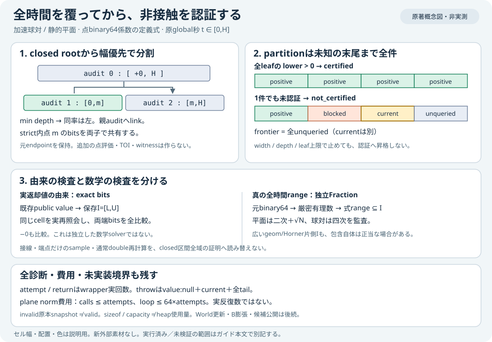

# 加速球対・平面の全時間非接触coverage

2026-11-04。**機能f128f50で公開受入済み：Native43CTest/専用69群・独立Fractionの全1913区間・自己14群/拒否53・Node684 skip0、Linux CI全23段/Pages・GNU warning/sanitizerも確認**。[設計](ACCELERATED_PAIR_COVERAGE_PLAN.md)に沿う新Native APIである。既存のWorld、92-export SDK、ゲームには接続していない。



## 何を認証するか

`pikapika::accelerated_pair_coverage::sphere_sphere(first, second, H, settings)` と `sphere_plane(sphere, plane, H, settings)` は、与えた点binary64係数を厳密実数として解釈する。時刻tは**原global秒**、対象はclosed `[0,H]` 全体であり、正規化parameterではない。

- 球対は `Φ(t)=|r+vt+(a/2)t²|²−(ra+rb)²`。r/v/aは二入力の厳密実数差で、式の単位はm²。
- 平面は `Ψ(t)=n·(P+Vt+(A/2)t²)−offset−radius|n|`。静的な負半空間を扱い、任意の非zero raw normalを正規化しない。

既存public `accelerated::sphere_sphere_value` / `sphere_plane_value` が返すIntervalを、各closed cellのauditへそのまま保存する。geom式とHorner式のintersectionを独自値へ置換せず、旧searchの非公開履歴も取り込まない。

**certifiedは、全 `[0,H]` を隙間なく覆う全leafで、保存したvalue.lower()>0の場合だけ**。端点・中点の安全、接線、zeroを含む区間、時間幅が小さいことは認証の代わりにならない。entry、TOI、接触応答、World更新、body候補は返さない。F/m、丸めtube B、半径膨張、World raw planeの別条件はcaller側の後続機能である。

## 入力と予算

Sphereはcenter/velocity/acceleration/radius、StaticPlaneはnormal/offset。各成分とoffsetの絶対値は有限1e12以下、radiusは有限 `(0,1e12]`、normalは少なくとも一成分が非zero。subnormal成分をnorm²のunderflowでzero扱いしない。Hは有限 `(0,.1]` 秒。

| Settings | 既定値 / 許可範囲 |
|---|---|
| time_tolerance | 1e−7秒 / 有限 `(0,.1]` |
| max_evaluations | 255 / 1..255 |
| max_leaves | 128 / 1..128 |
| max_depth | 24 / 0..32 |

RN-even・gradual underflowの環境確認が最初。拒否時はsnapshot無し。対応環境では、設定や入力を検証する**前**に、全原値・−0・H・Settingsをsnapshotへcopyする。invalid原本も残るので、snapshotの存在をvalidと呼ばない。`snapshot_validated` が検証完了を示す。

## 診断の読み方

rootをinstallしてから `partition_complete=true` になる。その後のpartitionは、認証済み・blocked・current・未照会を含む全closed leafであり、成功部分だけの一覧ではない。全auditには元cell、depth、parent audit、attempt、返却value、outcome、停止理由、split時刻を保存する。両子は同じrepresentable内点を共有し、元endpointを引き継ぐ。

探索は最小depth、同率なら左の未照会cellから進む。strict positiveは認証し、upper≤0はblocked。他の不確定cellは、外向き幅上限≤tolerance、depth、strict内点の不在、leaf予算の順に停止条件を調べる。**width_limitも未認証**である。通常blocked後も別の未照会cellを続ける。

評価予算で止まれば、auditを新造せずcurrentを残す。value呼出しがthrowすれば、attempt有り・value:nullのblocked auditとcurrentを残して全体停止する。frontierは**全未照会leaf**であり、currentを除く後方tailも省かない。全leaf認証以外はnot_certified。通常の最終reasonは時間順の最初のblocked leaf、全体停止時はその停止理由となる。

## 二つの検証を分ける

1. **実返却値の由来**：保存した全返却auditを既存public value関数へ再照会し、Interval両端の全binary64 bitsを比較する。−0も比較対象。これは実返却intersectionを保存した証拠であり、独立した数学solverではない。
2. **独立した全時間包含**：入力をFractionへ戻し、保存Iが真の式の全rangeを含むか検査する。平面は有理二次の端点・停留点と、符号を確認した平方比較。球対は四次の有理多項式を扱う。有限sampleを全時間証明へ昇格しない。

geomだけ、またはHornerだけの広いIも数学的に正当な包含になり得る。その変更を検出するbit由来検査と、真のrange包含の数学監査は別である。参照側が予算内で証明できなければ参照未解決として扱い、Iや入力を変えて通さない。

## 現在の実行結果と限界

初回単独strict MSVCビルドは警告無し。専用69群・固定有限65入力がPASSし、18 certified / 19 not_certified / 28 invalid_inputを実観測した。全1913返却auditでpublic valueの両端bitsが一致した。このaudit集合で実際に返った負zero端点は0件であり、入力・snapshotの−0保持は別に検査している。

安全放物線は球対21audit/11leaf、平面15audit/8leafへ実分割して全時間認証。接触例は255audit/128leaf、評価127例はpartition128・未照会frontier127・current1を保持した。二subnormal秒でwidth_limitとtime_resolutionを実観測し、微小軸/斜normal、環境拒否後復帰、caller編集/破棄後の所有も専用試験で確認した。

初回単独ログは `reports/accelerated-pair-coverage-native-development/run-001/`、正式なローカル集計は [local-verification](../reports/accelerated-pair-coverage-local-verification.json)。全43CTest・Node684/skip0・構文/Web cd45c7f1ac2ba5e5が成功し、独立Fractionは全1913区間（sphere1223/plane690）と全1040leaf・128未照会cellを監査した。14自己群/53拒否（Python -Oを含む）が成功。GNUで通常と独自依存5sourceをASan/UBSan計装した各65入力を実行し、fixture byte一致と各独立数学監査を確認した。新3TUのWerrorが成功し、旧48警告は同一。公開受入の詳細は末尾を参照。自然なallocation/value-throw fault注入も未実施。Workのattempt/returnはwrapperが把握する実回数だが、plane private norm費用は `attempts` 回・`64×attempts` loopの**上界だけ**であり、実反復数ではない。

同MSVCでResult 440B / Snapshot 208B / Cell 40B / Audit 96B / PartitionLeaf 72B、最大例のvector capacityはaudit255/partition128/frontier128だった。これは対象ABIのsizeof・観測capacityであり、allocator overhead、一時buffer、stack、RSS、heap実使用や16MiB保証を含まない。新外部依存・素材・license選択は追加していない。


この入力域の .1 上限はC++のbinary64定数 .1 と同じ点値であり、参照もその厳密有理数と比較する。数学的な有理数1/10へ入力を再解釈しない。time_toleranceは未証明区間の分割停止条件であり、接触を許す誤差ではない。

```cpp
#include "pikapika/accelerated_pair_coverage.hpp"
using namespace pikapika;
accelerated::Sphere first{}, second{};
first.radius = second.radius = 0.5;
second.center = {4, 0, 0};
second.velocity = {-1, 0, 0};
auto proof = accelerated_pair_coverage::sphere_sphere(first, second, 1.0 / 120.0);
// certified のときだけ、与えた点係数の全 [0,H] 非接触として読む。
// Worldを進める呼出しではない。その他のstatusでは診断と全未知tailを読む。
```

最大例のinline Result＋返却capacity×sizeofは39256B（440＋24480＋9216＋5120）。SnapshotはResult内なので重複加算しない。actual corpusでのeven-square-factor除去は0件、四次Bernsteinは46証明/50node/最大3nodeだった。gcd偶数因子・非有理重根・有限proof予算拒否は別の自己試験で確認し、実65入力で観測したと混同しない。数学的にvalidな広いIと人工nonreturnの整合正例も検査器の試験であり、Nativeの自然throw実行ではない。


## 機能f128f50の公開受入

[公開集計](../reports/accelerated-pair-coverage-public-verification.json)はfresh public-summary-001でPASS。Engine [41828267971](https://github.com/tatata93/pikapikaengine/actions/runs/41828267971) / job126568510900の全23段と、Pages [41828267271](https://github.com/tatata93/pikapikaengine/actions/runs/41828267271)の全3job/stepが成功した。

Linuxでも43CTest/Node684 skip0、専用69群/65有限入力・全1913区間を確認。通常fixtureと、interval/accelerated/新coverage/新tests2の独自5sourceをASan/UBSan計装した別fixtureがbyte一致し、両実行へ独立Fractionを適用した。自己14群/拒否53、新3TUのWerrorが成功。既存48GNU警告は前準備版とfile/line/column/診断multisetが同一、新規0だった。MSVC/GNU全DTOのbit一致や、新APIのNative/WASM parityへ拡張した主張ではない。

83Pages資源＋完全feature commitのGitHub workflow原本1、計84件2573147BがGit blobと一致。図2viewportと教材の全記事/原リンク/画像1120×780を実公開で確認し、図の文字・区画・費用上界・未実装境界に重なりは見られなかった。全11証拠を原本hashと照合した。概念図と旧ゲームの互換性であり、ブラウザで新Native coverageを実行した証拠ではない。

既存ゲームは再出撃後に射撃2撃破・boost energy59/193kmh・一時停止を操作し、22照会の全checked/validated/completed、resident mesh3/errors0を保存した。最初の出撃ではコンテナへキーを準備するUI操作が送信前にtimeoutし、フォーカス済み入力へ切替後の経過21秒で通常の敗北となった。その1撃破のAX/操作メモを別の履歴へ保存し、正式なboost/停止互換性の証拠には採用していない。製品コード変更なしでfresh再出撃し、成功記録とは分離した。

CIは全11844行/882882文字のうち4661行を原ordinal付きで保存した抜粋であり、完全remote logの保存を主張しない。ANSI色付きloop終端・inline参照JSONを初めから含めて元command照合を維持した。status/bytes/browser-record/公開集計は全exit0。既存362raw・旧26HTML・新7source・SDK92exports/67source-header/32TU/runtime91/7通知・WASM800982B/glue61661Bは公開集計時も保持された。

起動: [ロボットゲーム](https://tatata93.github.io/pikapikaengine/?v=f128f50) / [教材](https://tatata93.github.io/pikapikaengine/docs/learn/index.html?v=f128f50#accelerated) / [原著図](https://tatata93.github.io/pikapikaengine/docs/learn/diagrams/accelerated-pair-coverage.svg?v=f128f50)。次は同owned snapshotの全pairへB/半径膨張とplaneの追加条件・全体予算・H候補検査を接続する。実Worldのrounded dotと明示contact marginを考慮し、数学的な幾何非交差を既存solverのcontact無しへ読み替えない。一般応答・流体/材料損傷・専門モデル・IK制御・高精度撮像は未完。
