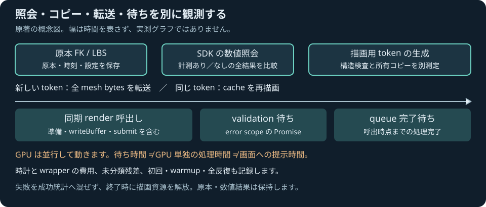

# ブラウザで派生meshの照会と転送を測る

2026-11-04 JST。ローカル受入済み、公開確認は[検証記録](../reports/2026-11-04-derived-gpu.md)へ追記する。[受入計画](DERIVED_MESH_GPU_PROFILE_PLAN.md)に沿う小規模な明示操作の[計測ラボ](../tools/derived-gpu-lab.html)である。実時間animationやrobotへの変形mesh適用は別段階。

## 対象と時刻

同じ配布WASMと原著SDK/Rendererを使う。実Source/FK/LBSの帯6頂点4面、既知の非軸法線192頂点64面、dyadic shear grid512頂点512面を選ぶ。全入力・設定・author原本を保存し、各prepareで計測あり/なしの型・全値bits・全TypedArray bytesを比較する。原本・入力を変えず、構造検査とtoken所有copyを別の時間へ分ける。

原本構築/FK/LBS・SDK起動・専用GPU renderer初期化と、各queryを区別する。初期化後のconstructor uploadの完了も先に待つ。各runは初回1pair、warmup1pair、計測3pairの固定回数で、全rawを保持する。最初という分類はcold OS/CPU/driverの保証ではない。

`createDerivedGPUProfiler(renderer,{now})`は、既存`renderChecked`をrenderer facadeのthisで実行する。元instance・device・queueのmethodは書き換えない。同期renderは元instanceをthisとして呼び、WebGPUのブランド付きmethodも元device/queueをthisとしてforwardする。

| 段階 | CPUから観測する範囲 |
|---|---|
| syncRender | 既存renderの同期呼出し。所有buffer copy、資源作成、全bytes writeBuffer、描画encode/submit等を含む |
| validationWait | 既存renderCheckedが呼ぶpopErrorScopeの呼出しからsettleまで |
| queueWait | その後のonSubmittedWorkDoneの呼出しからsettleまで |
| unassignedMs | 全体から上の区間を引いた未分類残差。wrapper・時計・他の処理も含む |

GPUは同期renderやvalidation待ちと並行して動く。queueWaitは呼出時点までの全queue workの完了をCPUから待つ時間で、GPU単独のtimestampではない。renderer初期化や他の同時利用が混ざると解釈できないため、このラボは専用renderer/deviceを使う。画面提示回数や一般fpsは測らない。

各pairのbaseline/instrumentedに別々の新しい所有tokenを作り、それぞれupload→同じtokenのcache再描画を行う。baselineでは元renderCheckedの全体をCPU時計で観測し、instrumentedではhelperの内訳も保持する。計測器の負荷は未較正で、両者の差を純粋なwrapper費用とはしない。同じshape IDの旧bufferを退役させ、初回転送bytesとcache転送0B、描画件数、退役件数を別に確認する。正常な一runは20draw/10新token/10cache。小規模の有限実験を最大容量や実キャラクター全体の性能へ拡張しない。

## 失敗・環境・所有

helperは`{completed,error,clockError,timing}`を返す。completedは既存renderCheckedの解決であり、GPU画素の数学的精度や画面提示の認証ではない。時計がthrow/非finite/後退等で無効になっても実描画処理を続け、timingをnullにする。実GPU例外とclockErrorは別に保持する。失敗や無効時刻を成功統計へ入れない。

同じrendererへ複数profilerから同時/再入することを拒否する。外部の直接描画をlockするものではない。時計は副作用を持たず、同じrenderer/device/queueへ別の操作を行わないこと。失敗時の資源処理は既存renderCheckedに従い、計測器が数値原本や旧成功geometryへfallbackしない。

adapter info、取得できたfeature/limit、実際のdevice、解像度・DPR・可視状態とbrowser情報を保存する。取得不能はunknown、fallback属性がfalseというだけでhardware実行を認定しない。device lostやGPUなしでもCPU照会の結果と原本を保持する。終了・pagehideでrenderer資源を解放し、再runで新規作成する。

外部profiler/library/assetは追加しない。W3C WebGPU草案のqueue/error scope契約を実読して原著の計測器を実装する。本体license未選定と既存runtime通知を維持する。最終試験数・実ブラウザの環境/数値/時刻・公開結果は検証記録で確定する。
