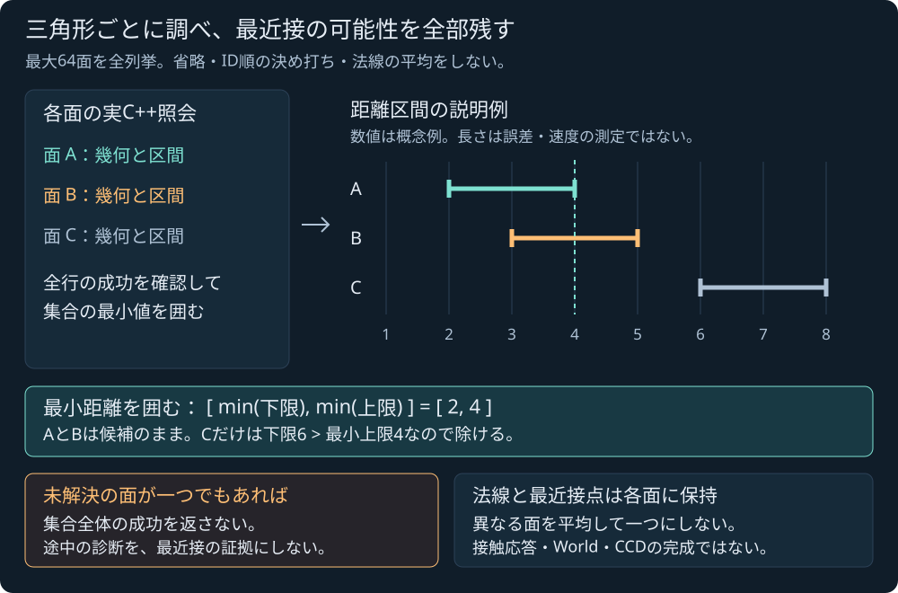

# 球と静的三角形集合の最近接距離を囲む

2026-11-04 JST。**Native純粋核を実装・ローカル/公開Linux CI/Pages受入済み**。[計画](SPHERE_TRIANGLE_MESH_PLAN.md)に沿って、最大64枚の静的な両面三角形を全列挙する。Native/ASan各59群、固定48入力と独立有理数2775成分・43改ざん拒否を確認した。既存の[単一三角形核](SPHERE_TRIANGLE.md)とその[共有SDK](SPHERE_TRIANGLE_SDK.md)の受入とは分けて記録する。新しい集合照会は主SDK・World・ゲームへ未接続である。

## 有限集合に対する瞬間の照会

同じ球中心xと半径rを、それぞれstable surface IDと元順序の3頂点を持つ三角形へ照会する。三角形はworld-spaceの静的な薄い両面で、向きを反転しても固体の内側を定めない。最大64面の所有copy、全入力検査、全行の診断保持を対象とし、ファイルcodecやC ABI resource handleは追加しない。

面順・ID・頂点順とdoubleのsigned zeroを原本として保持する。重複ID、空集合、容量超過、非有限や入力域外を拒否し、meshや球の入力、Worldの状態と時刻を変更しない。近接する座標からshared vertexや隣接面の同一性を推測しない。

初段は全列挙で、AABB/broadphaseで面を省略しない。各面には実際の既存C++照会を使い、JSの距離計算や、区間中点を使った別の判定で代用しない。現時点で利用可能な共有SDK APIを装わない。

## Native APIと予算

原本は [sphere_triangle_mesh.hpp](../core/include/pikapika/sphere_triangle_mesh.hpp)、名前空間は `pikapika::sphere_triangle_mesh`。ローカル受入した入口は次のとおりである。

```cpp
Result query(
    Sphere sphere,
    std::span<const sphere_triangle::StaticTriangle> triangles,
    const Settings& settings = {});
```

`Settings.max_surfaces` は既定64・許容1..64のcaller予算。`Settings.primitive` は単一面のSettingsをそのまま使い、品質条件や閾値を緩めない。空集合や65面以上は入力不正、64面以下でもcaller予算を超えればbudget failureで、面を切り捨てて成功しない。

球・頂点の各座標/半径は有限かつ絶対値<=1e150、半径>0、surface IDは1..2^53−1。全ID・重複・入力域・設定を、単一面の照会より前に検査する。退化や悪条件は、構造検査でこっそり面を除く理由にせず、変更していない単一面核の結果として保持する。strict FPの[Interval環境条件](INTERVAL.md)を最初に確認する。

最大作業は64照会、448候補、32768実平方根更新。単一面の総平方根予算は1呼出し後の更新数監査なので、設定値を1回の呼出し分超えて失敗し得るという既存の意味を継承する。この上限は実時間・fps・GPU性能の保証ではない。

## 最小値の区間と、残す面の条件

各面への真の最近接距離をd_i、その包含を[L_i,U_i]とする。全行が成功した場合だけ、集合への最近接距離を次で囲める。

```text
min_i L_i <= min_i d_i <= min_i U_i
```

距離²にも同じ関係が成立する。既存の各面の包含から上下端の最小を選ぶので、この集計のための近似sqrtを追加する必要はない。返す値は「区間の中点を最も近い面の距離としたもの」ではない。

nearestの可能性がある面は、距離²下限が全行の距離²上限の最小値以下のものをすべて保持する。下限がその最小上限より**厳密に大きい**場合だけ除外できる。等号・区間の重なり・同率をID順で1面へ潰さない。保持集合には実際のwinnerでない面が残り得るため、集合内の全IDが真の同率だと宣言しない。



図のA=[2,4]、B=[3,5]、C=[6,8]は説明用の距離区間である。最小距離は[2,4]に含まれ、AとBを保持し、Cは除外できる。実際の選別は距離²の包含で行う。数値、図の幅・配置は実行結果や誤差幅・性能の測定ではない。

## 各面の結果と、集合の成功を分ける

単一三角形核のstatus/reason、候補prefix、geometryと作業件数を各行へ保持する。1枚でも未解決・退化・モデル失敗があれば、集合全体のnearestを成功として公開しない。先に得られた正常行を、未解決面も含む全体の最小値の証拠へ昇格させない。全件完了と途中の診断を区別する。

`Result.rows` は元順の所有triangleとoptional queryを持つ。通常のモデル失敗ならその実結果を残し、残りの面もすべて照会する。割当や外側のfatal例外では所有できた診断prefixや未照会のnull queryが残り得る。nullを「距離なし」やmissへ変換しない。構造/環境の事前拒否ではrowsは空である。

全行成功時の `nearest` は `squared_distance` [m²]、`distance` [m]、`gap` [m]それぞれの最小区間と、昇順stable IDの `possible_surface_ids` を持つ。各区間は対応する全行の下端/上端の最小から作り、新しいsqrtや中点勝者の計算をしない。geometryを1個へ混ぜたり、集合の接触relationや応答を合成したりしない。`failed_index` は構造検査の元位置、`first_failed_row` は最初の非completed照会位置である。

集合statusは completed / invalid_input / budget_exceeded / row_failure / numerical_failure / unsupported_environment。reasonとmessageはこの集合の段階を示し、各rowの単一面status/reasonを消さない。`queries`、`candidates_examined`、`sqrt_refinements`、`sqrt_limited_rows`、`failed_rows`は実作業の診断で、未照会分を実行済み件数へ埋めない。すべての失敗でnearestは不在のままとする。

reasonは none / settings / surface_count / surface_budget / surface_id / duplicate_id / input_domain / row_failed / aggregate_inconsistent / nonfinite_intermediate / allocation_failure / environment。Native fixtureのJSONでは集合と各row.queryのmessageを省くが、数値・候補・optionalの意味を変えない。これは検証用の出力で、mesh原本の保存codecや共有SDKのDTO契約を追加したものではない。

異なる面のbarycentricやclosest_localは別の座標に属する。面ごとの最近接点・法線を平均したり、中点を選んだりして、一つの確定接触点・単位法線へ変換しない。共有辺で同率になる場合、異なる場所が同じ距離になる場合、広い区間のため順序を証明できない場合を、可能なsurface ID集合と各面のgeometryとして残す。

単一面のcompletedは最近接幾何と法線の品質が成立した意味で、gapのrelationがboundary_unresolvedでも成立し得る。この既存の意味を集合のために変更しない。geometryのない失敗行を、距離0や無限大の成功行として埋めない。

## ローカル検証と境界

Native通常/strict buildとASanがそれぞれ59群成功した。固定48 fixtureは集合completed29・row_failure6・preflight拒否13である。全136 primitive rowsは128成功・8失敗で、集合の成功29件と面ごとの成功128件を混ぜて数えない。Native/ASanのfixtureは373170 B、SHA256 `6cad93d2d7187cd2a817c413f63822aa232aa2932e3f8c437a647d935ad59b88` で全byte一致した。

孤立1面と既存核のbit一致、明確な2面の優劣、共有辺/頂点の同率、離れた面の多重最近接、裏側、面順置換とID対応、巨大共通offset、1面失敗の伝播、空/重複ID/65面拒否、所有copyと再試行を検査した。独立Fraction参照は2688 primitive成分と87 aggregate成分、合計2775成分が成功。真の複数winner13例・優劣10例・実64面容量1例を確認した。入力のlabelや配列順を答えの根拠とせず、各面の真の最近接点から最小値と必要な候補を求める。winner削除・区間/ID/符号零などの43改ざん負例も拒否した。有限corpusでの比較と、原入力から外向きに構成する包含の根拠を区別し、Native/ASanの一致だけで数学的包含を正当化しない。

全33CTest、Node516/516（skip0）、構文とWeb build `50e73448d9d02126` / 46 modules・22 entryがローカルで成功した。統合recipeは最初に旧単一面checkerを呼び出して失敗したため、その失敗summary/stdout/stderrを保持し、該当呼出しをmesh checkerへ訂正して再実行した。別strict実行と負例に加え、この再実行でも独立2775成分が成功した。既に成功した33CTest/516Nodeはsource hash一致を確認して再利用し、全試験を再実行したとは記載しない。原ログ・修正履歴は[統合報告](../reports/2026-11-04-sphere-triangle-mesh.md)へ記録する。

既存SDKの55 source/header・7通知・2artifact・manifestと、全assets/samplesは基準commit `38b59f1` からbyte不変を確認した。既存単一面核・共有SDKへこの集合照会を追加したものではなく、新しい集合用C ABIや主WASMを配布したとはしない。修正版5c9093bの公開Linux CI/Pagesも全工程成功し、新試験のGNU警告2件を整理後、新規警告0・既存36診断を維持した。公開29ファイル1,097,707Bがcommit blobとbyte一致。原著図・既存ゲームREADY・単一面ラボの成功表示は初回7b598e7で確認し、その観測資源が最終commitでもbyte不変であることを照合した。詳細は[公開検証](../reports/sphere-triangle-mesh-public-verification.json)。次の[SDK接続案](SPHERE_TRIANGLE_MESH_SDK_PLAN.md)は設計のみである。

外部geometry/solver/区間library、package・素材は追加しない。既存一次資料の最小化の定式化と、原著Interval/sqrt・単一面照会を継承する。本体ライセンスは未選定のまま。

主SDKの有界集合API、手動ブラウザ操作、ゲームのmesh接触、三角形storageのcodec、隣接面/manifold、閉固体内部、時間方向CCD、接触応答・摩擦支持、流体/損傷・専門シミュレータは別の未完段階である。有限の距離照会を、これらの完成や一般性能の保証へ拡張しない。
