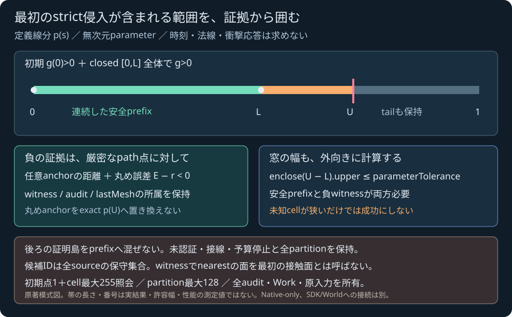

# 定義線分と静的三角形集合のentry window

2026-11-04 JST。ローカル受入済み。[事前設計と容量](SPHERE_TRIANGLE_MESH_ENTRY_PLAN.md)に沿う純粋Native-only核。新C ABI/JS/UIやWorld、接触応答はまだ接続しない。公開GNU CI/Pagesの受入は[検証記録](../reports/2026-11-04-sphere-triangle-mesh-entry.md)へ別に確定する。

## 受理には四つの証拠が必要

`p(s)=start+s(end−start), 0<=s<=1` は入力binary64から定義した厳密な実線分。g(s)は静的な薄い両面三角形集合への最小距離から球半径を引いた値で、速度や時刻、運動方程式の真解ではない。位置/半径/距離はm、parameterと幅は無次元。右手系、Y上。

`entry_window` は初期g(0)>0、closed [0,L]全体のstrict正、exact p(U)に対するE補正込みstrict負のwitness、外向きU−Lの幅上端がparameterTolerance以下、を全て満たす場合に限る。Workもexactでなければ受理しない。距離の連続性から最初のstrict負集合の開始は(L,U)に含まれる。窓内の単一根・接線不存在・特定面・正確な時刻・法線・manifold・反力を保証する結果ではない。

<figure><figcaption>原著の証拠構造の模式図。帯の長さは計算結果や誤差幅・性能の測定ではない。</figcaption></figure>

全[0,1]のstrict正被覆がある場合だけ `separated`。初期点でstrict負を証明できた場合は `initial_penetration` でentry窓なし。初期境界/符号未確定、点・面の品質失敗、接線だけ、評価・分割・深さ・sqrt予算で証拠が足りない場合は未認証/失敗を保持する。

## 全partitionと照会の所属

初期点はaudit0の独立kind。その後は未照会partition leafの浅いdepthから、同率は左から調べる。最初のunknownの後ろもwitness探索のために照会できる。証明済みの島は全件保持するが、safePrefixは0から連続被覆された範囲だけを伸ばす。bestWitnessより後の未照会tailを捨てず、全partitionに残す。

返却済みでWorkがexactなrow_failureはそのcellのunknown診断として残し、子や別cellを新たに照会できる。失敗ancestorからsafe/witnessを作らない。これにより途中の任意anchorが面上で法線未確定となっても、その失敗を保持したうえで他の点に証拠が得られる余地を残す。初期点にはstrict符号証拠が必要なので同じ失敗でも停止する。invalid/環境/numerical/未知workはglobal停止する。

各cellのp(J)/exact p(m) box・任意anchor・R/Eは、元のstart/endとglobal sから囲む。丸めた子endpointで別pathを作らない。auditのWorkはdelta、Resultは総計。N×512をmesh call前、512を各R/E sqrt前に予約し、予約を実使用量へ置き換えず、未返却workをexact0と扱わない。

全snapshot/settings、initial proof、証明島/prefix、最良の負witnessとwindow、全partition状態/blocked reason、未照会frontier/current、全audit、最後に返ったmesh全行/候補とaudit linkを所有する。窓を受理した場合のcandidate IDsは全source IDの保守集合で、witnessのnearest面や最初の接触面の特定ではない。

## 容量と境界

sourceは1..64、座標絶対値/radiusは有限1e12m以内でr>0、IDは一意な1..2^53−1。設定と全入力を事前検査し、FP環境は最初に調べ、呼出側の丸め設定を変更しない。三角形の退化/法線条件は既存mesh核の診断に従う。

評価は初期点を含め1..256、全partitionは1..128、depth0..32、既定256/128/depth24。parameterToleranceは有限0<tol<=1、既定1e-6。enclosure sqrt設定1..256、全sqrt設定1..16777216。全partitionにunknown/current/未照会tailも含み、旧DFSのfrontier上限33を使わない。上限内でも接線や非常に厳しい設定で認証できるとは約束しない。

新しい外部solver/素材/依存は使わず、元のNative kernel/共有SDK artifact/ゲーム原本を保持する。本体license未選定。独立Fraction参照・改ざん負例、Native厳密FP/旧回帰・公開GNU sanitizerと配信の受入は別の証拠として揃える。故意のallocation/内部例外注入、自然到達していない診断は実行済みと扱わない。

## 実行した検証

MSVC strict FPで76試験群・完全有限入力65件が成功。内訳は18全区間非接触・8entry窓・20未認証・2初期貫通・17入力拒否。解析1/4・7/12・3/8等の既定幅の窓は外向き幅上端9.536743164062502e−7以内。別の許容幅1の例は[0,0.375]であり、全8例が1e−6以内という主張はしない。中点の法線未確定を保持しながら子の証拠で窓を認証する例も実行した。

実256audit/128partition、255評価予算、127leaf予算、旧33を超える127frontier、64source全保守ID、所有copy/−0/settings/環境拒否を確認。独立Fractionで47全path・47初期点・36closed prefix・8窓幅・9witness、558証明葉・1452audit・3840lastMesh成分を照合し、自己解析17群・改ざん90拒否・label/order独立・Python−O拒否が成功した。

37CTest、586Node（skip0）、教材12、構文/Web build、旧owned SDK59model＋明示host補足3の独立参照/71負例、旧mesh/single/simulation回帰が成功。既存276保護原本・80exports/59source-header・WASM674978Bと7通知は不変。最大容量は有界性の受入であり、一般実時間性能の測定ではない。
