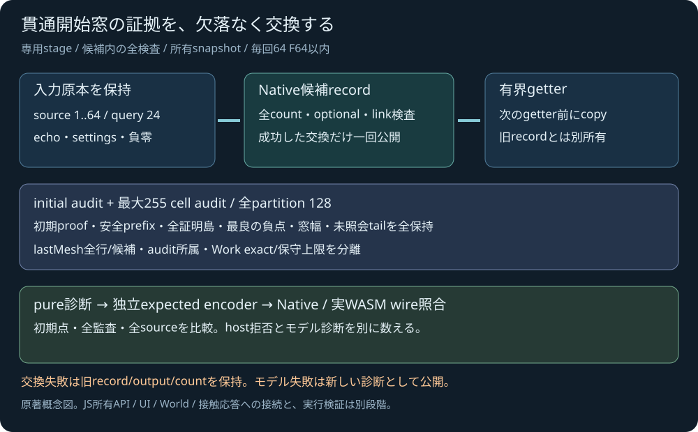

# 貫通開始窓の有界C ABI

2026-11-04 JST。ローカル受入済み。[事前設計](SPHERE_TRIANGLE_MESH_ENTRY_SDK_PLAN.md)に従い、[Native entry-window核](SPHERE_TRIANGLE_MESH_ENTRY.md)の所有診断を共有SDKへ交換した。実行結果は[受入記録](../reports/2026-11-04-sphere-triangle-mesh-entry-abi.md)に保存し、公開GNU/Pagesは別に確認する。JavaScript所有decoder/手動entry UIは後続で、既存のtrajectory guardラボはentry窓を表示するUIではない。

<figure><figcaption>原著の交換モデル概念図。数学認証や実行結果・性能の測定図ではない。</figcaption></figure>

## 入力と公開する所有物

追加6 exportsは `pp_sim_sphere_triangle_mesh_entry_begin`、`_append`、`pp_sim_sphere_triangle_mesh_entry`、`_record`、`_last_mesh`、`_candidate`。同期・非再入。新stage/new recordは既存single/mesh/trajectory/Worldと独立し、module共通入力・出力scratchだけを共有する。memory growth後はviewを取得し直し、出力を次getter前にcopyする。

begin(n)は0..64、appendは1..6面（1面=ID+ABC9の10F64）、queryは24F64。query0..18は既存guardと同じstart/end/radius/mesh/primitive/予算、19がparameterTolerance、20..23はstrict +0。IDは一意な1..2^53−1をモデルで要求する。hostはID0/unsafe・非有限・不正整数/範囲/予約値・不足stageを拒否し、重複IDや有限なモデルdomain違反はNative診断を返す。球/三角形座標はm、parameterと幅は無次元、Y上の右手系。

候補recordはquery echo・全source・Native resultを所有する。snapshot:nullの場合も元echo/sourceは残る。query前のstageを旧snapshotへ仮代入しない。入力/交換/割当/packet検査の失敗は旧record/output/countを保持する。正しく交換できたモデル失敗は新失敗recordとしてpublishする。begin/appendの成功も旧record/output/countを変更しない。resetは新record/stageも消す。

## 完全な有界packet

各getterは最大64F64、長さ・全fieldは正式[ヘッダ](../core/include/pikapika/simulation_api.h)と事前設計mapに記載する。summary40にはstatus/reason/source数、snapshot/initial/prefix/witness/window/current/lastMeshの有無、各count、全Work11を入れる。audit64は初期点のkindと全p(J)/p(m)/anchor/R/E/certificate/mesh status/reason/Work deltaを保持し、未使用部分は+0。

| record | count / 上限 | 意味 |
|---|---|---|
| input | 24 / 1 | 元query、−0を保持 |
| source | 14 / 64 | 元sourceと最後のmeshへの所属 |
| audit | 64 / 256 | 初期点もaudit0として算入 |
| certified leaf | 6 / 128 | prefix後方の証明島も全て |
| partition | 8 / 128 | [0,1]全体、state/link/blocked reason |
| frontier | 4 / 128 | bestU以後の未照会tailも全て |
| current | 4 / 1 | 初期点停止の[0,0]を許す |
| initial proof | 6 / 1 | strict初期符号の両certificate/audit link |
| best witness | 18 / 1 | exact path box・anchor・E・負certificate |
| window | 6 / 1 | L/U・外向き幅・witness audit link |
| candidate ID | 2 / 64 | window時の全source ID昇順の保守集合 |

lastMeshはsummary24、全row58と各candidate13を分けて取得する。source flags/nearest IDはlastMesh所属であり、最初の接触面の特定ではない。lastMeshAuditIndexをwindow/witness/閲覧auditと混同しない。可変message原文はNative fixtureと同じくwire対象外で、status/reasonを交換する。文言を空文字で復元したふりはしない。

## 証拠の分離

frozen pure65入力の数学診断から独立encoderでexpected packetsを作り、実Native probeと実raw WASMへ別々に照合する。入力echo/全optional/全count/enum/予約+0、実interval/原本/未使用KKTの−0まで比較する。host拒否入力は計算モデルの実行数から分け、source入力multisetは既存Fraction参照へ渡す。交換metadataの一致自体を数学solverと呼ばない。

再生成したSDKのartifact bytes/SHA・runtime linked members差分・全7通知・memory上限は実測監査で確認した。旧SDKのsource hash/配布bytesを新値として使わない。新API/testのASan/UBSanと、別の全entry純粋核ASan/UBSanを区別する。故意allocation/未知work注入やWindows sanitizerの実施を推定しない。

実生成は86exports/30翻訳単位61source-header、WASM719410B/glue58933B。runtime91部品増減0・7通知hash不変。専用24群/38CTest/586Node skip0、Native/実WASMの全数値/−0照合とpacket27改ざん拒否、元pure65数学/90負例、旧SDK回帰が成功。303原本不変、24HTML生成部だけ更新。JS所有decoderは[次段の未実装案](SPHERE_TRIANGLE_MESH_ENTRY_JS_PLAN.md)。

entry窓の証拠は初期strict正・closed安全prefix・E補正strict負・外向き幅の四条件。未知が狭いだけで成功とはしない。定義線分の幾何的証明を実機械の厳密な運動方程式、単一根、接触面/法線/manifold/反力へ広げない。World/一般TOI応答、流体/損傷/専門車両航空鉄道、IK/制御、高精度光学撮像は別の未完段階。本体license未選定、新外部solver/素材/課金はない。
