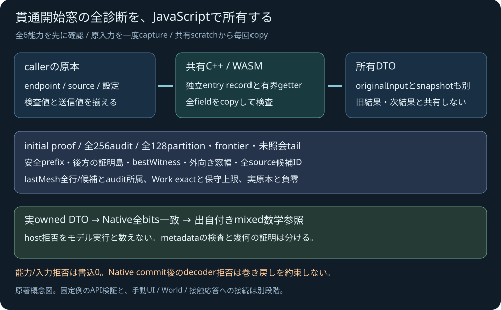

# Entry-windowを所有するJavaScript API

2026-11-04 JST。実装・ローカル統合検証済み。公開CI/配信の結果は別追記。[事前計画](SPHERE_TRIANGLE_MESH_ENTRY_JS_PLAN.md)に従い、86-export共有SDKのraw診断を所有DTOへ戻す。元のC++核/ABI/719410B WASM/58933B glueは変更しない。実行結果は[検証記録](../reports/2026-11-04-sphere-triangle-mesh-entry-js.md)へ確定する。専用の手動entry UI/World/応答とは別段階。

<figure><figcaption>原著の所有構造概念図。数値認証や性能の測定図ではない。</figcaption></figure>

```js
const result = runtime.querySphereTriangleMeshEntry(
  {start: [1, 1, 1], end: [1, -2, 1], radius: 0.25},
  [{id: 37, vertices: [[0, 0, 0], [4, 0, 0], [0, 0, 4]]}],
  {parameterTolerance: 1e-6},
);
```

距離や位置はm、parameterとその幅は無次元。定義線分について初期strict正・closed安全prefix・E補正strict負witness・外向き窓幅を揃えた`entry_window`を返す契約を継承する。窓を厳密な物理時刻/単一根/特定の接触面や法線/反力へ読み替えない。`not_certified`は安全という結果ではない。

## 入力と結果の所有

全6能力を最初のinput書込み前に検出し、旧80-export SDK/欠損/loader拒否を明示する。旧trajectory・瞬間meshやJS幾何へのfallbackは行わない。endpoint/radius/全source/設定を一度captureして検査とencodeへ同じ値を使い、全input copy後にbegin/append/queryする。65面/unsafe ID/非有限/不正整数はhost拒否、空集合/重複ID/有限のモデル域外/設定0等はNativeのモデル診断を返す。

結果はNativeの全数学診断に`originalInput`（全原本/設定/24値echo）を追加する。snapshotの有無、初期proof、全証明島/prefix、bestWitness/window/全保守ID、全partition/frontier/tail/current、全256audit、lastMesh全行/候補と所属、Work delta/合計/保守上限を保持する。所有copyは編集不能化とは違い、caller・originalInput・snapshot・lastMesh行・旧/次DTO・共有scratchは別の値を所有する。実intervalと原本の−0を保持し、整数Native snapshotの+0正規化は元echoと分ける。

## metadataと数学的根拠

packetの正確な長さ・全count/型/enum/flag/予約+0、不在payload、source/echo bits、初期singletonと通常dyadic cell、全partition被覆、幅優先履歴、証明島と連続prefix、bestWitness/窓/lastMesh所属、全Workを検査する。frontierは最大128で旧DFS33を使わず、bestU以後の未照会tailを残す。exact row_failureの祖先はunknownのまま、子区間の新しい証拠だけで認証する。

これは交換metadataと所有の監査で、JSで距離・sqrt・KKTを解き直す数学solverではない。幾何包含は既存Native契約と独立Fraction参照に置く。実WASMから復元したDTOをpure結果とbit照合し、62実モデルとhost3の補足出自を保存したmixed65を独立参照へ渡して成功した。全model105056数値/3239負零、originalInput4728数値/108負零が一致し、独立558葉/1452audit/3840成分と90改ざん拒否を確認した。raw wire比較件数をそのままowned DTOの比較件数とはしない。

能力/入力拒否は書込0で旧Native recordを保持する。一方、正常Native query後にdecoderがpacketを拒否するとJS結果は返さないが、Native record/outputのrollbackは保証しない。既に返したDTOは後続queryや失敗と独立する。未返却workの人工packet試験は故意allocation/内部例外の実注入とは分ける。

新外部solver/package/素材/有料serviceなし。本体license未選定。UI/World/TOI応答、流体/損傷/専門車両航空鉄道/IK制御/高精度撮像の残件を、この所有APIの受入で埋めない。
