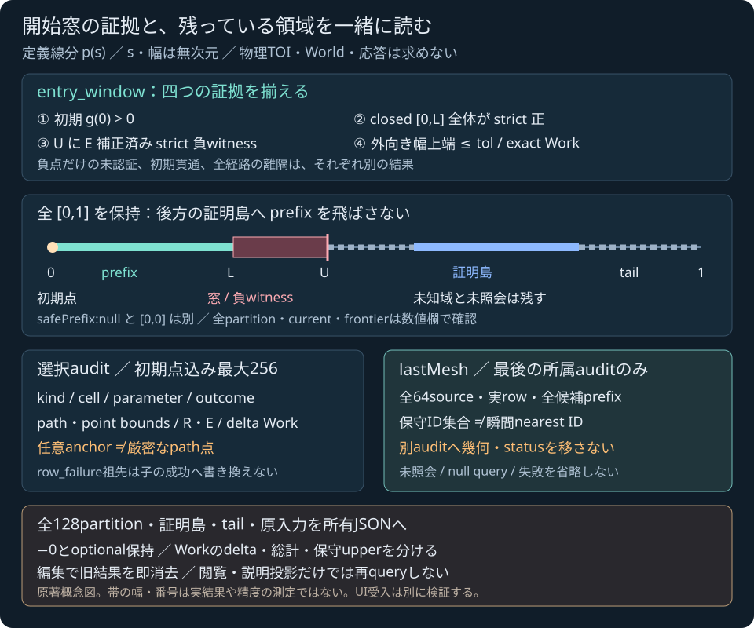

# Entry-windowの手動ラボ

2026-11-04 JST。**実装・ローカル統合受入済み、公開確認待ち**。実測は[検証記録](../reports/2026-11-04-sphere-triangle-mesh-entry-lab.md)へ保存。[計画](SPHERE_TRIANGLE_MESH_ENTRY_LAB_PLAN.md)に沿い、[公開受入済み所有API](SPHERE_TRIANGLE_MESH_ENTRY_JS.md)を手動で調べる画面を追加する。この文書は表示と保存の契約を説明し、新UIのローカル/公開検証成功や操作件数を先取りしない。

入口ファイルは `tools/sphere-triangle-mesh-entry-lab.html`。HTTP配信下で実86-export C++ WebAssemblyの `querySphereTriangleMeshEntry` を一回呼び、返った所有DTOを表示する。既存trajectoryラボとは別の入口で、瞬間query・旧guard・JS距離計算へ置き換えない。C++核・SDK artifact・ゲーム原本はこのUI段階の変更対象にしない。

<figure><figcaption>原著概念図。帯の長さ・番号は実行結果、誤差、性能の測定ではない。</figcaption></figure>

## 入力を編集して一回照会する

```text
p(s) = start + s(end − start), 0 <= s <= 1
g(s) = distance(p(s), 入力した静的三角形集合) − radius
```

入力binary64を厳密な実数とした定義線分である。位置・半径・距離はm、距離²はm²、sと窓幅・parameterToleranceは無次元。時刻、速度、運動方程式の真解ではない。右手系・Y上。三角形は薄い静的両面であり、閉固体の内外や厚みを推定しない。

入力JSONのshapeは `start,end,radius,triangles,settings`。triangleは元順の `id,vertices`、settingsは `mesh:{maxSurfaces,primitive:{...6設定}}` と `parameterTolerance,maxEvaluations,maxLeaves,maxDepth,enclosureSqrtRefinements,maxTotalSqrtRefinements`。省略設定は実API既定へ補完する。tol既定1e-6、評価256、partition128、depth24、enclosure128、全sqrt1000000。低予算や厳しい品質設定を自動で増やさず、入力をclampしない。

比較例は[事前調査](../reports/sphere-triangle-mesh-entry-js-next-lab-review.md)の固定25名で、既受入Native65入力から元inputをmoduleへ埋め込む。`fixtureName`が出自を示す。履歴ファイルをruntimeに取得して答えとして表示せず、毎回実SDKへ照会する。解析quarter、対称中点の法線失敗後の子証明、初期負/境界、E補正、256audit/128partition、全64保守ID、各予算とhost65面を含む。25例の実UI status内訳と実操作成功は統合検証で確定する。

初回load・preset選択・reset・明示retryでは、その世代の入力が未編集のときだけ自動一回queryする。通常の編集では古い結果と保存状態を即消去し、実行ボタンを待つ。投影面、audit、sourceの閲覧変更ではqueryを増やさない。

strict JSONはduplicate key、unknown key、不正Unicode、非有限/overflowを拒否し、−0を保存する。入力上限は65536B・depth12・12000nodes。空集合・重複ID・有限モデル域外・半径0・整数設定0はモデル結果、65面・ID0・unsafe ID・非整数設定などはhost拒否として区別する。形式拒否、SDK loader/能力拒否、host交換拒否、モデルstatusを一つの「計算失敗」にまとめない。旧80-export/能力不足では入力書込前に拒否する。

## 窓が受理された意味

| status | 読むべき意味 |
|---|---|
| `entry_window` | 初期点strict正、closed安全prefix [0,L]、E補正strict負witness U、外向きwidth.upper ≤ tol、exact Workが揃った開始窓 |
| `separated` | 全closed [0,1]をstrict非接触として被覆 |
| `initial_penetration` | s=0がstrict負。新規entry窓やbestWitnessはない |
| `not_certified` | 接線・境界・品質・予算などで証拠不足。安全やmissとはしない |
| `invalid_input` | Nativeモデル入力拒否。host拒否とは別 |
| `unsupported_environment` / `numerical_failure` | 環境拒否/数値失敗。部分診断を成功へ変えない |

窓は単一根・厳密な物理TOI・特定接触面や反力ではない。負witnessだけの未認証と受理されたwindowも異なる。`safePrefix:null` は初期安全を証明していない。`safePrefix:[0,0]` は初期strict正のみでも成立し、正の長さのcellを証明したとは限らない。

初期欄には `initialSeparationProven`、initialの両certificateとaudit所属を置く。初期auditは `initial_point`、cell [0,0]、parameter0で、通常cellの中点評価と区別する。初期query失敗時の `initial:null/current:[0,0]` も残す。window欄には実L/U、外向きwidth区間、tol、bestWitnessのexactPathBounds/任意anchor/E/upperGapCertificate/audit所属を置く。任意binary64 anchorが球の内側でも、厳密p(s)が同じとは限らず、E補正を省略しない。

`candidateSurfaceIds` は窓が受理されたときの全sourceの昇順保守集合であり、lastMeshのnearest IDsへ縮めない。複数entry例の保守ID `[5,37]` と瞬間nearest `[37]` は違う診断である。

## 連続prefixと全partitionを読む

parameter帯と数値欄では、初期点、連続prefix、後方の証明島、全partition、current、全frontier、bestWitness、windowを分ける。後方の証明島まで未知域を飛び越えてprefixを延ばさず、bestU以後の未照会tailも削除しない。幅広tol例のwindow `[0,.375]`、prefix `[0,0]`、後方の証明島 `[.5,1]` はそれぞれのまま表示する。

| 所有データ | 全件を読む場所 |
|---|---|
| audits | 初期点込み最大256。元の幅優先評価順の表とselector、選択audit全fields、完全JSON。末尾255も選択対象 |
| certifiedLeaves | 最大128の全closed証明島。cell/depth/certificate/auditIndexを全行表示 |
| partition | 最大128の全closed被覆。state/auditIndex/blockedReasonをpreに全件表示 |
| frontier / current | 最大128の全未照会cellと停止cellを別表示。初期singletonも保持 |
| candidateSurfaceIds | 全64までの保守IDを全体欄とJSONへ保持 |
| source / lastMesh | 全64面の元順、実row/null query、全候補prefixを表と選択欄/JSONへ保持 |

scrollは画面の表示領域を限るだけで、データを先頭N件へ切り詰めない。無いoptional/nullを架空のordinal0や成功結果で補わない。row_failureの祖先は未知のまま残し、子cellの新しい証拠でwindowが成立しても祖先を成功へ書き換えない。

lower/upper certificateは下界式/上界式それぞれの包含であり、二つを真のgap全体の上下端として扱わない。Workは全11項目を保持する。各auditのdelta、全体総計、既知refinement数、保守upper、`workExact`を分ける。未返却blockの予約は実使用回数や0ではない。人工Workfalse/初期allocation DTOの表示試験は、実Native例外の故意注入とは分けて記録する。

## 選択auditとlastMeshは別の所属

auditとsourceのselectorは閲覧操作である。lastMeshは最後に返ったmeshだけを保持し、所属は `lastMeshAuditIndex` が示す。任意に選んだauditへ表のstatus、候補、closestや法線を移さない。重ねる幾何は所属が一致した場合だけで、不一致なら最後のmeshが別auditであると示す。全source、未照会行、null query、候補失敗も保持し、異なる面のclosest/法線を平均しない。

XY/XZ/YZへの投影は説明用である。path/point box、任意anchor、三角形を表示するが、UIへ距離・sqrt・KKT・Interval・接触solverを実装しない。厳密path点と丸めanchorを同一視しない。帯の最小1px ink、boxの表示用拡張や重なりは包含・離隔の証拠ではなく、常に数値boundsを併記する。巨大座標や縮尺で有限の描画値を作れなければ表示不能とし、数値packet/status/保存を変更しない。

## 世代と保存

編集・preset/reset/retry開始では旧summary、initial/window、帯、葉/audit/partition、lastMesh/候補、JSON、保存可能状態を即クリアする。loaderをcoalesceし、同期throw/rejected promiseから再試行できるようにする。入力編集・二重retry・disposeをまたぐ遅延callbackに古い結果を復活させず、dispose後のhandler/保存を無効にする。

保存schema1、kind `sphere-triangle-mesh-entry-lab`。補完済みinput、full result/originalInput、SDK diagnosticsと、top-levelの表示条件 `projection/inspectedAudit/inspectedOrdinal/inspectedSurfaceId` を含む。空選択はnull。snapshot:nullでもoriginalInput/echo/全設定を残し、整数Native snapshotの+0正規化と原−0を分ける。形式/loader/host拒否をモデルpacketへ偽装せず、実モデルの失敗packetは保存する。

出力codec上限は8388608B・depth32・1000000nodes。byte上限は末尾LFを含む。超過時は明示拒否し、保存内容を切り詰めない。表示JSONと実Blob保存はstrict再読込後、型/optional/全数値bits/−0をowned packetと照合する受入とする。

## 統合検証の境界

このUIの専用DOM/SDK試験、全25実WASM入力、容量末尾・所属・編集世代、実ローカル/公開ブラウザとBlob保存、回帰/公開CI/Pages/配信byteはそれぞれ実行後に記録する。実装中の本説明や概念図を成功の証拠にはしない。既受入65入力のFraction参照/90改ざん拒否は数学根拠として別に維持し、UI metadata/所有確認と混同しない。

新外部library・素材・有料serviceは追加しない。本体licenseは未選定。World、一般CCD/TOI、manifold/反力/摩擦やゲーム接触への接続は未完。流体・材料損傷・専門車両/航空/鉄道・IK制御・高精度撮像、未実行の故意fault注入を、この有限線分の手動UIで完成扱いにしない。
