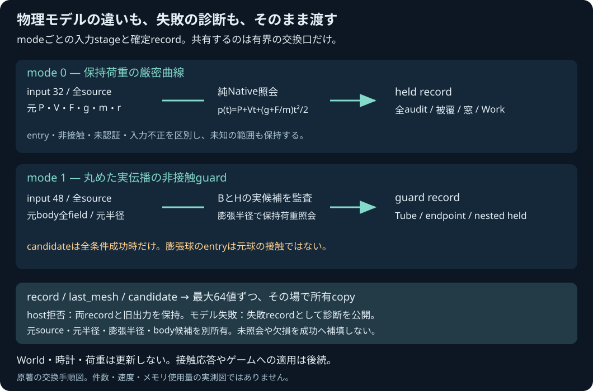

# 保持荷重と丸め自由伝播の有界C ABI

2026-11-04。コード4e422ddで公開受入済み。[実行記録](../reports/2026-11-04-sphere-triangle-mesh-flight-sdk.md)を参照。[設計](SPHERE_TRIANGLE_MESH_FLIGHT_SDK_PLAN.md)と[正式header](../core/include/pikapika/simulation_api.h)を参照。保持荷重の厳密曲線と丸め自由伝播guardは別modeであり、Worldを進めるAPIではない。

`pp_sim_sphere_triangle_mesh_flight_*`の6入口を追加する。mode=0は保持荷重、mode=1は丸め自由伝播guard。`begin(mode,N)`→`append(mode,count)`→`query(mode,count)`で照会し、`record(mode,kind,index)`・`last_mesh(mode,part,index)`・`candidate(mode,row,ordinal)`で全診断を読む。末尾candidate入口は**lastMeshの三角形primitive候補**であり、Hでのbody候補はrecord kind8である。

## 交換と結果の所属

beginは0..64面、appendは1..6面（IDとABCの10値×面数）。held入力32値、guard入力48値、summary24値、各getterは最大64値。既存のF64/U32 exchange容量、ABI1と旧入口は維持する。正式の全offsetと定数はheaderを優先する。

各modeが別のstageと確定recordを1組ずつ所有する。valid begin/appendはそのmodeの準備だけを変え、直前の結果と出力を保持する。queryは全所有copy・核呼出し・診断監査・packet検査を完了してからrecordをmoveし、summaryを一度publishする。host拒否は両modeのstage/recordとoutput/countを保持する。正常に交換できたモデル失敗は新しい失敗recordとして返す。

Native核が返す`allocation_failure`は、有限で整合したモデル診断ならpartial/unknown Workも含めて保存する。host側のcopy/packet allocation失敗とは区別する。実allocation fault注入を実施していない段階で、その回復を実測成功とは記載しない。

原本sourceは全件・全順序を保存する。guardの元body半径、Tubeの上向き膨張半径、nested held inputの半径を混同しない。nestedのentry windowは元球の接触を示さず、outerの未認証を成功へ昇格しない。body candidateは全条件が成立したときだけ存在し、回転・角運動量・force/torqueを含む全bodyを保持する。

## 全診断を分割して読む

| 種類 | 値数・上限 | 内容 |
|---|---|---|
| 元input / Native snapshot / held input | 32または48 / 各1 | 元実数と型変換後を区別。nested held半径は膨張値 |
| source | 14 / 64 | ID・全ABC、最後のmeshとの所属flag |
| held header | 48 / 1 | 全optional/count、prefix、Work11、最後のauditとのlink |
| World body / body candidate | 32 / 各1 | 全28field、World bodyにはgravity3。派生ωや時計を捏造しない |
| Tube / endpoint | 24 / 40 | nominal/exact加速度、B、丸め上界、位置区間・包含判定 |
| acceleration / whole path / whole velocity | 8 / 各1 | global SIの各3成分区間 |
| audit | 64 / 256 | global秒のcell/time、path/point/anchor、R/E、証拠・Work差分 |
| certified leaf / partition / frontier | 6 / 8 / 4、各128まで | 閉区間被覆、全islandと未照会tail |
| current / initial / witness / window | 4 / 6 / 18 / 14 | 停止位置、正の初期証拠、負の点証拠、受理窓 |
| 保守surface ID | 2 / 64 | 窓があるときの全source ID昇順 |
| last mesh summary / row / primitive候補 | 24 / 58 / 13 | 全row・null query・KKT・否定不能面を保存 |

存在しないoptionalや範囲外ordinalのgetterは拒否し、旧出力を保持する。metadata/paddingは正零、実数/区間やunused KKTの符号付き零は保存する。可変message原文だけは交換対象にしない。messageを再構成してNative全field一致と数えない。

IDは1..2^53−1、整数設定はuint32域、非有限・長さ違い・予約値の負零はhost拒否。有限の不正mass/inertia/quaternion等は実Nativeモデルへ渡す。static入力の−0はfalseとして受理し、original echoだけ−0を保持する。captured不正World bodyへ成功candidate用のvalidateを掛けない。mode0 rawとmode1 nestedのworldBodyは不在、mode1外側のcaptureだけがWorld body getterの対象となる。

## 検証と後続

純Nativeの79保持荷重・100guard・別補足4を完全入力から交換し、host拒否と実モデル結果を区別する。実WASMの全packet/数値bits/負零をNative交換結果と照合し、実取得したモデル行だけを独立Fraction参照へ渡す。拒否行をNative結果で補填した集合を全WASM検証とは呼ばない。入力集合のfingerprint、原本・snapshot・candidate・全mesh診断、失敗時保持と両mode独立を別々に確認する。

これはraw C ABIと実WASM交換の段階。所有JavaScript API・手動UIは後続で、既存`simulation.mjs`に新methodを追加したふりをしない。JS接続時はNative形の`inertiaDiagonal/velocity/material`を明示し、既存World DTOの`inertia/linearVelocity`からは全fieldの所有変換が必要。旧34値bodyResultを32値packetへ流用しない。

一般Worldの進行・全pair順序・接触応答/摩擦/支持・残時間・tick commit・流体や材料損傷は追加しない。正式SDKのsource/flags・artifact・runtime/通知、実メモリと計測していない量を検証記録へ分けて残す。
