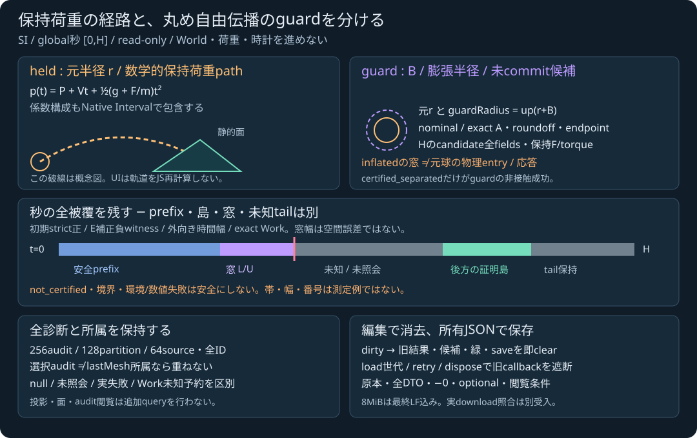

# 保持荷重と丸め自由伝播guardの手動ラボ

2026-11-04 JST。**実装・ローカル専用検証済み、全統合/実ブラウザdownload/公開受入は未確認**。[計画](SPHERE_TRIANGLE_MESH_FLIGHT_LAB_PLAN.md)に沿って、[所有JS API](SPHERE_TRIANGLE_MESH_FLIGHT_JS.md)の二つのread-only照会を手動で読む。pagehideを含む専用23群、固定30入力の29実モデル結果と1host拒否の照合が成功した。これらはローカル専用Node/DOMと実SDKの範囲であり、全npm/Web build・実ブラウザ操作・実Blob download・公開CI/Pagesの成功を先取りしない。最終状態はPLANと親の検証記録を優先する。

入口は [tools/sphere-triangle-mesh-flight-lab.html](../tools/sphere-triangle-mesh-flight-lab.html)。既存92-export SDK/C++/数値核/ゲームのbyteを変更せず、原著UI・固定入力データを追加する。既存entryラボをimportして自動初期化せず、独立したcontrollerを使う。外部素材・依存は追加していない。エンジン本体のlicenseは未選定。

<figure><figcaption>原著概念図。曲線・帯・数値の配置は実行結果や誤差・性能の測定ではない。</figcaption></figure>

## 二つのmodeを混同しない

| mode | 実際に呼ぶowned API | 成功が意味するもの |
|---|---|---|
| `held` | `querySphereTriangleMeshHeldLoad(sphere, triangles, H, settings)` | 厳密実数の保持荷重二次経路の非接触、または条件を満たした開始窓 |
| `guard` | `querySphereTriangleMeshFreeFlightGuard(body, gravity, triangles, H, settings)` | 丸め自由伝播の並進tube、膨張球の全経路非接触、実H候補監査を揃えたguard |

heldの定義は `p(t)=P+Vt+0.5(g+F/m)t²`, `0≤t≤H`。入力binary64を厳密実数として、係数構成の丸めもNative Intervalに含める。guardはこれと既存自由伝播の演算グラフの差をBで囲み、`r+B`を上向きに作った膨張球をheld核へ渡す。`guard.inflated`のentry windowは**元半径の物理entryではない**。候補bodyはWorldへcommitしておらず、このラボは時計・荷重・位置を更新しない。

位置/半径/距離/Bはm、秒のHとtimeTolerance、質量kg、力N、トルクNm、角運動量kg m²/s。Nativeの有限profileは`0 < H ≤ .1s`、最大64source。UIは有限な域外値もモデル入力として渡し、成功域へ縮めない。右手系・Y上。時間幅を空間誤差と呼ばない。静的三角形は薄い両面であり、閉固体の内外や厚みは推定しない。

## 原本入力と固定30例

held入力は `mode,sphere,triangles,horizon,settings`。sphereの全必須fieldは `id,position,velocity,mass,force,gravity,radius`。guardは `mode,body,gravity,triangles,horizon,settings`。bodyはNative同形の全必須 `id,isStatic,mass,radius,inertiaDiagonal,position,orientation,velocity,angularMomentum,force,torque,material:{restitution,friction}`。旧World DTOの`inertia/linearVelocity`やflat materialへ変換せず、慣性/力/速度の欠落を推測しない。

held設定は `mesh:{maxSurfaces,primitive:{...6設定}}` と `timeTolerance,maxEvaluations,maxLeaves,maxDepth,enclosureSqrtRefinements,maxTotalSqrtRefinements`。guardは `{heldLoad:held設定,maxAngularIncrement}`。既定はtimeTolerance=1e-7s、評価256・葉128・depth24・enclosure128・全sqrt1,000,000、maxAngularIncrement=.5。省略だけを補完し、明示nullは拒否する。低予算や厳しい品質値を成功に向けて増やさない。

固定30例は [presetデータ](../tools/sphere-triangle-mesh-flight-presets.mjs) の `cohort,fixtureName,mode` に出自を持つ。凍結183完全入力の正式receipt・3原本JSON hash・全入力fingerprintを `flightLabPresetProvenance` に保持する。runtimeで履歴fixtureをfetchして答えを表示せず、embedded原本を毎回実APIへ渡す。補足cohortは主corpusの値を緩めた代替ではない。名前で結果を選ばない。

面/辺/頂点の四次距離例、端点chordが誤る安全/途中侵入、非有理極小、F/m相殺、接線・初期負・境界、全256audit/128葉/64保守ID、回転/候補失敗、nominal/exact A差、非二進H、膨張窓、静的未対応、不良qと65面host拒否を含む。−0や有限失敗入力をclampしない。原著独立Fraction/RN参照は数値証拠の出自であり、図やラベルを解析証明にしない。

strict入力JSONは131072B・depth16・24000nodes。duplicate/unknown key、不正Unicode、非有限/overflowや欠落fieldを拒否する。空集合・重複・有限モデル域外・整数設定0などの実モデル失敗と、unsafe ID/65面/非整数交換などのhost拒否を分ける。全6能力不足・旧86等はSDK wrapperの入力書込前に拒否し、旧APIやJS計算へfallbackしない。

## 分類・optional・所属を読む

| 分類 | 表示で保持する意味 |
|---|---|
| held `separated` | 全closed秒領域をstrict非接触として証明 |
| guard `certified_separated` | tube・膨張球非接触・候補監査の条件を満たしたread-only guard |
| held `entry_window` | 初期strict正、連続prefix、E補正strict負点、外向き時間幅、exact Workを揃えた窓。単一根や反応ではない |
| `initial_penetration` | 初期strict負。新規entry窓を捏造しない |
| `not_certified` | 接線/境界/品質/予算/未対応などの証拠不足。安全やmissにしない |
| `invalid_input` | 正常交換後のモデル入力拒否。host例外とは別 |
| `unsupported_environment` / `numerical_failure` | 環境拒否/計算失敗。prefixを成功へ変えない |

非接触の表示はheld separated/guard certified_separatedに限定する。guardの外側statusとinflated側statusを併記し、inflated entryを外側成功へ昇格しない。`snapshot:null`、`initial:null`、`safePrefix:null`、初期singleton `[0,0]`、実queryの失敗、未照会/null queryを別に表示する。

| 診断 | 読む場所と所属 |
|---|---|
| 原本/snapshot | 分類欄のoriginalInput・全echo・全settingsとNative snapshot。整数−0原本とsnapshotの+0正規化を分ける |
| 全数学bounds | Tube欄のacceleration/wholePathBounds/wholeVelocityBounds。全3×2成分を保持 |
| 原半径/膨張半径 | Tubeのnominal/exact A、係数差、positionError B、roundoff、guardRadius、inflated inputを併記 |
| H候補 | Endpointの全bounds/L1/3flags、flightFailure、candidateEvaluatedとbody欄の全候補fields。未commitと明記 |
| 初期/prefix/window | 初期証拠、prefix、bestWitness、timeWidth/pathBounds/L1径、全保守IDを別欄で表示 |
| 全被覆 | 全128 partition/state/auditIndex/blockedReason、current/frontier/未照会tailを数値欄へ保存 |
| 全評価/島 | 初期点込み全256auditと全128certifiedLeavesを元順table＋selectorで閲覧。scrollは件数を切らない |
| 全source/lastMesh | 全64元source、最後のmesh全rowと候補prefix。選択auditとlastMeshAuditIndexの一致だけで重ねる |

guardでは閲覧中のheld診断が`guard.inflated`所属であることを明示する。lastMeshのnearest IDsとentry候補の全保守IDを同一視せず、異なる面のnormal/closestを平均しない。元bodyに不良qが保存されていることと、成功candidateの物理field監査を混同しない。

Workはaudit deltaと全体合計、既知使用・保守upper・workExactを保持する。未知blockの予約を0や実測使用へ置き換えない。row_failureの祖先を子cellの新証拠で成功へ書き換えず、後方証明島を未知域越しにprefixへ接続しない。人工Workfalse/環境/例外DTO表示試験は自然presetや実fault注入の実行証拠と区別する。

## 説明図・閲覧は追加queryをしない

XY/XZ/YZの図は原本三角形、元中心/半径、返却whole/path/point bounds、任意anchor、所属が一致するclosest box、成功candidate中心の投影だけを描く。灰/青/黄のbox、橙の元半径、紫破線の膨張半径と候補点を区別する。JSでF/m・放物線・距離・KKT・sqrt・normal・Interval証明・応答を計算しない。任意anchorをexact p(t)と呼ばない。

timelineはglobal `[0,H]` 秒に全partition、証明島、prefix、窓、frontier/current、初期点、負witnessを別段へ配置する。最小1px帯とbox輪郭の3px拡張は表示用であり証明境界ではない。巨大座標や極小時間で有限描画ができなければ図だけを明示拒否し、数値status/packet/saveを保つ。表示はGPU/World精度や性能を証明しない。

投影・audit・面の選択はquery0。全診断は完全JSONに残り、閲覧のために別SDK queryを行わない。

## 編集・load・retry・dispose

初回load/preset/reset/retryは、その世代の入力が未編集なら実APIを一回だけ呼ぶ。通常編集では旧summary・図・表・候補・JSON・save状態を即消し、明示照会を待つ。mode変更は対応する最初の**明示preset**へ切り替えて旧結果を消すが、自動queryはしない。bodyとsphereを黙って変換しない。selectorとinput.modeが異なると入力段階で拒否する。

controllerは `initializeSphereTriangleMeshFlightLab({doc,loadRuntime,saveFile})` から `{run,retry,getState,dispose}` を返す。loadをcoalesceし同期throw/rejectedから復帰する。load中の編集、二重retry、旧世代callback、dispose後の到着で結果を復活させない。getStateは最後にdisplayしたowned packetのcopyまたはnull。disposeはhandler/保存を無効にする。`doc.defaultView`が提供するpagehideにdisposeを接続し、そのhandlerもdisposeで解除する。別documentのglobal windowへfallbackしない。追加2群ではEventTargetのpagehide、初期/retry中の遅延resolve/reject、旧handler、表示済み結果の消去、listener解除とdisposeの冪等性を検査した。これは実ブラウザのbfcache動作全体を検証した主張ではない。

元runtime/native/export/prototypeを置換せず、SDKは元receiverを維持して同期交換する。同じmoduleの共有scratchへの並行/再入利用をUIが追加しない。getterのviewを保持せず、元入力・originalInput・snapshot・別DTOは別所有。所有は編集禁止ではない。queryがNative結果をpublishした後にJS decoderが不正packetを拒否した場合、返却DTOを作らないがNative record rollbackは保証しない。

## 二つの保存ボタンと実download受入

全結果保存はschema1/kind=`sphere-triangle-mesh-flight-lab`、mode、補完済みinput、実full result（originalInput含む）、SDK diagnostics、top-level `projection,inspectedAudit,inspectedOrdinal,inspectedSurfaceId` を持つ。空選択はnull。model failureも保存できるが、形式/loader/host拒否を偽モデルpacketへ変えない。入力保存は最後に照会したcaptured inputであり、未照会editorの上書きではない。

結果codecは8388608B・depth32・1000000nodes。入力保存は131072B。どちらも最終LF込みUTF8 byte上限を監査し、超過時は明示拒否して末尾や負零を切らない。表示JSONとBlobは同じcaptured所有結果から生成する。

専用Nodeではcallbackへ渡るpayload・再読込・最終LF境界を検査した。これは実ブラウザdownloadの成功ではない。次の実受入で、成功full packetとモデル失敗full packet（nested entryまたは不良body診断）の少なくとも2件をBlobで実downloadし、取得fileのbytesをstrict再読込して型/keys/全数値bits/−0/optional/viewを表示packetと照合する。公開CI/Pages・配信byte・旧ゲームの正常操作も別証拠を必要とする。

初期draftのwhole-bounds欄が誤field名でnull表示になった点はcanonical field名へ訂正した。専用初回18/20の2失敗は、mode selectorをheldのままguard JSONへ編集したテストsetupであり、明示mode変更を含む世代試験へ修正した。元失敗rawのパス・最終hash・統合集計は親の検証記録で確定する。

## 次の物理依存

このラボは保持荷重/自由伝播のread-only証拠を制作時に読む入口である。一般接触へは、Worldの静的mesh所有と全pair、元半径の窓順序と残時間/累積丸め、妥当な接触/manifold、反発・摩擦・支持、transactional tickと荷重一回消費の受入が残る。区間normalのmidpointをpoint impulseへ落とすだけの応答は受入にしない。車両・航空・鉄道、流体、材料損傷、関節/制御も未完のまま維持する。
