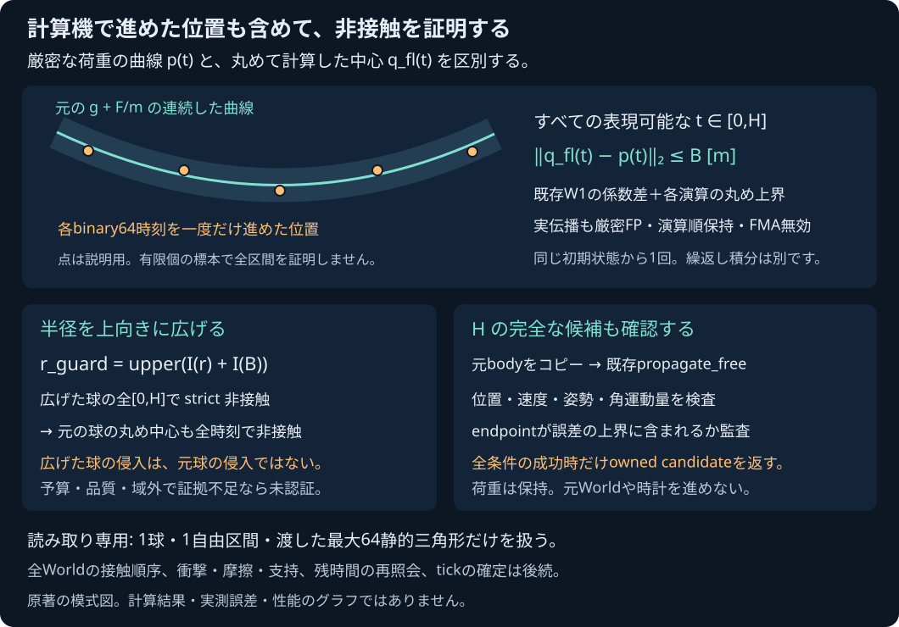

# 丸め自由伝播を含む球×三角形メッシュの非接触guard

Native専用の読み取り専用照会。元bodyと荷重を保持したまま、1球・1自由区間・最大64枚の静的な薄い両面三角形について非接触を調べる。最新の受入状態は[PLAN](PLAN.md)と[検証記録](../reports/2026-11-04-sphere-triangle-mesh-free-flight-guard.md)を参照する。

## 二つの位置を区別する

[保持荷重核](SPHERE_TRIANGLE_MESH_HELD_LOAD.md)の `p(t)=P+Vt+(g+F/m)t²/2` は、入力binary64を厳密な実数として定める曲線である。一方、実際の `detail::propagate_free` は `a_fl=g+F*fl(1/m)` と、複数の丸め演算で中心位置を求める。

同じ初期状態をbinary64 duration tで一度進めた並進位置をq_fl(t)とする。既存W1の `flight()` が持つ、係数差と各演算のULP上界を再使用して、全表現可能なt∈[0,H]について `||q_fl(t)−p(t)||₂≤B` を囲む。有限個の時刻での観測を、全区間の証明に置き換えない。繰返し小刻みに積分した結果や、丸めた点列の間を結んだ連続曲線はこの契約に含めない。

`r_guard=upper(I(r)+I(B))` として半径を上向きに広げ、元P/V/m/F/gのまま保持荷重核へ渡す。広げた球の全[0,H]でstrict非接触を証明できれば、距離のLipschitz性から元球の丸め中心も非接触となる。

広げた球のentry/初期貫通は、元球の物理的なentry/貫通とは別である。このguardはそれらを未認証として保持し、元球の接触時刻や反力へ変換しない。全source/全partitionを省略しない。

## 入口と返すもの

`pikapika::sphere_triangle_mesh_free_flight_guard` の `query(body,gravity,triangles,H,settings)` と `query_body(const World&,body_id,triangles,H,settings)` を使う。設定は既存の `held_load` プロファイルと `max_angular_increment`（既定0.5rad、有限0<値≤π）。位置tubeの品質を理由なく閾値で切り捨てない。

原body全fields、重力、H、全source順と設定を所有するsnapshotを保持する。`tube` は丸めた加速度、元F/m+gの区間、その差、既存W1のB/roundoff/上向き半径を別々に返す。`inflated` は広げた半径を入力にした保持荷重核の完全な所有結果で、元snapshotの半径と所属を混同しない。

元bodyのコピーをHで一度だけ実際に伝播し、回転中点・角運動量・torqueを含む全bodyをvalidateする。位置は丸めた係数のendpoint+roundoffと、元F/m+gのendpoint+Bの両方へ監査し、さらにendpointの誤差L1上界≤Bも要求する。

`certified_separated` は全域separated/exact Work、Hの完全な候補の成功、endpoint監査がすべて揃った場合だけ返す。`candidate` はこの最終成功時にだけ存在し、荷重も保持する。失敗途中の候補を公開しない。`not_certified`/`invalid_input`/`unsupported_environment`/`numerical_failure` は別のstatusで、reasonと所有prefixを保持する。

全表現可能durationの保証は並進分岐の位置の包含である。姿勢・速度の連続真解の誤差、すべての内部durationで完全6DOF伝播が成功することは主張しない。Hでの実候補成功を別に検査する。

## 入力域とコンパイラ条件

Hは有限の(0,0.1]秒。bodyは既存`RigidBody::validate()`に従い、動的CoM中心の球proxyだけを扱う。有効な静的bodyは明示unsupported。重力は±1e9、source座標は±1e12、一意IDの1..64面、IDは1..2^53−1。原mass/radius/位置/速度/forceと派生域は保持荷重核の有限契約に従う。B/半径和/広げた半径をfinite・非負・上向きで確認し、広げた半径が1e9mを超えれば派生域の未認証にする。設定や半径を黙ってcapへ合わせない。

binary64、RN/ties-even、gradual underflow、演算順の保持、fast-math/再結合/FMA/contraction無効が必要で、照会だけでなく**実際のdynamics.cppの伝播側**にも適用する。Native CMakeは `/fp:strict` または `-fno-fast-math -ffp-contract=off -frounding-math`、固定Emscripten builderもdynamics.cppのcontractionを無効にする。独自の異なるビルド条件ではこの証明を主張しない。

環境を最初に検査し、不適合時にIntervalをdefault構築して例外を起こしたり、呼出側のFP controlを変更したりしない。

## W1とSDKの互換性

既存 `continuous_world.cpp` の `flight()` とWorldの本文・演算順は保持し、同じTUへprivate bridgeだけを追加した。上界の数式を新しい核へ複製しない。既存の誤差上界を返すprivate headerもSDKのsource provenanceへ追加し、共有TUの変化を正式なbuilderで再生成する。

SDKのexportsは86のまま。この新Native APIをSDK/JSから呼べるようにした変更ではない。WASMのbyteが変わる場合も、元byteと正式再buildのbyte/hash・配布runtime/licenseを別々に監査する。手書きmanifestで整合を装わない。

旧W1の20ケースは全入力・全CcdReport・全World before/after・ポインタ/rollbackを保存し、同じNative backendで変更前後をbit比較する。SDKは公開している全body/report/clockを同じWASM backendで比較する。Nativeの既定16384contactsと既存ABIの8192capは明示的に別profileとして保存し、SDKのduration0拒否もモデル結果へ混ぜない。

## 独立受入と境界

Fraction参照は整数商/bit組立によるRN/ties-evenで元の演算graphを再現し、元F/m+gとの差とULP recurrenceを独立に監査する。元bodyから求めた厳密path、B、上向き半径和、Hのendpoint、広げた保持荷重の完全証拠とWorkを調べる。FMAや再結合で別の値になる反例、係数差/Bの削除、下向き半径和、windowを成功へ昇格する改ざんを拒否する。一般quartic全最小化、速度/姿勢の全時間真解、実allocation fault注入は別の受入である。

原Worldの全body/plane/gravity/storage/pointer/荷重と時計は変更しない。他のWorld body/planeとのpair順序、同時接触、triangle manifold、反発/摩擦/支持、衝撃後の再照会と残時間、全tick rollback/確定と一回の荷重消費が後続。guard成功をWorld tick成功へ読み替えない。

新外部依存/転載素材/有料serviceは追加していない。本体license未選定。
