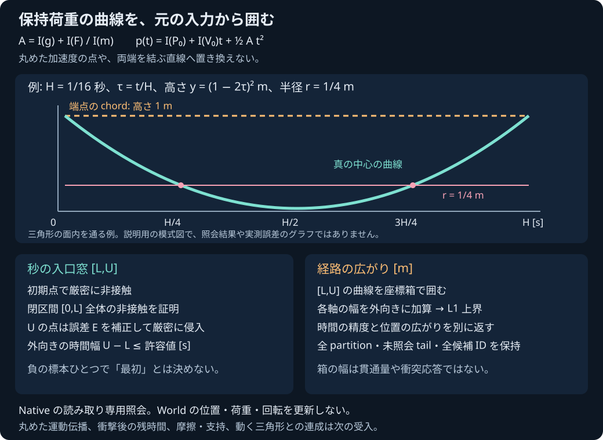

# 保持荷重の球と静的三角形メッシュ

2026-11-04。Native専用の読み取り専用照会。実行結果の受入状態は[PLAN](PLAN.md)と[検証記録](../reports/2026-11-04-sphere-triangle-mesh-held-load.md)を参照する。SDK/ブラウザから呼べる機能とは案内しない。



## 何を計算するか

一定の世界外力F、質量m、重力加速度gから、球中心の自由軌道を定める。入力doubleはそれぞれ厳密な実数として扱い、内部では `A=I(g)+I(F)/I(m)` を区間のまま使う。`p(t)=I(P0)+I(V0)t+I(0.5)A*square(t)` を、元のglobal秒時刻で評価する。丸めた `g+F*(1/m)` や、分割点で丸め直した初期位置へ置き換えない。

世界座標で指定した薄い両面三角形の全source集合への距離を、既存のmesh核で照会する。面だけでなく有限の辺と頂点を含む。閉立体内部や厚み、動く三角形、回転する非球形は定義しない。

```cpp
#include "pikapika/sphere_triangle_mesh_held_load.hpp"
namespace held = pikapika::sphere_triangle_mesh_held_load;
held::HeldSphere sphere;
sphere.id = 7;
sphere.position = {1, 1, 1};
sphere.velocity = {0, -64, 0};
sphere.mass = 1;
sphere.force = {0, 2048, 0};
sphere.gravity = {0, 0, 0};
sphere.radius = 0.25;
const std::vector<pikapika::sphere_triangle::StaticTriangle> source{
    {31, {{{0,0,0}, {4,0,0}, {0,0,4}}}}
};
const auto result = held::query(sphere, source, 1.0/16.0);
// Result is an owned diagnostic; no position/velocity/load has been updated.
```

この例ではτ=t/Hとすると高さは `(1−2τ)²`。最初の侵入開始はH/4、離脱は3H/4で、両端を結ぶ直線は侵入を見逃す。これは衝突後も力を保持した自由軌道の照会であり、球が実際に床を貫通する応答をゲームへ導入したものではない。

## 成功と未認証

| status | 必要な証拠 |
|---|---|
| `entry_window` | 初期strict正、閉[0,L]全体のstrict正、安全prefixの後のUでstrict負、外向き秒幅上端が許容値以下、Workがexact |
| `separated` | 閉[0,H]全体のstrict正の被覆とexact Work |
| `initial_penetration` | 初期点の誤差補正後のstrict負 |
| `not_certified` | 接線/初期境界、予算・品質・秒分解能・派生域、静的bodyなど、証拠が不足 |
| `invalid_input` | 設定・原入力・source ID/重複・不明body等が契約外 |
| `unsupported_environment` | binary64/丸め/gradual-underflow等の必要なFP環境を満たさない |
| `numerical_failure` | 数値/所有診断/内部整合性の失敗。部分診断から成功を作らない |

初期点を一評価として監査してから、最小depth、同率は左の未照会cellを選ぶ。先行の未知区間を飛び越して「最初」と決めない。負witnessの後に残る未照会tailも含め、全partitionを所有する。回復可能で実行量がexactなrow failureは未知cellとして細分できるが、その失敗ancestorから証拠は作らない。

任意のbinary64 anchor cに対し、経路全体のRと、選択した厳密時刻の点のEを外側から囲む。距離boundsが[dlo,dhi]なら `dlo−Rup−r>0` がcell全域の非接触証拠、`dhi+Eup−r<0` がその時刻の侵入証拠。anchorを厳密なp(t)とみなさず、Eを省略しない。

入口窓は唯一の根や正確な接触点を返すものではない。全元source IDを昇順の保守候補として返す。witnessの最近接IDだけへ減らさず、法線やmanifold、反発・摩擦の選別結果とも扱わない。

## 時間と空間の単位

`Cell.time_bounds`、auditの`time`、prefix、witness、windowはすべて秒。`EntryWindow.time_width`は厳密なU−Lを外向きに囲む。horizonの正規化parameterではない。

`EntryWindow.path_bounds`は[L,U]の元曲線の座標箱。`l1_diameter_bound`は格納した各軸の箱幅の和を外向きに囲む。その上端が経路の空間的な直径の上界[m]になる。下端は実移動距離の下界ではなく、箱幅は最大貫通量・伝播誤差・接触点精度ではない。時間の許容値を位置精度へ読み替えない。

## 入力域と有限作業

Hは有限の0<H≤0.1秒。massは[1e−12,1e18]kg、radiusは(0,1e9]m、position/triangle座標は±1e12m、velocityとgravityは各±1e9、forceは±1e24N。IDは1..2^53−1、sourceは一意IDの1..64面。派生acceleration/path/velocity boundsがそれぞれ±1e12/±1e12/±1e9を越える場合は、元入力の不正と分けて未認証にする。

設定は縮めず検査する。time_toleranceは(0,0.1]秒、既定1e−7秒。evaluationsは1..256（初期点含む）、全partition leavesは1..128、depthは0..32。enclosure sqrtは1..256、全sqrt更新は1..16777216。既存mesh/primitiveの設定domainも維持する。

各mesh照会前にN×512、各R/E root前に512の更新blockを予約する。既知実行数と不明blockの保守上界を別に保持し、不明量を0にして続行しない。初期1+最大255cellで、primitive更新≤8388608、R/E更新≤262144、合計上界≤8650752。構成上の上界であり、実測時間やfpsではない。

原入力、全source順、設定、acceleration、全域path/velocity、初期証拠、全audit/partition/島/frontier/current、prefix、witness/window、Work、lastMeshと所属を所有する。返した診断を変更しても元入力/別の結果を変えない。実際に注入していないallocation/内部例外は、人工packetだけで実行済みとは報告しない。

## const World adapter

`query_body(const dynamics::World&, body_id, triangles, H, settings)` は選択bodyを一度copyしてvalidateし、世界重力とともにraw照会へ渡す。owned `world_body`は全RigidBody fields（姿勢、角運動量、慣性、torque、materialを含む）を保存する。中心運動で回転を積分しない。既存CoM中心の球proxyだけを扱う。

静的bodyをmで割って動かさず、明示unsupportedとする。全World body/plane/gravity/荷重/storage/pointerは変更しない。他のWorld body/planeとの接触を検査したとは主張しない。sourceは外部の静的世界三角形で、Worldに登録されたcolliderではない。

## 独立検証と残り

Python stdlib Fraction参照は原binary64を有理数化し、A=g+F/m、二次coordinateの両端・区間内停留点を使って全cell rangeを監査する。anchorでの距離は、面内可行解と全3clamped辺から独立に最小化する。C++のKKT maskや選択結果を正解として使わない。R/E上界は有理数の二乗比較、prefix/全partition/window/Work/IDは全所有packetで検査する。

一般quartic solverではないため、解析的な面/辺/頂点の入口、chordが偽安全/偽衝突になる例、非有理極小、接線、F/m打消しを別に要求する。全結果を未認証にして通す検証にはしない。負例変異、実容量、入力保存、旧回帰、Linux strict warnings/ASan/UBSanはそれぞれ別記録に残す。

ordinary-doubleの`propagate_free`を囲む証明には、係数差とoperation-graphの伝播tubeが別途必要。全pair event順序/同時接触、接触法線/feature競合/manifold、反発/摩擦/支持、衝撃後の再照会と残時間、全tick rollbackを接続する前に、この窓をpoint impulseへ渡さない。SDK/JS/UI化も後続で、流体・材料損傷・専門車両/航空/鉄道・IK/制御・高精度撮像の要求は未完のまま維持する。

新外部依存や転載素材は追加していない。本体licenseは未選定。

## 実行して確かめる

Windowsのリポジトリrootで `./scripts/build-native.ps1` を実行すると、専用試験を含むCTestが動く。専用入口は `build/native/Release/pikapika_sphere_triangle_mesh_held_load_tests.exe`、`--fixtures` で完全入力と全診断のJSONを標準出力する。UTF-8のまま保存し、`python -X utf8 scripts/check-sphere-triangle-mesh-held-load.py <fixture.json>` と `python -X utf8 tests/sphere_triangle_mesh_held_load_reference_test.py <fixture.json> --output <report-directory>` で独立参照・負例を実行できる。

LinuxはCMake Release出力の同名target（`.exe`無し）を使う。strict FPを外した独自buildは認証の対象にしない。Native92群のWindows実行、独立Fraction、回帰、GNU strict/Werror、全依存核のASan/UBSan、公開配信は検証記録で別々に判定する。
