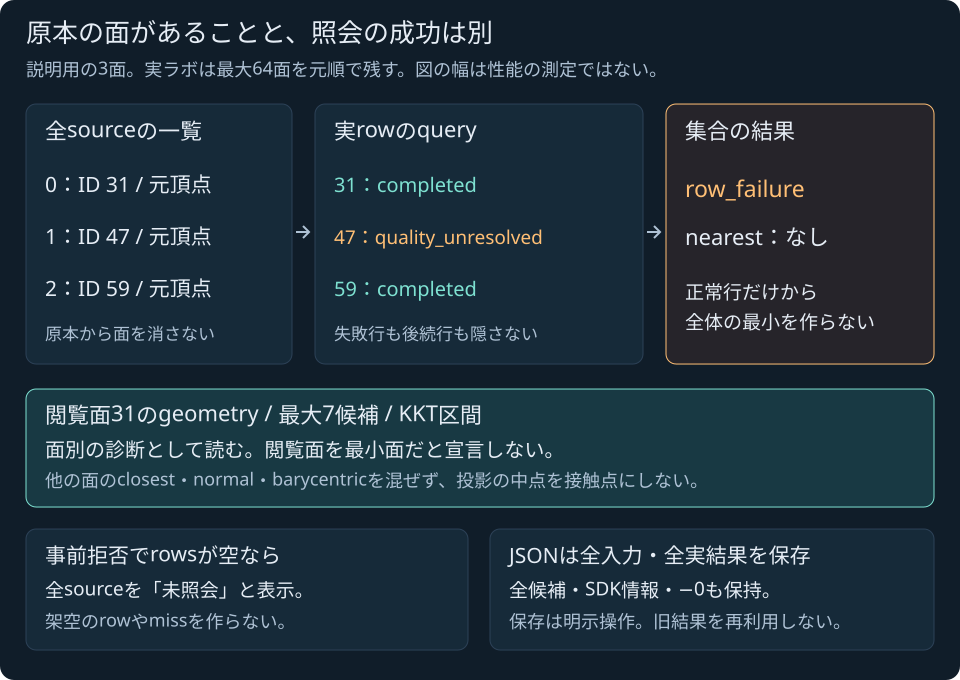

# 静的三角形集合の手動照会ラボ

2026-11-04 JST。**ローカル・公開Linux CI/Pages受入済み**。[共有SDK](SPHERE_TRIANGLE_MESH_SDK.md)の公開受入とは別に、最大64面の原本、全行診断、最小になり得る面のID集合を手動で確認する。[手動集合ラボ](../tools/sphere-triangle-mesh-lab.html)は既存の実SDKを呼ぶ。[実装計画](SPHERE_TRIANGLE_MESH_LAB_PLAN.md)に沿って実装・検証した。

静的な両面三角形集合と球の、ある瞬間の距離照会である。既存のC++核/74-export SDKをそのまま呼び、JSで距離・KKT・最小面を計算し直さない。Worldの時刻や荷重を進めず、ゲームの接触、CCD、反発/摩擦の応答を操作するラボではない。

## 手動で調べる手順

1. 比較例を選び、JSONにある球、全triangle、surface ID、nested primitive設定を確認する。入力を変更したら、前の結果を消して明示照会する。
2. 集合のstatus/reasonとnearestの有無を確認する。成功なら距離²・距離・gapの区間と全possible IDを読む。モデル失敗はnearestがないまま扱う。
3. 元順のsource一覧で、最後の面まで確認する。閲覧する面を選び、その行に実queryがあるか、行別のstatus/reason、geometry、候補prefixとKKT区間を調べる。
4. XY/XZ/YZへ投影を変えて、同じ所有結果の見え方を比較する。閲覧面や投影の変更は表示条件の変更で、別のC++照会や最小面の確定ではない。
5. 保存可能な実結果をJSONへ出し、全入力・全行・全候補・SDK情報と表示条件を保持する。未照会やhost拒否から成功packetを合成しない。

ローカルの実ブラウザで17例、入力editと明示照会、retry、閲覧面/投影の切替、実Blob保存を確認した。17例は10成功・6モデル失敗・1 host拒否で、失敗を成功へ読み替えない。公開版でも同じ操作と保存を確認した。

比較例はsingleton、裏側、明確な優劣、共有辺、共有頂点、離れた同率、面順反転、区間での順序未確定、巨大共通offset、実64面、途中/遠方の退化面、候補予算、法線幅、重複ID、空集合、65面。例のlabelを数値判定の代わりにせず、返された実status/reason・区間を読む。

## 入力の意味と単位

入力は次のshapeを用いる。具体的な数値は例であり、実際の照会結果をJSで埋めるための答えではない。

```json
{
  "sphere": {"position": [1, 3, 1], "radius": 1},
  "triangles": [
    {"id": 31, "vertices": [[0, 0, 0], [4, 0, 0], [0, 0, 4]]},
    {"id": 47, "vertices": [[0, -2, 0], [4, -2, 0], [0, -2, 4]]}
  ],
  "settings": {
    "maxSurfaces": 64,
    "primitive": {
      "maxCandidates": 7,
      "sqrtRefinements": 128,
      "maxTotalSqrtRefinements": 1024,
      "maximumLocalWidth": 1e-7,
      "maximumNormalWidth": 1e-8,
      "minimumSineSquared": 1e-12
    }
  }
}
```

SI単位系、右手系、Y up。位置・半径・距離・gap・local幅はm、距離²はm²、normal/barycentricとsin²は無次元。各三角形は正のsafe整数IDと元順の3頂点を持つ。入力の形状/数値域とprimitiveの品質条件は[SDK契約](SPHERE_TRIANGLE_MESH_SDK.md)を継承し、型/IDのhost拒否と、受理した入力のモデル失敗を区別する。

65面を編集できても実SDKの上限は64面である。切捨て、隠れた分割、予算の自動拡大、位置やradiusのclampをしない。空集合や重複ID、品質/候補予算不足も、別の正常入力へ直して照会しない。strict JSONの符号零保持とduplicate key・非有限/不正な数値の拒否を使い、通常のJSON.parse/stringifyへの無意識な置換で-0を失わない。

## source・実row・集合結果を分ける



原著の概念図。面IDや配置は説明用で、実画面・誤差幅・性能測定ではない。正常行があっても、一つのrowが失敗した集合にnearestを作らない。閲覧している面をwinnerと宣言しない。

| 表示するもの | 読み方 |
|---|---|
| 全source | 呼出し元が指定した元順のID/頂点。存在することは実query済みを意味しない |
| 実rowのquery | Nativeが実行したその面の結果。geometryなしの失敗や候補prefixも隠さない |
| 未照会 | preflight拒否やfatal時のnull query。miss・距離0・無限大ではない |
| 集合nearest | 全行成功だけが持つ最小区間とpossible IDs。1行失敗なら不在 |

preflightでDTO.rowsが空でも、元入力のsourceは一覧へ残し「事前拒否で未照会」と区別する。架空のNative rowを作らない。通常のrow_failureでは後続の面も実行され、その正常な行は個別診断として読める。個別成功のgeometryを図示する場合も、集合nearestがない状態を併記する。

`possibleSurfaceIds` は「最小になり得る面」であり、全IDが真に同率だという意味ではない。全64 IDを保持し、最小IDや区間中点から1面を選ばない。各面のclosest、normal、barycentricはその面に固有で、平均して単一の接触点/法線へ変換しない。feature候補の同率と、距離0などで法線が定義できない状態も別である。

## 図の範囲

図は3D座標の2D投影で、奥行きを落とす。違う面が重なったり、三角形が線へ潰れたりしても、3D形状の消失/退化を示したわけではない。全sourceのIDと実行状態を表に残し、画面の線の本数だけで面数を判断しない。

closestは返却された区間領域として表示する。極小区間のinkを見える線幅へ広げても、元boundsやDTOを変更しない。中点を物理接触点にせず、描画の太さを誤差幅へ読み替えない。巨大/域外座標で有限の縮尺を作れないときは「説明図を表示できない」とし、実queryの数値結果は書き換えない。画素、world/view/clip/GPU算術の包含証明を行う図ではない。

## 編集・読込み・保存の境界

source/preset変更、reset、retry開始で、前のgeometry・候補・図・JSONと保存可能状態を消す。新しい入力の照会前に旧候補を残さない。読込中に旧runtimeでqueryせず、同時loadをまとめ、同期throw・非同期rejectからretryできる。古い世代やdispose後の遅延結果で画面を復活させない。これらは専用18試験で確認した。

保存はユーザーの明示操作だけで行う。schema1 / kind `sphere-triangle-mesh-lab` に、`input,result,diagnostics,projection,inspectedOrdinal,inspectedSurfaceId` を所有copyから出す。空集合では閲覧ordinal/IDはnull。モデル失敗はnearest:nullのまま保存し、途中行や-0を落とさない。表示を短くしても保存データを部分成功bufferへ切り詰めない。実ブラウザで失敗結果と64面全結果の2種類をダウンロードし、表示JSONとのbyte一致と全DTO数値bitsを確認した。

strict codecの予算は入力64KiB/depth10/6000 nodes、出力4MiB/depth20/200000 nodes。予算を超えた場合は不正値や省略した成功JSONを作らずエラーにする。通常のJSON.stringifyへの置換で符号零を落とさない。

本文と概念図はfile://でも読める。実WASMの操作にはHTTP/HTTPS配信が必要。ローカルは `npm start` による `http://localhost:8080/tools/sphere-triangle-mesh-lab.html` を使う。公開Pagesでも17例と編集・retry・保存を実操作した。新APIのない旧SDKやロード失敗で、JS幾何fallbackを行わない。

## 現在の受入範囲

専用18試験、全Node544/skip0、構文、Web build `457dd1cda43de02c`（47modules/23entry）、既存Native34CTestが成功した。既存SDK45 model/3 hostの27160packet/20808model bits、独立2775成分と43改ざん負例も再確認した。

実ローカルブラウザの21実結果packet、2実Blob downloadについて42644数値bits（うち5733負零）が実WASM再照会/表示保存と一致した。独立Fraction参照は先行45入力に実ブラウザ21packetを追加し、総7353成分（今回追加4578）を検査した。入力変更時の旧表示消去、ID0拒否/reset、符号零edit/retry、失敗後も後続面の診断、実64行/全64 ID/末尾7候補、XY/YZ変更を確認。新ラボの受入根拠は[検証記録](../reports/2026-11-04-sphere-triangle-mesh-lab.md)と対応JSONへ保存する。コード`203c11a`の公開CI/Pages全job/stepが成功し、42ファイル1,428,296Bがcommit blobとbyte一致。公開ブラウザでも42644数値bits/5733負零と独立追加4578成分を確認した。既存ゲームの2撃破・ブースト・停止と35照会全成功/3常駐meshを確認し、新mesh接触を適用した結果とはしない。[公開受入記録](../reports/sphere-triangle-mesh-lab-public-verification.json)に全工程状態・有限ログ・配信・ブラウザ証拠hashを保存した。

既存C++/SDK638777B・74exports・57原本/7通知・全assets/sample原本を変更しないUI段階である。外部package/素材/サービスを追加せず、本体ライセンスは未選定。ゲーム原本を変更せず、一般のWorld/CCD/storage/manifold・衝撃/摩擦支持、閉固体内部、ゲームmesh接触、流体/損傷や専門シミュレータ、IK/制御・高精度撮像の完成をこのラボへ含めない。
