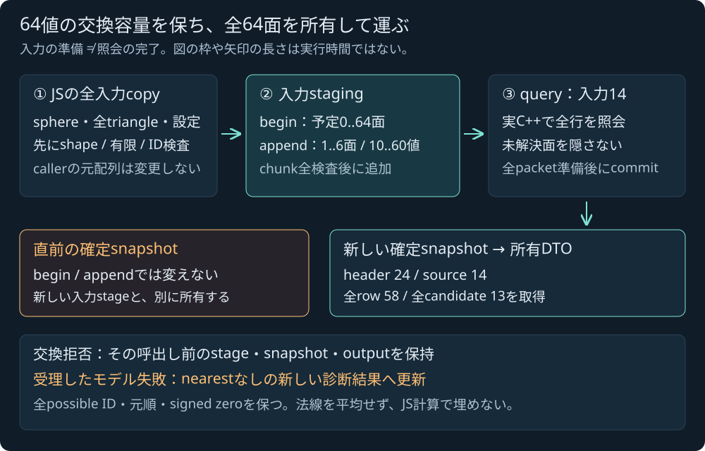

# 球×静的三角形集合の共有SDK契約

2026-11-04 JST。**実装・ローカル/公開Linux CI/Pages受入済み**。公開受入済みの[Native集合核](SPHERE_TRIANGLE_MESH.md)を、ABI1の64 F64交換とJSの所有snapshotへ接続した。既存68-export版の[単一面SDK](SPHERE_TRIANGLE_SDK.md)とは別段階であり、旧配布物へ集合照会が含まれていたとは扱わない。新6exportsを含む74-export版・source/header合計57で実WASMと独立参照を検証した。独立MSVC ASanの追加試行は未完了で、実行成功とはしない。

[接続計画](SPHERE_TRIANGLE_MESH_SDK_PLAN.md)、[C ABI header](../core/include/pikapika/simulation_api.h) / [JS bridge](../engine/simulation.mjs)に沿った使用契約である。[統合報告](../reports/2026-11-04-sphere-triangle-mesh-sdk.md)で数値照合・来歴・未完了の検証と公開待ちを分ける。

## JSから全入力を渡す

```js
const triangles = [
  {id: 41, vertices: [[0, 0, 0], [4, 0, 0], [0, 0, 4]]},
  {id: 42, vertices: [[0, -2, 0], [4, -2, 0], [0, -2, 4]]}
];
const result = runtime.querySphereTriangleMesh(
  {position: [1, 3, 1], radius: 1},
  triangles,
  {
    maxSurfaces: 64,
    primitive: {
      maxCandidates: 7,
      sqrtRefinements: 128,
      maxTotalSqrtRefinements: 1024,
      maximumLocalWidth: 1e-7,
      maximumNormalWidth: 1e-8,
      minimumSineSquared: 1e-12
    }
  }
);
if (result.status === 'completed') {
  console.log(result.nearest.distance,
              result.nearest.possibleSurfaceIds);
} else {
  // 行の診断は残しても、集合全体のnearestはnull。
  console.log(result.status, result.reason, result.rows);
}
```

これはAPIの使用例で、ローカル数値受入の件数は末尾の固定fixtureに基づく。解析的には球中心から面41まで3m、面42まで5mだが、JSでこの値を計算して実C++の結果を埋めない。位置・半径・距離・gap・局所幅はm、距離²はm²、法線・barycentric・角度のsin²は無次元。右手系・Y upを使う。

`triangles` は0..64件の配列で、各要素は正のsafe整数IDと元順のABC頂点3組。shape・各有限値・ID・整数設定・容量と6exportsの存在を、入力交換前にJSで検査する。呼出し元の全triangleを一度所有copyしてから、そのcopyをchunkへ分ける。後のcaller編集やgetterから借りたHEAP viewを原本として混ぜない。

0件は空集合というC++モデル拒否を得るために通す。重複ID、有限だが座標域外、非正radiusなども、交換の型条件を満たせば実Nativeモデルへ渡す。一方65件以上、ID0/unsafe、shape・非有限などはhost拒否で、geometryや合成モデルstatusを返さない。Nativeの入力域は座標/半径の絶対値<=1e150、radius>0、IDは1..2^53−1である。

`maxSurfaces` は既定64。単一面用の6設定は**nested `primitive`**へ置く。既定値とモデル上の意味は上の例および[単一面契約](SPHERE_TRIANGLE_SDK.md)に従い、`maxSurfaces` と最初のprimitive整数3設定はuint32交換域を検査する。その域内の0やモデル上限超過を自動clampせず、C++へ渡す。非有限の品質値は交換前に拒否する。

## stagingと、直前の照会結果を別に所有する

64面の原入力はID+9座標で640値。64 F64の交換容量を増やさず、1..6面（10..60値）ずつ追加する。runtimeごとに一つの有界stagingを持ち、resource handleやWorld資源は作らない。



図は原著の概念図で、枠の長さ・配置は実行時間や転送性能の測定ではない。最大64面ならappendは11呼出し、最終chunkは4面40値になる。この件数は速度向上の保証ではない。

| 操作 | 受け入れる入力と意味 |
|---|---|
| `begin(triangle_count)` | 0..64の予定件数で新stagingを開始。直前の確定snapshot/outputを変えない |
| `append(value_count)` | 10..60の10の倍数。1..6面を元順で追加し、chunk全検査後にだけstagingを更新 |
| `query(value_count)` | 全面の追加完了後、入力14とstagingで実Native核を呼ぶ。成功した交換は新snapshotをcommitし、stagingを再照会用に保持 |

未begin、予定数未達/超過、不正chunkやgetter範囲などの交換拒否は、その呼出し前のstaging・確定snapshot・output有効count/prefix bitsを保持する。beginに成功して既にstageを替えた後の失敗を、beginより前のstageへ自動rollbackする契約ではない。input scratchの保持も約束しない。

正しい交換のC++モデル失敗は、新しい`nearest:null`の診断snapshotへ更新する。以前の成功nearestを残して返したり、正常行だけで最小値を作ったりしない。query後のJS decodeが不正packetを検出してthrowしても、Nativeが既にcommitしたsnapshotをquery前へ戻す意味ではない。callerへ既に返った所有copyはそのまま保持する。

global resetはstagingと集合snapshotを消す。単一面・optics・motion・skin・derivedなどの記録とは独立で、本照会自体はWorldの時刻・姿勢・荷重を変更しない。交換APIは同期・非再入という既存条件を維持する。割当失敗の強い保証はcommit前の準備/move/swapの順序を対象にし、未実施のfault injectionを検証済みとしない。

## 全行・全候補を返すJS DTO

```text
Result
  status, reason, failedIndex|null, firstFailedRow|null
  rows[{triangle:{id,vertices}, query:SingleResult|null}]
  nearest|null
  queries, candidatesExamined, sqrtRefinements, sqrtLimitedRows, failedRows

Nearest
  squaredDistance:[lo,hi], distance:[lo,hi], gap:[lo,hi]
  possibleSurfaceIds:[stable IDs in ascending order]
```

status/reasonは[Native集合核](SPHERE_TRIANGLE_MESH.md)と同じsnake_case文字列。モデルmessageはこのDTOに含めない。`query` は[単一面の所有DTO](SPHERE_TRIANGLE_SDK.md)と同じgeometry・全候補・optional診断・作業件数を持つ。scalar区間は通常Arrayの`[lo,hi]`、Bounds3は3区間の配列で、全decode/整合検査を終えるまで部分DTOを返さない。

rowsはNativeが所有した行の元順である。構造/環境の事前拒否では空になるが、Nativeのsource getterはその照会時原本を別に保持する。JS DTOに存在しないtop-level sourceを合成せず、保存用途ではcallerの元入力も別に保持する。fatal時のnull queryは未実行であり、miss・距離0・無限大へ置き換えない。通常のrow_failureは残りの全行も実行し、失敗行も残す。

全行成功だけがnearestを持つ。距離²・距離・gapそれぞれの全行下端の最小と上端の最小で囲む。距離²下限が最小上限以下の全IDを`possibleSurfaceIds`に残し、境界や同率をID順の一面へ切り捨てない。保持した全IDが真の同率とは限らない。面ごとのgeometryを一つへ混ぜず、法線・barycentric・最近接点を平均しない。

元頂点のsigned zeroと未使用KKTの`[-0,+0]`はbitsを保つ。不在域の+0 paddingと混同しない。通常の`JSON.stringify`は-0を失い得るため、照合・保存には原rawや符号零を保持する既存strict JSON経路を使う。後続query/resetや、返されたcopyのcaller編集が相互に記録を変えない所有契約である。

## 6exportsとpacket配置

新関数は `pp_sim_sphere_triangle_mesh_begin` / `_append` / `pp_sim_sphere_triangle_mesh` / `_source` / `_row` / `_candidate`。ここで省略した共通prefixは`pp_sim_sphere_triangle_mesh`。ABI1・F64 output容量64を維持し、候補batch getterは増やさない。

| packet | 値数 | 内容 |
|---|---:|---|
| query input | 14 | sphere4、maxSurfaces1、primitive整数3、品質3、reserved zero3 |
| header | 24 | 集合分類・optional index・source/row/work件数・nearest3区間・reserved zero3 |
| source | 14 | ordinal、ID、ABC9、hasRow/hasQuery/isPossibleNearest |
| row | 58 | 単一面と同じsummary/geometry/optional/candidate件数 |
| candidate | 13 | 単一面と同じfeature/disposition/KKT数・barycentric6・KKT4 |

正確なoffsetは[計画](SPHERE_TRIANGLE_MESH_SDK_PLAN.md)を参照する。source getterはstagingではなく照会時の確定原本を読み、後のbegin/appendに追従しない。source flagsから全possible IDを集めるので、64 IDをheaderへ切り詰めない。null queryや存在しない候補のgetterは拒否し、別rowや単一面snapshotで代用しない。

decoderは厳密count・有限性・enum/flag/index・元順/ID/全原本bits・optional padding、実work総和と失敗位置を照合する。nearestがある場合は全行geometry、上下端の最小、全possible ID条件も検査する。この検査はJS幾何fallbackではなく、実C++結果の交換整合を確認するもの。不正packetや旧SDKの能力不足を、成功モデルやsingle APIへfallbackさせない。

## ローカル受入と来歴

Native48 fixtureを45実C++モデルと3 host拒否へ分類した。モデルは29成功・16意図した失敗（6 row_failure / 10 preflight拒否）。host拒否は65面begin、ID0/unsafe IDのappendであり、空の合成モデル結果へ補填しない。実WASMのpacket27160 / projected model20808 numeric bitsがNativeに一致し、負の零4453件も一致した。両照合範囲を足して独立fixture数とはしない。実WASM結果へ独立Fraction2775成分と43改ざん負例を適用し、成功した。Native単独の59群やその参照結果を、新WASMの成功証拠として流用していない。

staging・snapshot/output保持、chunk失敗後復帰と再照会、全入力/全行/全候補・符号零、実64面と末尾、global reset、他snapshot/World不変と所有copy、旧SDK能力拒否・破損packet拒否を受け入れた。不正snapshotを注入するdecode試験と実WASMのモデル実行を分け、注入結果を実C++の数値結果とは数えない。新Native API18群・旧API77群・全34CTest、専用JS10群を含むNode526/526（skip0）、構文、Web build `1f40cf023bb8472f` / 46 modules・22 entryがローカルで成功した。旧単一面SDKの22327 packet / 13432 model numeric bitsなど既存回帰も成功した。

| 主SDK artifact | 確定値 |
|---|---|
| exports / source・header合計 | 74 / 57 |
| WASM | 638777 B |
| WASM SHA256 | `a9424df2c00c9cbf9fb11a979e2c00b991cf17a9128a0ccb52ea86bbc8b871ec` |
| Emscripten glue | 53435 B |
| glue SHA256 | `d0b06ae80449622cd98df4df496447a552c4c6c31bfe7a656c08df9eae4aae18` |

基準commit `207aa60` から保護対象62ファイル（変更しないC++原本55＋既存通知7）と全authored assets/game Sourceはbyte不変。意図した変更はAPI cpp/headerと新SDKの3artifact・生成HTMLで、保護対象62とは別に数える。

7通知は不変だが、linked標準runtime memberは不変ではない。昇順uint64 ID sort/introsortのため、既設libc++の `libc++-debug-legacyexcept.a(algorithm.o)` が1 member増えた。pinned Emscripten6.0.13の `system/lib/libcxx/src/algorithm.cpp` は2718 B、SHA256 `32d0eded6a24dcf1e5d4968e7a8e9902b459084bbe08d681dc14bf093ce53f9a`、SPDX `Apache-2.0 WITH LLVM-exception`。既存の[LIBCXX-LICENSE.txt](../third_party/emscripten-6.0.13/LIBCXX-LICENSE.txt)で配布通知する。根拠は[ローカルpinned source/runtime監査](../reports/sphere-triangle-mesh-sdk-runtime-audit.json)の原本hashとlink map抜粋で、全文map保存とはしない。新solver/geometry packageの導入ではない。

独立MSVC ASan試行はcompile未完了、247.548秒・exit15でruntime未実行の `NOT_COMPLETED` として保持した。先行Native純粋核のASan59群と、この新API試行を混同しない。公開GNUではAPI cppと新試験のASan/UBSan18群（通常strict核libraryと結合）、純粋核の別ASan/UBSan59群が成功した。Windowsの未完試行を成功へ書き換えず、別platformの受入として記録する。

ローカル実ゲームでは3撃破・boost clip1記録・停止、新SDK638777 B/build ID読込み、22照会全成功・3常駐meshを確認した。これは旧機能の互換受入で、新しい集合核をゲームmesh接触へ適用した結果ではない。公開CI/Pagesと手動集合ラボは、引き続き別の有限受入である。

外部solver/geometry/JSON library、package・素材やライセンス選定は追加しない。閉固体内部、隣接面/manifold、時間方向CCD、衝撃/摩擦支持、ゲームmesh接触、流体・損傷や専門シミュレータの完成を意味しない。区間中点を点衝撃solverへ渡す許可や一般性能の保証でもない。

公開受入: コードc9dda79のLinux CI/Pages全job/step成功。34CTest/Node526skip0、実WASM27160packet/20808model bits・独立2775成分/43負例と旧回帰を確認。既存warning36診断を維持し、新API/kernelの追加warningなし。公開41ファイル1,438,875Bがcommit blobとbyte一致。実公開ゲーム2撃破/boostclip1記録/停止、21照会全completed・3常駐meshと新638777B SDK/build ID一致を確認した。旧単一面ラボ既定入力/結果の147数値bitsもNode実SDKへ一致。全根拠は[公開検証](../reports/sphere-triangle-mesh-sdk-public-verification.json)。次の[手動集合ラボ案](SPHERE_TRIANGLE_MESH_LAB_PLAN.md)は設計のみ・UI未実装で、ゲームのmesh接触は未接続のまま。
