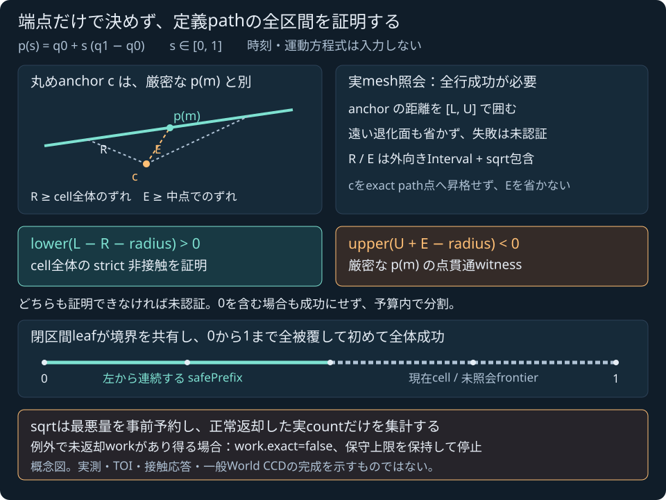

# 球と静的三角形集合の定義線分軌道を監査する

2026-11-04 JST。**Native純粋核をローカル・公開受入済み（コード93ec576）**。[設計契約](SPHERE_TRIANGLE_MESH_TRAJECTORY_PLAN.md)に従い、既存の[瞬間の集合照会](SPHERE_TRIANGLE_MESH.md)を使って、球中心の定義された線分経路全体にstrictな非接触を証明する。共有SDK・ブラウザ操作・World・ゲームへの接続を、この段階の利用可能な機能として案内しない。

## 定義する経路と成功の意味

入力binary64は、それぞれが表す厳密な実数として扱う。球中心と半径の単位はm、parameter sは無次元である。

```text
p(s) = q0 + s (q1 − q0),  0 <= s <= 1
S = 入力した1..64枚の静的な両面三角形の和集合
g(s) = distance(p(s), S) − radius
```

全体の非接触成功には、**すべてのsでg(s)>0**という証明が必要となる。有限個の端点・中点が安全だったことを全経路の安全へ昇格しない。接触を許すepsilonは設けず、0を含む包含を非接触とも貫通とも決めない。三角形の隣接関係・閉固体内部・厚み・片面材質を推測しない。

時刻、速度、外力、姿勢は入力しない。これは定義線分経路についての幾何学的な証明であり、運動方程式の真解を囲むものではない。既存の定義放物線に対する `trajectory_guard` を置き換えず、最初の接触時刻、接触manifold、衝撃・摩擦・支持反力や一般WorldのCCDも求めない。



図は原著の概念図であり、配置・長さ・葉数は実行結果、誤差幅、性能の測定ではない。

## 丸めたanchorと厳密なpathを分ける

空でない有限三角形集合Sに対し、三角不等式から距離は次を満たす。

```text
d(c,S) − |x−c| <= d(x,S) <= d(c,S) + |x−c|
```

任意のt∈Sに対する `|x−t| >= |c−t|−|x−c|` の最小値を取り、xとcを交換すれば両側が得られる。この導出は本段の原著記述で、新しい外部論文の実読や外部実装の利用を主張しない。

cell J=[a,b] の全pathと、dyadic midpoint mでの厳密な点p(m)を、差・積・和の各段階から既存の外向き[Interval](INTERVAL.md)で囲む。通常doubleで計算したp(m)を、そのまま厳密点区間として扱わない。

anchor cは有限binary64の**任意点**でよい。box centerを選んでも、それが厳密なp(m)と等しいとは限らない。既存sqrt包含を使って次の上界を作る。

```text
R >= max(s in J) |p(s) − c|    // cell全体のずれ
E >= |p(m) − c|               // witness点での丸めずれ
```

各成分のInterval差、平方、和から二乗上界を得て、その有限・非負の上端そのもののsqrtを包含する。そのsqrt上端をR/Eに使い、未校正のlibm normや後付けepsilonを証明へ入れない。Rを通常doubleの半線分長へ置換したり、Eを丸め誤差なしとして省いたりしない。

## 三つの結論と、全mesh行の成功

anchorに対する既存mesh queryが全行成功し、集合距離を[L,U]と囲んだ場合だけ、次の式をさらに外向きIntervalで評価する。

| 証明する式 | strictな条件 | 結論 |
|---|---|---|
| clearanceCertificate = L − R − radius | 包含のlower > 0 | Jの全pathがstrict separated |
| penetrationCertificate = U + E − radius | 包含のupper < 0 | 厳密なp(m)にstrict penetrationの点witness |
| 上記のどちらも成立しない | 0を含む場合も含む | 未認証。予算内なら分割する |

これらは下界式・上界式それぞれの数値包含であり、path gap全体の上下端pairではない。clearanceCertificate.upperをpath gapの上界に、penetrationCertificate.lowerをpoint gapの下界に読み替えない。anchorの `nearest.gap` とも区別する。

遠い退化面を含め、meshの1行でも失敗したcellは認証しない。正常な他の面を使って失敗行を無視しない。anchorが三角形上にあると既存核はd=0で単位法線を構成できず失敗し得るため、そこから貫通を推測しない。距離だけが欲しいguardでも、現在は既存核の法線・conditioning・幅の品質条件を継承する。真に離れた経路を必ず認証できるという完全性は主張しない。

点witnessはpath上に貫通が存在する証拠であり、最初の接触時刻、entry bracket、残時間の応答許可ではない。witnessの前後や未照会範囲が安全だったことも意味しない。

## 閉区間の全被覆と左からのprefix

最初のpartitionは[0,1]。未解決cellを同じdyadic mで[a,m]と[m,b]に分け、左を先に深さ優先で処理する。両者は境界mで重なり、穴を作らない。非接触成功の直前に、全certified leavesが0から1まで境界一致で覆い、各leafのstrictな証明が揃うことを再監査する。

`safePrefix` は左から連続して証明できた範囲だけを示す。何も証明していなければoptionalはnullで、値0だけを使って[0,0]の安全を装わない。右側の局所証明で未解決の左側を飛び越えず、prefixがあっても未処理の残区間を捨てて全体成功にしない。

certified leaves、現在の未認証cell、未照会frontier、実評価済みCellAuditを区別して所有する。完全な64行mesh結果をすべてのcellへ複製せず、最後の実mesh結果を別に所有する。照会前のcellへ前回の結果を転用せず、null queryをmissに変換しない。

## Native入口と所有する診断

正式headerは [sphere_triangle_mesh_trajectory.hpp](../core/include/pikapika/sphere_triangle_mesh_trajectory.hpp)、名前空間は `pikapika::sphere_triangle_mesh_trajectory`。正式な実装入口は次である。

```cpp
Result audit(
    Vec3 start, Vec3 end, double radius,
    std::span<const sphere_triangle::StaticTriangle> triangles,
    const Settings& settings = {});
```

`Settings.mesh` は既存mesh profile、ほかの正式名は `max_evaluations` / `max_leaves` / `max_depth` / `enclosure_sqrt_refinements` / `max_total_sqrt_refinements`。モデルの入力・品質設定をcopyし、既定値へ勝手に置換しない。

Statusは `separated` / `penetration_witness` / `not_certified` / `invalid_input` / `unsupported_environment` / `numerical_failure`。Reasonは `none` / `settings` / `surface_count` / `surface_id` / `duplicate_id` / `input_domain` / `surface_budget` / `mesh_query_failed` / `evaluation_budget` / `leaf_budget` / `depth_budget` / `sqrt_budget` / `parameter_resolution` / `nonfinite_intermediate` / `allocation_failure` / `environment` / `coverage_inconsistent`。各cellのOutcomeは `pending` / `separated` / `split` / `penetration_witness` / `not_certified` とする。

`Result.snapshot` はoptionalな完全所有入力で、start/end/radius、元順とbitsを保つtriangles、全Settingsを持つ。`failed_index` はsource事前検査の位置であり、cellや最初の失敗mesh行のindexではない。

| Resultの記録 | 意味 |
|---|---|
| `certified_leaves` / `safe_prefix` | 実証明済みの左からの葉 / 連続prefix。葉は対応するaudit indexを持つ |
| `witness` | strict negative upperを証明した場合だけ。parameter、厳密pathの包含、anchor、error上界と対応auditを保持 |
| `current` / `frontier` | 現在の未認証cell / まだ調べていない左からのcell列 |
| `audits` | cellごとのparameter/depth/midpoint、path/point bounds、anchor、実mesh照会の有無とstatus/reason/distance、`displacement_squared_bound` / `error_squared_bound` と `displacement_root` / `error_root`、二certificate |
| `last_mesh` / `last_mesh_audit_index` | 最後に実返却された完全mesh結果と対応先。後続cellへ転用しない |
| `partition_leaves` / `maximum_depth` | 現partition全体の葉数 / 実際にcurrentとして取り出した最大depth |

`CellAudit.work` は**そのcellの差分**で、`Result.work` が総計。Workは実mesh/primitive queries・candidate件数、primitive/enclosure/合計sqrt refinement、limited行/call件数を分ける。`sqrt_refinements_upper` は未返却blockを含め得る保守上限で、`exact` がtrueのときだけ返却countを完全な実workと呼べる。`mesh_queried` はcallを試みた意味であり、Resultが正常に返ったことを保証しない。全optionalを埋めた架空の完全診断で例外を隠さない。

## 入力域と保守的な事前予算

初段はq0/q1/頂点の各成分がfiniteかつabs<=1e12 m、半径がfiniteかつ0<r<=1e12 m。既存単一面核の1e150領域を縮める変更ではなく、このguard固有の明示契約である。全source・ID・重複・settings・実行環境を先に検査し、完全copyがない入力へ架空のsnapshotを付けない。呼出し側のFP mode、入力、World、時刻を変更しない。

| 予算 | 既定 / hard上限 |
|---|---|
| mesh evaluations | 256 / 1024 |
| partitionの総leaves | 128 / 128 |
| subdivision depth | 16 / 32（0でもrootを評価） |
| R/Eのendpointごとのsqrt refinement | 128 / 256 |
| 全sqrt refinement | 1,000,000 / 16,777,216 |

sqrt blockの開始前に、残り総予算が最悪更新数以上あることを要求する。N面のmesh blockはN×512、R/Eの各blockは最大512を保守予約し、正常返却後に実返却countだけを加算して残予約を解放する。**予約量は実使用量ではない。** 低予算では、実使用が少なく済む入力でも予約不足で未認証になり得る。元の品質設定を勝手に下げない。

内部sqrt更新後の例外では、返却されないworkが既存queryのcounterへ現れない可能性がある。そのblockの予約を解放せず、既知workと保守上限を分けて `Work.exact=false` とし、追加処理を止める。返却済み実countへ予約全量を重複加算せず、失敗時counterを常に完全な実workとは呼ばない。非接触成功には正常な全block返却と `Work.exact=true` も要求する。

maxLeaves128の二分木では最大255 mesh evaluationsで、1024の設定上限を先に使い切るとは限らない。最大16,320 primitive rows・114,240 KKT candidates・8,616,960 sqrt更新という構造上限は、設定総予算でも制限される。これは処理量の上限であり、実行時間・fps・GPU性能保証ではない。

## 検証状態と残る段階

Native69群と62入力が成功した。25全区間非接触、4点貫通witness、20未認証、13入力拒否を区別し、未認証をmissにしない。初回全35CTest、test-onlyのcorpus拡張後の専用1CTest/69群、全Node544/skip0・構文/Web build `457dd1cda43de02c`（47modules/23entry）が成功した。実128leaf/255照会と末尾、127leaf予算時の正prefix保持、64source、feature遷移、signed zero、snapshot/settings所有、原本無変更、品質/予算と環境拒否/復帰を含む。

独立参照は62入力について48全path、4witness、297証明済みleaf/606auditを確認し、14解析self群・71改ざん・label/order独立とPython最適化拒否も成功した。全workはNativeで各anchorへの実mesh再照会とR/E直接sqrtを再実行してdelta/global実countを比較し、Python側では和/範囲/予約と数学的包含を監査した。Pythonが実命令回数を独立測定したとはしない。

追加回帰の初回では、丸めanchor=startとする想定が誤っていた。実interval出力のanchor=endを確認し、元入力を保持したまま別のinside-anchor例を追加して、E込みで偽witnessを防ぐ最終試験が成功した。初回35CTest/56fixture、訂正前61の実測、失敗assert、最終62の成功を別に保存した。故意のallocation fault injection/未返却work.exact=falseの実行や、depth<=32 dyadic域で自然に到達しないparameter_resolutionは検証済みとしない。環境mode拒否はNative試験で実行し、62finite JSONの数学検証と分ける。

コード93ec576の公開Linux CI/Pagesは全job/stepが成功した。GNUで新cpp/testそれぞれを−Wall/−Wextra/−Wpedantic/−Werror監査し、guard・mesh・primitive・Interval・core・portable・testをinstrumentしたASan/UBSan69群も成功。Linux Release/ASanの62入力fixture byteが一致し、sanitized出力の独立参照も成功した。既存36warning診断は前段と一致。公開42ファイル1,528,714Bは当該commit blobに一致し、原著図の表示と既存meshラボ既定入力の実WASM170数値bits/20負零も確認した。Windows sanitizerの新成功は主張しない。根拠は[検証記録](../reports/2026-11-04-sphere-triangle-mesh-trajectory.md)、[ローカル受入JSON](../reports/sphere-triangle-mesh-trajectory-local-verification.json)、[公開受入JSON](../reports/sphere-triangle-mesh-trajectory-public-verification.json)。

独立参照は入力doubleをexact rationalへ戻し、各triangleのfeasible faceと3本のclamped edgeから、parameter範囲ごとの有理二次式を作る。各有効範囲の両端とstationary pointを調べ、certified leaf全体の距離²>r²とpoint witnessの距離²<r²を確認する。時間標本を増やすだけの検査で代替せず、Nativeのretained KKT maskを答えに使わない。全被覆・prefix・R/E・原本/signed zero・予算改ざんの拒否も独立した受入対象となる。

新solver・geometry/Interval library・package・素材は追加しない。主SDK74 exports/57原本・WASM638777B/7通知と既存C++/JS/assets/sampleの保護98ファイルが前段からbyte不変。実旧SDK27160packet/20808model bits・独立2775成分/43負例、旧single22327/13432bitsと既存simulationも再確認した。新guardは主WASMへ未搭載である。共有SDK接続、手動trajectoryラボ、World/CCD・接触応答、流体/損傷・専門シミュレータは後続の別受入である。本体ライセンスは未選定のままとする。
