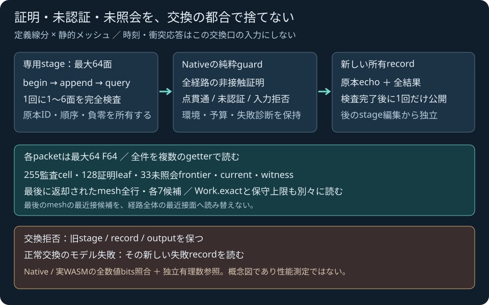

# 定義線分guardの有界C ABI

2026-11-04 JST。Native・実WASM raw wireをローカル/公開受入済み（コード84afb8c）。公開受入済みの純粋Native核は[定義線分guard](SPHERE_TRIANGLE_MESH_TRAJECTORY.md)。この段では同じ核を専用C ABIから呼び、Nativeと実WASMの全wireを比較する。JavaScriptの所有DTOを返す通常APIと手動trajectoryラボは次段であり、利用可能とは案内しない。

## 所有と受理

`pp_sim_sphere_triangle_mesh_trajectory_begin(n)`で0..64面の専用stageを作り、`_append(valueCount)`でID+ABC9を1..6面ずつ渡す。旧single/meshのstageとrecord、Worldとは独立。正しいbegin/appendも既存の結果recordと出力を変更しない。不正chunkの途中だけを追加しない。

`pp_sim_sphere_triangle_mesh_trajectory(24)`の入力はstart3/end3/radius、meshMaxSurfaces、primitive設定6、guard設定5、予約+0×5。予約−0、不正な整数交換、非有限入力はhost拒否。有限のモデル領域違反や整数設定0は元のNative核へ渡す。`PP_SIM_OK`は交換の成功であり、非接触の証明を意味しない。

入力echo・原本source・Native結果をcandidate recordとして所有し、全出力を監査後に公開する。正常交換のモデル失敗は新しい失敗診断を返す。交換拒否は旧stage/record/output/countを保持する。Native snapshotがnullでも、元のechoとsourceは読める。resetは専用stage/recordも消去する。故意の割当失敗を注入した試験の成功を、構造監査だけで主張しない。

## 全結果を64 F64以内のpacketで読む

header32はstatus/reason、source/leaf/frontier/audit数、snapshot/failedIndex/prefix/witness/current/lastMeshの有無と値、partitionLeaves/maximumDepth、Work11、予約+0×2。詳細offsetと宣言は原本[simulation_api.h](../core/include/pikapika/simulation_api.h)を正とする。

| 入口 | 件数と内容 |
|---|---|
| `record(0,0)` | inputEcho24 |
| `record(1,index)` | source14、最大64面、元のID・順序・数値bits |
| `record(2,index)` | audit64、最大255件、末尾3個は+0 |
| `record(3,index)` | certified leaf6、最大128件 |
| `record(4,index)` | 未照会frontier4、最大33件 |
| `record(5,0)` | optional current4 |
| `record(6,0)` | optional witness18 |
| `last_mesh(0,0)` | optional lastMesh header24 |
| `last_mesh(1,index)` | lastMeshの実query row58、最大64行 |
| `candidate(row,index)` | 当該lastMesh rowのcandidate13、最大7件 |

source14末尾のhasRow/hasQuery/isPossibleNearestは**lastMeshだけ**に所属する。最後の照会結果を後続の未照会currentや経路全体の最近接面へ読み替えない。lastMeshAuditIndexは実際の最後の返却callへリンクする。不在getter・末尾超過は旧出力を保持して拒否する。

auditはcell境界/depth、中点parameter、outcome、optional path/point bounds・任意anchor、mesh実行/status/reason、距離・R/E二乗・sqrt包含・証明式7interval、当該cellのdelta Work11を保持する。全体Workとdeltaを混同せず、known countと`exact=false`時の保守上限も分ける。不在payload・予約は+0であり、実原本/interval/KKTの−0を置換しない。

<figure><figcaption>自作の交換モデル概念図。性能測定や一般接触応答の完成を表さない。</figcaption></figure>

## 受入の区分

Nativeの交換/原子性25群と全36CTestが成功。初回テスト側size_t→unsigned警告2件を記録し、型と上限検査を明示して専用再build/25群を再実行し警告を除去した。本番核/APIを試験に合わせて変更していない。固定62入力のモデル交換59・host拒否3が実行で確定し、25全経路非接触・4点貫通・30モデル失敗を保持。host拒否は数学核のモデル実行として数えない。

pure Native DTOと全packetを独立にencodeして71,234数値/2,472負零をbit比較し、19改ざんを拒否した。606audit/297certified leaf・lastMesh120行/815候補、実255audit/128leaf・64面と各末尾を保持。実共通WASMも全同入力/getterを再生し70,278数値bits/2,398負零がNative一致、同じPython packet監査と19改ざんも成功した。数値件数は各runnerの比較対象が異なるため足し合わせない。

独立有理数checkerは元の固定62 pure入力に対して実行する。そのscopeと、受理された交換結果の全DTO bit一致を分けて記録する。Pythonのcheckerへ実WASM packetから復元していない入力を渡して、全ケースをWASM由来と呼ばない。

主WASMを固定Emscripten6.0.13で再buildし、80exports・59source-headerを実測した。WASM674,978B/SHA256 `5f3c633b0f4a209ad07dc8fb3f847d496e0264ecf0ca1eb7667dd38deac0b0e7`、glue56,289B/SHA256 `25dad6ad39c0734d172dd2fee7937a5b33af235a26868dfd2af1954929c72855`。runtime linked members増減0・7通知hash不変。全Node544skip0と旧mesh/single SDK・simulation数値回帰が成功。実localゲームの3撃破/移動boost/停止と20SDK照会全成功・clip1・3resident meshesを確認したが、新guardをゲーム接触へ適用した試験ではない。

新所有JavaScript decoder、UI、World・一般CCD/TOI/接触応答・ゲームmesh接触の統合は未実装。割当fault injection/未知work例外の実行は未検証で、Windows sanitizer成功も主張しない。公開GNUでAPI/test instrument＋通常strict核archiveの25群と、pure guard全依存核の別ASan/UBSan69群が成功した。本体ライセンスは未選定で、有料serviceや新素材は追加しない。

## 公開受入

コード84afb8cのEngine CI41764778386とPages41764778247は全job/step成功。新test/probeを各-Wall/-Wextra/-Wpedantic/-Werrorで独立監査し、既存36warning診断は重複数も含めて前段と一致した。初回7a8300bの46warning/gate停止は別記録に保持し、brace/改行だけの修正後にNative全packet byte同一を確認した。

訂正版50公開ファイル1,710,851Bが当該commit blob一致。公開ゲームの3撃破/boost/停止・21照会全成功/clip1/3常駐と旧メッシュラボ170数値bits/20負零は初回公開7a8300bで実行し、entry/JS/SDK/ゲーム資源11ファイルが訂正版とbyte一致することを明示監査して継承した。訂正版で新たにプレイしたとはしない。全工程/全warningを含む有限ログ（全ログではない）と配信/ブラウザhashは[公開検証JSON](../reports/sphere-triangle-mesh-trajectory-abi-public-verification.json)へ保存。
