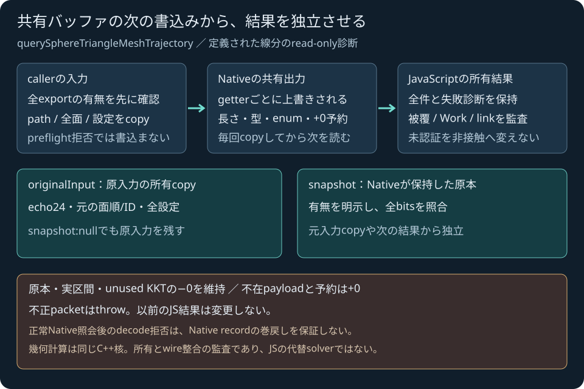

# 定義線分guardの所有JavaScript API

2026-11-04 JST。コード5ff5723をローカル・公開受入済み。[公開受入済みC ABI](SPHERE_TRIANGLE_MESH_TRAJECTORY_ABI.md)と同じ80-export WASMを使い、全診断をJavaScriptの所有DTOへ復元する。C++核・C ABI・SDK artifactを変更せず、旧mesh decoderのgetter参照だけを純粋callbackとして共用する。

## 呼出し

HTTP/HTTPSで配信するES moduleから使う例。幾何計算は共通C++ WASMで行う。

```js
import {loadSimulationRuntime} from './engine/simulation.mjs';
const runtime = await loadSimulationRuntime();
const result = runtime.querySphereTriangleMeshTrajectory(
  {start: [1, 2, 1], end: [2, 2, 1], radius: 0.5},
  [{id: 37, vertices: [[-0, 0, -0], [4, 0, 0], [0, 0, 4]]}],
  {maxEvaluations: 256, maxLeaves: 128}
);
console.log(result.status, result.safePrefix, result.work);
```

単位はm。入力は真の運動方程式や時間ではなく、binary64が定める `p(s)=start+s(end−start), 0<=s<=1`。settingsはNativeと同じnested形で、`mesh:{maxSurfaces,primitive:{maxCandidates,sqrtRefinements,maxTotalSqrtRefinements,maximumLocalWidth,maximumNormalWidth,minimumSineSquared}}` と、guardの `maxEvaluations,maxLeaves,maxDepth,enclosureSqrtRefinements,maxTotalSqrtRefinements`。省略項目は[Native既定値](SPHERE_TRIANGLE_MESH_TRAJECTORY.md)を使う。

## 入力と結果の所有

新6exportsを全て確認してから、面数・各ID・頂点参照を一度ずつ取得し、path/全source/全profileを所有copyする。全入力の交換形を検査してからbegin/append/queryする。NaN/Inf/不正な整数交換/65面以上/安全整数外ID等のhost拒否はNativeへの書込前で、旧Native stage/record/outputも保持される。有限domain違反・空source・整数設定0等はNativeモデルへ渡し、JS幾何による代替分類をしない。

各getterの共有出力は次のcall前にcopyし、長さ・finite/dense値・整数count・0/1flag・enum・予約+0・optional payloadを検査する。全source、最大255audit/128leaf/33frontier、current/witness、最後に返却されたmeshの全行と全candidate prefixを省略しない。旧74-export SDKや欠損exportsは明示拒否し、瞬間mesh照会/JS幾何へfallbackしない。

戻り値はNativeのserialized resultと同じ構造で、status/reason/outcomeと全nested enumを既存SDK同様の文字列へ変換する。さらに `originalInput={start,end,radius,triangles,settings,echo}` を返す。settingsは既定値を補った完全profile、echoは24F64の原値で、無関係なcaller独自propertyを保存する形式ではない。`snapshot` がnullでもoriginalInputを保持し、両者の配列/設定objectは別に所有する。Native整数settingsの−0はsnapshotではuintの+0となるが、originalInputとechoは元bitsを保つ。実原本・区間・unused KKTの−0を消さない。

返却後のcaller入力、exchange scratch、次のcall、古いDTOの編集から独立する。`work.workExact=false` は既知workと保守上限を別に保持し、成功へ昇格しない。各auditのWorkはdelta、全体Workは総計で、予約量を実測使用量へ置き換えない。

<figure><figcaption>自作の所有モデル概念図。物理計算や性能測定の代替ではない。</figcaption></figure>

## 分類と監査の範囲

`separated` は全closed leafの[0,1]被覆、strict正の証明式、exact workを要求する。`penetration_witness` は厳密なpath中点のstrict負の証明を保持する。`not_certified` は予算や品質等で未認証でありmissではない。`invalid_input`、`unsupported_environment`、`numerical_failure` を別に返す。

連続prefix、DFSの分割と未照会frontier/current、Work delta/総計、最後の返却meshとauditのlink、witness・leafと証明式の一致をmetadataとして監査する。距離・法線・R/Eの包含や証明式をJSで再計算する独立solverではない。数学の包含検証は、実WASM由来DTOを独立Fraction参照へ通す別受入で行う。

不正packetは結果を公開せずthrowする。過去に返したJS DTOは変更されない。ただし正常なNative queryのpublish後にdecode拒否した場合、Native recordの巻戻しを保証しない。preflightでの交換拒否とこのdecode拒否を混同しない。

## 受入と後続

専用22件/全Node566件skip0・構文/Web buildと既存SDK回帰が成功。固定62入力のうち実model59件について全serialized DTOの50663数値bits（2144負零）とoriginalInputの3877数値bits（100負零）を照合し、caller変更/次call/古いDTO/共有scratchからの独立を確認した。host3はモデル結果を持たないため、数学checker用の固定62corpusでは実WASM owned DTO59件とpure Native補足3件を明示し、全62件をWASM由来とは呼ばない。そのmixed corpusに独立Fraction参照297leaf/606auditと71改ざん負例/14解析群が成功した。

[実ブラウザーで固定入力を実行する検証ページ](../reports/sphere-triangle-mesh-trajectory-js-browser/index.html)は、この公開methodを実際に呼び、完全な所有DTOと診断を表示する。手動編集ラボは次段であり、このページは固定例の検証器。ローカルの実ブラウザー結果324数値bits/24負零が同じWASMのNode照会と一致した。実ゲームの射撃/ブースト/停止・20照会全成功も確認したが、新guardをゲーム接触へ適用した検証ではない。詳細は[検証記録](../reports/2026-11-04-sphere-triangle-mesh-trajectory-js.md)。

Nativeの故意allocation/internal exception/未知work注入は未検証。人工packetでの`workExact=false`試験はdecoderの保持・拒否の検証であり、C++例外を実注入した証明ではない。UI、World/一般CCD/TOI/接触応答、ゲームへの適用、流体/損傷・専門モデル/IK/高精度撮像は後続。本体ライセンス未選定、新packageや素材は追加しない。

公開追記: [Engine CI41768169352](https://github.com/tatata93/pikapikaengine/actions/runs/41768169352)と[Pages41768168303](https://github.com/tatata93/pikapikaengine/actions/runs/41768168303)の全job/stepが成功。36CTest/Node566skip0、owned59＋補足3の独立参照、API/test sanitizer25群と別pure全核69群を確認し、既存36warning診断のmultiset/出現数を維持。公開56ファイル1798436Bが当該commit blobと一致し、公開固定例324bits/24負零とゲーム3撃破/boostclip1/停止・20照会全成功3常駐を確認した。[公開証拠](../reports/sphere-triangle-mesh-trajectory-js-public-verification.json)へ全工程/有限ログ/全warning/byte/ブラウザーを保存。次の最小段は[手動線分ラボ](SPHERE_TRIANGLE_MESH_TRAJECTORY_LAB_PLAN.md)で、この計画自体をUI実装済みとしない。
