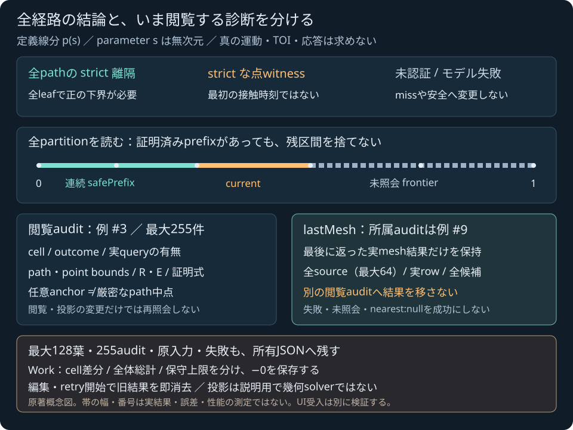

# 定義線分guardの手動ラボ

2026-11-04 JST。**コード656f59dをローカル・公開受入済み**。[計画](SPHERE_TRIANGLE_MESH_TRAJECTORY_LAB_PLAN.md)に沿い、公開受入済みの[所有JavaScript API](SPHERE_TRIANGLE_MESH_TRAJECTORY_JS.md)から、全経路の証明と未処理範囲、面別の実診断を読む。比較例は固定Native corpusから25入力を採用し、runtimeに検証履歴ファイルをfetchして答えとして表示する構成にはしない。下記のローカル検証と、後続の公開CI/Pages・配信・操作の受入を分ける。

新しいentryは `tools/sphere-triangle-mesh-trajectory-lab.html`。[公開ラボを開く](../tools/sphere-triangle-mesh-trajectory-lab.html?v=656f59d)。既存の瞬間meshラボとは別の画面で、同じ80-export C++ WASMを使用する。JSで距離・KKT・R/E・証明式を解き直さず、Worldやゲームの時刻・荷重も進めない。

## 入力は時間ではなく、定義した線分

```text
p(s) = start + s (end − start),  0 <= s <= 1
gap(s) = distance(p(s), 入力した静的三角形集合) − radius
```

start/end/頂点/radiusと距離はm、距離²はm²、parameter sは無次元。右手系、Y up。入力binary64が表す厳密な実数から定義されるpathであり、速度や時間、運動方程式の真解ではない。三角形は薄い静的両面で、閉固体内部・厚み・隣接関係を推定しない。

入力shapeは `start,end,radius,triangles,settings`。triangleは元順のIDと3頂点を持ち、settingsは `mesh:{maxSurfaces,primitive:{...6設定}}` とguardの `maxEvaluations,maxLeaves,maxDepth,enclosureSqrtRefinements,maxTotalSqrtRefinements`。元の設定を自動で増やしたり、位置/半径をclampしたりして成功へ近付けない。品質条件や域は[モデルガイド](SPHERE_TRIANGLE_MESH_TRAJECTORY.md)を継承する。

strict JSONでduplicate key・不正Unicode・非有限や不正な数値を拒否し、−0を保存する。finiteな域外座標やradius0、整数設定0などは、受け入れたモデル自身の結果として区別する。65面例を編集できても、実SDK上限64へ切り詰めない。input形式、loader/SDK、host交換拒否、Nativeモデルの失敗/未認証は別の状態である。

## 結果の三つの読み方

| 実結果 | 意味 |
|---|---|
| `separated` | closedな全leafが[0,1]を覆い、各leafでgap>0がstrictに証明された |
| `penetration_witness` | あるparameterの厳密path点でgap<0がstrictに証明された。全経路や最初の接触時刻を意味しない |
| `not_certified` | 予算・品質・実mesh失敗等で未認証。missでも安全でもない |

`invalid_input` / `unsupported_environment` / `numerical_failure` も別に表示する。0を含む証明式を非接触/貫通へ決めず、端点や有限個の標本点が安全だから全pathも安全、という表示をしない。

`safePrefix` は左から連続して証明された範囲だけを示す。nullはs=0の安全も証明していない。prefixがあってもcurrentや未照会frontierを捨てて全体成功へ昇格しない。閉区間leafが同じ境界で接することと、未被覆の穴があることを区別する。



原著の概念図。帯の長さ・件数・audit番号は説明用で、実画面・実行結果・誤差幅・性能測定ではない。

## 全件と、診断の所属を確認する

1. 比較例とJSONを読み、原入力・全設定を確認して明示照会する。inputを変更したら旧結果を消し、新たな照会前に前の安全表示を残さない。
2. status/reason、snapshotの有無、prefix/witness、partitionLeaves/最大depthと全Workを読む。成功と途中の診断を分ける。
3. certified leaves、全audits、current、frontierを調べる。audit選択は既存の所有結果を閲覧する操作で、再照会ではない。
4. lastMeshの所属auditを確認してから、全sourceと実row・候補を読む。別のauditを選んでも、このmesh結果がそのauditのものへ変わることはない。
5. XY/XZ/YZの投影を切り替え、所有結果をJSONで保存する。閲覧・投影によってモデルDTOのbitsや照会件数は変えない。

| 診断 | 保持する情報 |
|---|---|
| `originalInput` | snapshot:nullでも残る全path/source/settings/echo。Native snapshotとは別所有 |
| `certifiedLeaves` | 最大128葉。closed bounds・strict lower-gap certificate・auditIndexを末尾まで読む |
| `audits` | 最大255件。cell/depth/midpoint/outcome、optional path/point bounds・anchor、実queryの有無とstatus/reason、距離・R/E・二certificate、cell固有のWork |
| `current` / `frontier` | 現在の未認証cellと未照会の最大33cellを別に保持 |
| `witness` | parameter、厳密なpath点のbounds、anchor、誤差上界E、strict負のupper式とauditIndex |
| `lastMesh` | 最後に返った実mesh結果。lastMeshAuditIndex、全64source/実row、各面の最大7候補を保持 |

sourceがあることと実query済みであることは別で、preflight拒否やnull queryをmissへ変換しない。遠い退化面・失敗行・後続正常行を隠さない。lastMeshが失敗ならnearest:nullのまま、正常な一部rowを全経路や集合の成功へ変えない。全mesh結果を各auditへ複製・再計算するUIではない。

面別possible IDsはanchorで最小になり得る候補であり、path全体のwinnerを決めるものではない。異なる面の最近接点・法線・barycentricを平均せず、閲覧面を確定接触面と呼ばない。

## R/Eと図の範囲

各auditのanchor cは任意binary64点で、厳密なp(m)とは限らない。Rはcell全体の `|p(s)−c|`、Eは厳密な中点pathの `|p(m)−c|` の上界である。厳密p(m)を示すものはpointBoundsで、丸めanchorをpathそのものへ昇格しない。

clearanceCertificateは `L−R−radius` という下界式の包含、penetrationCertificateは `U+E−radius` という上界式の包含である。この二つを真のgap全体の上下端pairとして表示しない。返却された二乗上界/root・証明式と数値boundsを、そのまま診断として読む。

2D投影は入力三角形・定義線分、選択auditのpath/point box・anchorを説明する。投影で面が重なったり線へ潰れても、3Dで面が消失/退化したことを意味しない。parameter帯も表示の補助であり、表の全bounds・状態・未照会件数を置き換えない。

極小boxのinkを最小pxへ広げる場合は表示上の処理と明記し、元DTO・保存boundsを変えない。有限の表示縮尺を作れなければ「説明図を表示できない」とし、数値モデルのstatusを変更しない。world/view/clip/GPU算術や画素精度の包含証明を行う図ではない。

## Work・編集・保存

各auditのWorkはそのcellのdelta、全体Workは総計。primitive/enclosure/合計sqrt更新、limited行/call、返却既知workとsqrt保守上限を区別する。`work.workExact=false` のcounterを完全な実作業と呼ばず、事前予約量を実使用量へ変換しない。人工DTOで未知workの表示を検査することと、Nativeへ故意の例外/割当失敗を注入することは別である。

入力/preset/reset/retry開始で旧leaf・witness・lastMesh/候補・図・JSON/保存可能状態を消す。同時loadをまとめ、同期throwや非同期rejectからretry可能にし、古い世代・dispose後の遅延結果で旧表示を復活させない。再読込中に旧runtimeでqueryせず、旧74-export SDKや欠損exportsで幾何fallbackを行わない。

保存はschema1 / kind `sphere-triangle-mesh-trajectory-lab`。完全な正規化 `input`、全owned `result`（originalInput/optional snapshotを含む）、SDK `diagnostics` と、`projection,inspectedAudit,inspectedOrdinal,inspectedSurfaceId` を保持する。閲覧対象不在のindex/IDはnull。実モデルの未認証/失敗/witnessもそのまま保存できる契約とし、未照会・loader/host拒否から架空のmodel packetを作らない。最大255audit/128leaf/64source/実row・全候補を切り詰めず、表示の短縮を保存dataへ持ち込まない。

strict codecの入力予算は64KiB/depth12/12000nodes、出力は8MiB/depth32/1000000nodes。出力byte上限は末尾LFも含める。予算を超えたdataを省略した成功packetへ変えない。通常JSON.stringifyへの無意識な置換で−0を消さない。実Blob downloadと表示JSON・所有packetの全数値bits/−0一致は、このUI段階で別に検証した。

## 検証状態と境界

専用UI/DOM20試験、全Node586件（skip0）、既存Native36CTestが成功した。実ローカルの採用25例はseparated11・penetration_witness1・not_certified10・invalid_input2・host拒否1。失敗や未認証を成功へ読み替えず、host拒否をモデル実行へ数えない。

実ブラウザの全25例に追加7結果packetと2実Blob downloadを含め、100742数値bits/3896負零を照合した。原著概念図も実ブラウザで全文字と配置を目視した。このローカル受入と、公開CI/Pages・配信byte・公開ブラウザ操作の未確認状態を分ける。先行SDKの成功を、このUIの公開成功へ流用しない。人工例外packetとNative例外注入、59モデル由来とhost補足の混合数学corpusのscopeも維持する。

新依存・外部素材は追加せず、C++核・C ABI・SDK artifact・ゲーム原本を変更しないUI段階である。本体ライセンス未選定。World/一般CCD/TOI/接触応答やゲーム適用、流体/損傷・専門モデル/IK/制御/高精度撮像の完成をこのラボへ含めない。

公開追記: Engine CI41770992200/Pages41770991665全job/step成功。36CTest/Node586skip0、独立mixed62参照/71負例、API/test sanitizer25群とpure guard全核別69群が成功し、既存36warning診断のmultiset/出現数一致。64配信ファイル1925537Bが656f59d blob一致。実公開25例＋追加7packet・2実Blobも100742bits3896負零まで直接SDK/表示と一致。公開ゲーム3撃破/boostclip1/停止、21照会全完了・失敗0・3mesh常駐。原試験記録13ファイルはprivate ACLにより最初Gitから読めず、77e03caでbyte/hash不変の通常権限archiveへ複製し、全13blob hash一致を確認。public-verification.jsonに全工程/有限ログ/全warning/配信/操作とscopeを保存。次は[entry windowのNative設計](SPHERE_TRIANGLE_MESH_ENTRY_PLAN.md)。未実装の設計をTOIや応答の完成扱いにしない。
