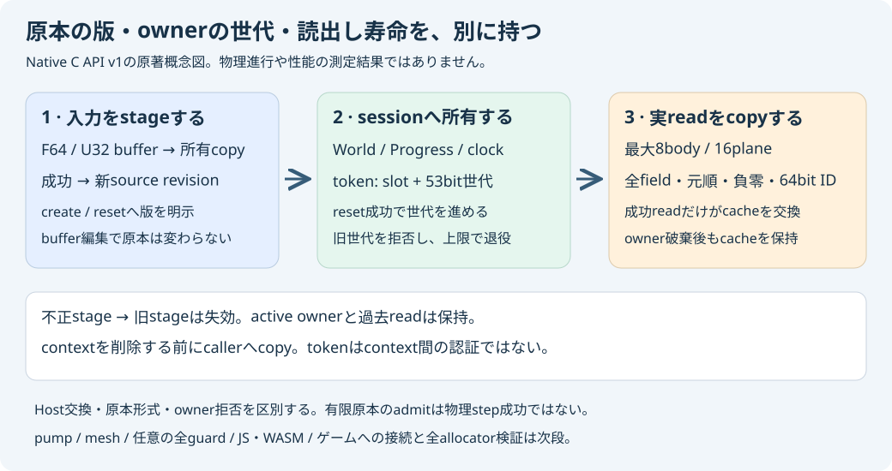

# Native plain-source session C API v1

`core/include/pikapika/world_static_mesh_session_api.h`をC/C++から使う独立ライブラリ。
旧`pp_sim_handle`とは別のcontextで、最大4session、8body／16planeを所有する。
原本の形式は[plain-source v1](WORLD_STATIC_MESH_SESSION_SDK_PLAN.md)と同じ。
contact margin以外のguard項目はNative既定値で、mesh／任意の全guard／pump／Report getterは未実装。
既存WASMのexportや数値bindingを変更していない。



## 使い方

```c
#include "pikapika/world_static_mesh_session_api.h"
int example(void) {
    pp_ws_context* c=pp_ws_context_create(UINT32_MAX,0x1fffff);
    double* f; uint32_t* w; pp_ws_result staged,made,read;
    if(!c) {return 1;}
    f=pp_ws_input_f64(c); w=pp_ws_input_u32(c);
    f[0]=0; f[1]=-9.81; f[2]=0; /* gravity */
    f[3]=0; f[4]=0; f[5]=1.0/120.0; /* time, margin, step */
    w[0]=0; w[1]=0; w[2]=4; w[3]=0; w[4]=0; /* empty World */
    staged=pp_ws_stage(c,6,5);
    if(staged.host!=PP_WS_OK) {pp_ws_context_delete(c);return 2;}
    made=pp_ws_create(c,staged.revision[0],staged.revision[1]);
    if(made.host!=PP_WS_OK) {pp_ws_context_delete(c);return 3;}
    read=pp_ws_read(c,made.token[0],made.token[1],made.token[2]);
    if(read.host!=PP_WS_OK) {pp_ws_context_delete(c);return 4;}
    /* Copy pp_ws_snapshot_f64/u32 using snapshot_info_get counts here. */
    pp_ws_context_delete(c);return 0;
}
```

通常のCMake targetは`pikapika_world_static_mesh_session_api`。静的ライブラリの依存は
source decoder／owner／controlled scheduler／controlled tick／clock scheduler／coreへ続く。
既存coreから新APIへの逆依存は作らず、旧SDKのexportを増やしていない。

## revisionと世代

入力bufferは512 F64／256 U32の固定capacity。active長はplain-source v1の完全一致が必要で、
最大は310 F64／61 U32。capacity内なら任意の長さが合法になるわけではない。
stageは入力を所有copyし、成功時にfull64 revisionをlow32／high32で返す。
create／resetにはそのrevisionを明示する。別stage成功後の古いrevisionは拒否する。
busy以外のstage試行は、count超過や原本拒否を含めて直前のstageを破棄する。
その後に古いrevisionを渡しても旧原本を暗黙に使わず、active sessionは変更しない。
revisionがUINT64_MAXに達した後は再stageを拒否し、wrapしない。実際の全域反復は未試験。

owner tokenは[slot, generation low32, high21]で、世代1..2^53−1。
context作成時の世代上限を1..最大世代から明示でき、上限に達したslotは退役する。
reset成功時は世代を進め、古いtokenを拒否する。stage revisionとowner世代は別の整数。
同じcontext内の取り違えを検査するtagで、別contextに同じslot・世代が存在し得る。
tokenやrevisionをcontext間の認証・globalな識別子とは扱わない。

## 診断と所有

`result.host`、`owner`、`source`、`token_status`を区別する。呼んでいない下位APIは
UINT32_MAX。sourceのpart/indexは原本診断で、indexなしはUINT32_MAX。
不正clockなどの有限原本はstageできる場合があるが、実ownerのcreate/resetが別に拒否する。
data admissionの成功を物理stepの成功に読み替えない。C側status値とNative enumの対応は
全項目のstatic_assertで固定する。

readは実Registry::readの所有Snapshotから全plain-source fieldを固定配列へ写す。
sourceと同じF64/U32 layoutでbody／plane順、負零、full64 body ID／tickを保持し、
backlog・sequence・読出し時tokenはsnapshot_infoへ返す。このAPIにpumpはないため、
公開操作でbacklog／sequenceを進める経路はない。
成功readだけがcacheを交換し、失敗read、stage、create、reset、destroyでは交換しない。
したがってownerのreset／destroy後も前回cacheを読める。
context削除でviewは無効になる。削除後にも必要な値はcallerが先にcopyする。
このcacheは全guard設定や全scheduler Reportを交換する形式ではない。

contextと入力bufferへのアクセスはcallerが単一threadで排他する。有効でないpointer、
削除済みcontext、二重deleteや操作中deleteは契約外。NULLの明示gateはあるが、
任意pointerの生存やthread競合を検査する仕組みではない。
操作のbusy gateは再入を拒否する設計で、このC APIのallocator再入／故障全経路は未検証。
旧Native ownerの実allocator試験を新C APIの受入へ流用しない。

## 検証範囲

fresh wfoc1の実MSVC19.51 Release／DebugでC translation unitとC++ callerを別々にcompileし、
実依存6libraryへlinkした。stage後のbuffer編集、count／nonfinite失敗後の旧stage失効、
原本拒否とowner設定拒否、旧世代、reset／destroy後のcache、context削除後のcaller copy、
4slot／full／世代上限2での退役と別slot再利用、実FE_UPWARD拒否を検査した。
9ケースで独立Python入力構成と全1,254 F64 bit値／142負零／全U32を照合し、
Release／Debugの全文rawが一致、実-O実行を拒否した。
通常mainへの追加・最新sourceの検証記録は受入receiptを参照する。

全allocator経路、context間認証、一般平面の丸め境界、全clock／commit機械証明、
WASM／JavaScript／ゲーム接続、一般衝突応答・流体・材料損傷の完成は含まない。


## 実GNUと限定Native故障の続報

2026-11-05 C APIの実GNU13.3 C/C++をsource57d8bd8/job127285493025で有限受入。15command、全46production+2harness（C1）の通常/真Debug/明示C+C++ O1 ASan-UBSanで各9/1254bit/142負零と全U32/rawが正規化なし一致、実-O/source/normal/parent/compiler不変も成功。decoded137908B/実JSON保存、child raw/objectはrunner-local。全6Engine/Pages成功・manifest2018件61150288BのGit照合も確認。別のNative Release故障試験はcontext1+stage14/create3/reset3/read2の実bad_alloc23地点と4outer×5再入20、初期捕捉/全過去cache/active owner/世代/復帰/非確保getterを確認。fresh wfocam1 mainでも2CTest・旧20profile・旧9/1254bit/全故障raw一致が成功。登録Release56/Debug54、Debugは一覧だけ・旧54全再実行ではない。最初のMSVC NDEBUG表記parser失敗を保持し、fresh wfoca2で補正。新故障testのGNUは別1command driverと14コピー拒否/実Windows拒否0commandまでで未実行。全allocator/OS OOM/aligned/CRT/thread/post-pump faultやpump/mesh/full guard/JS/WASM/ゲームの完成ではない。
[実GNU受入](../reports/world-static-mesh-session-c-api-gnu-verification.json)と[Native故障受入](../reports/world-static-mesh-session-c-api-allocation-verification.json)は別の実行。通常故障実行ファイルへASanを混ぜたとは扱わない。
