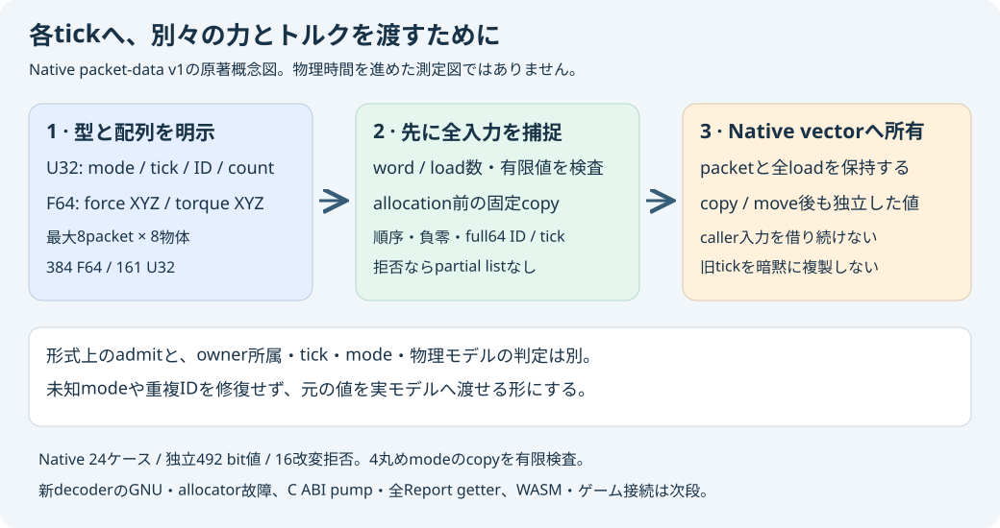

# 所有tick荷重packet wire v1

2026-11-06。[Native header](../core/include/pikapika/world_static_mesh_session_packet_wire.hpp)／
[実装](../core/src/world_static_mesh_session_packet_wire.cpp)。独立したC++データdecoderで、
C ABIのpump、数値モデルの実行、WASM／ゲーム接続は後続。
既存のTickLoadPacketそのものを所有値として作る。新しい数値runtime profileは追加しない。

## 形式

U32は先頭にpacket数。各packetはmode、expected_tick low32／high32、load数の4word、
続いて各loadのbody ID low32／high32を置く。F64は同じpacket／load順でforceXYZ、torqueXYZ。
最大8packet×8loadで384 F64／161 U32。これはactive payloadの値数で、全heap／allocatorの
byte上限ではない。未使用領域は入力と解釈しない。

forceはN、torqueはN m、いずれも既存のworld荷重。mode 0は総荷重の置換を表し、加算ではない。
body.force／torqueを世界座標で置き換え、World.gravityは別に保持する。
既存伝播の加速度はgravity＋force/mなので、重力をpacketへ重複加算しない。
decoderはraw modeのuint32全域、ID／expected_tickのuint64全域、配列順、有限F64のbitを保持する。
未知mode、ID 0／重複ID、古いtickやstatic bodyの非零荷重を修復しない。
それらを使って進められるかは実owner／数値モデルの判定であり、data admissionと区別する。

拒否順はU32全体のhard長→packet数→各header／load数／ID長→U32 exact長→F64 exact長→有限値。
nonfiniteはpacket／row／componentを返す。成功までpartial packet listを返さない。
すべての有効な入力wordとF64を、最初のpacket allocation前に固定配列へ捕捉する。
callerのspanは初期copyが終わるまで有効・不変であることが前提。

返却値はvector<TickLoadPacket>と各packetのvector<BodyLoad>を所有する。
元入力へのspanを保存せず、copy／move後に旧結果やcaller入力を破棄しても値を保持する。
公開vectorをcallerが変更した後は、その変更後の値を実モデルが再検査する。
成功packetを次tickへ暗黙複製する機能や、session内の永続入力queueは作らない。

## 検証

fresh wfopk2の実MSVC Release／Debug、続くfresh main wfopkm1で、両構成の新CTestを実行した。
24ケース＝11admit／13refuse、27packet／82load／492個のF64 bit表現／164負零を独立参照へ照合。
full64 ID／tick、full32 raw mode、同時8×8、有限値の正負最大・最小subnormalを含む。
nearest／upward／downward／toward-zeroを実際に設定し、decoder前後の丸めmodeと返却bitを確認した。
decoderは算術伝播をせず、この試験を全FPU状態・trap・FTZ／DAZや物理kernelの認証へ広げない。

独立checkerは入力corpusを名称・順序に依存しないfingerprintで固定した。
16コピー改変を拒否し、rename／reverseを受理、実-O subprocessを拒否した。
初期producer001は有限極値を追加する前の履歴。最初の参照保存先作成失敗は検証前のsetup失敗で、
修正後のunpin原本とpin済み受入を分ける。

main登録はRelease57／Debug55。旧20構成原本は全文一致。実行は新testだけで、旧56全再実行ではない。
このtargetは既存core／model libraryをbuild／linkせず、数値stepを実行していない。
新packet decoderのGNU／ASan、allocator故障、C ABI pumpと全Report getterは次段。
先行C APIの実GNU／故障試験へ、この新decoderの受入を混ぜない。

## 実GNUの続報

2026-11-06 source b01610bの実GNU13.3 packetを有限受入。owner job127340156639/465秒、親21/22/15/1に続く新11command成功。1production+1harnessの通常/真Debug/O1 ASan-UBSanで各24ケース/492個F64 bit表現/164負零・full64・rawmode・4実丸めmode・copy/move寿命が全文raw一致。数値coreをlinkせず、normal/parent全object/library/compiler/sourceは不変。decoded156356Bと実final JSONを保存、child raw/objectはrunner-local。range-loop Werror失敗455ea31と修正wfopkw1は別原本。新packet allocator故障、C ABI pump/全Report取得/WASM/ゲームの受入ではない。
[正式GNU記録](../reports/world-static-mesh-session-packet-wire-gnu-verification.json)。上記GNU未受入は先行段階の履歴。
