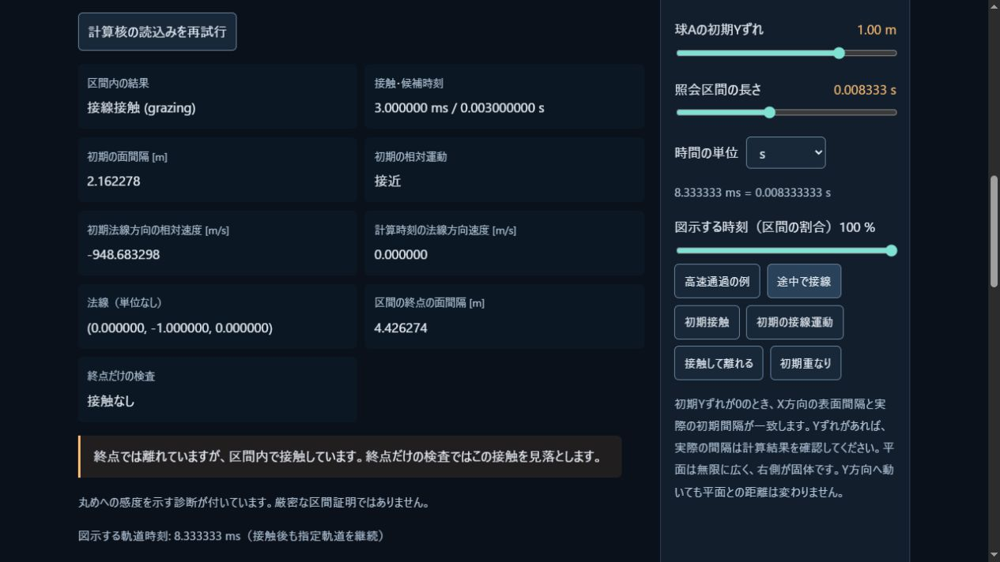
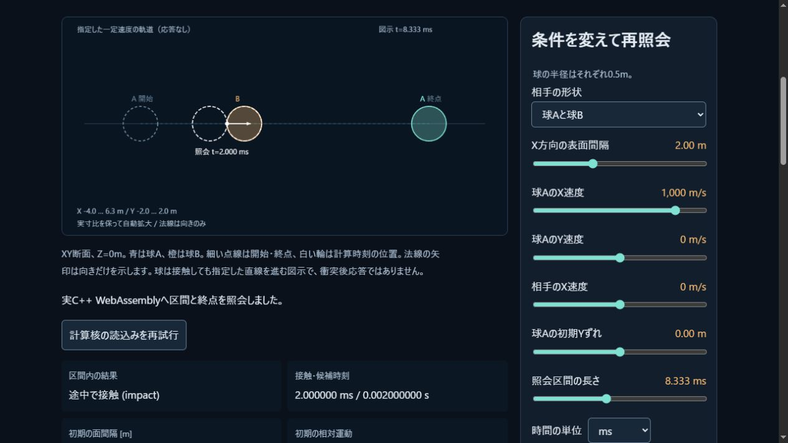

# 一定速度の接触時刻を共通C++から照会する

2026-11-03 JST。前コードe06cd50を基点とする未コミット作業で検証。
Win10.0.19045 / i5-6500 / GTX1060 6GB / RAM15.94GiB、Node24.14.1、MSVC19.51。
原本・配布物のSHA256は[manifest](../assets/pikapika-simulation.build.json)で識別する。

## 今回使えるもの

自作[線形TOI核](../docs/CONTINUOUS.md)は、一定速度の2球と球/並進平面について、
秒単位の区間内の最初の接触を照会する。初期重複、初期接触、将来の衝突、接線、
無接触、不確かな境界、接近/離反、法線の有効性を区別する。
既存の静的球sweepとの違いは、両物体の速度、移動平面、明示した分類と診断である。
既存Worldの積分・接触応答や従来650B WASMの原本は変更していない。

2個のstateless関数を[C ABI v1](../docs/SIMULATION_ABI.md)へ追加し、
`runtime.querySphereSphere(a,b,horizonSeconds)` / `querySpherePlane(sphere,plane,horizonSeconds)`
から実C++を呼ぶ。入力15値、出力13値。失敗は診断付きで直前の出力とWorld状態を保つ。
公式Emscripten6.0.13で再生成し、WASM184090B/glue38078B、29 exports。
追加の完成済み物理/数学ライブラリは導入していない。C/C++標準ランタイムの
[通知](../third_party/emscripten-6.0.13/NOTICE.md)とリンクmember一覧を再生成した。

[接触時刻ラボ](../tools/contact-lab.html)は区間と終点の両方を実WASMへ照会する。
CanvasはZ=0の3Dクエリ断面を同じ距離尺度で図示し、指定軌道上の時刻をsliderで確認できる。
任意のJSによる代替TOIは使わない。初期値では中心距離3m、半径各0.5m、片方1000m/s。
2msで接触するが、1/120秒の終点は表面間隔約4.333333mで離れている。
図は応答のない直線軌道で、衝突後の跳ね返りや時間積分を示していない。

## 自動検証

- Release CMake/CTest5/5成功。core15 + dynamics16 + hydrostatics20 + ABI18 + continuous17 = 86群。
- 線形核17群/132解析比較。[生出力](continuous-native-tests.txt)。
  最大時刻絶対誤差5.4569682106375694e-12秒、最大単位法線誤差1.5700924586837752e-16、
  接触表面の最大相対残差3.219646771412954e-15。試験集合の値であり入力全域の保証ではない。
- [ABI18群](continuous-api-tests.txt)では、秒とflagの写像、不正count/半径の出力保持、
  無接触の明示、移動平面とWorld非変更を追加確認。
- Node全89試験成功、skip0。新規の実WASM5件と操作ラボ7件を含む。
  3D斜め接触、Galilean/入替不変性、移動平面、接線/uncertain、寿命、拒否後復帰、
  単位切替、初期接触/離反、実API再照会、初期化失敗からのretryを検証した。
- [TOI Native fixture12例](continuous-native-fixtures.json)と、既存剛体・静水圧の全軌跡を
  同じWASMで再計算。[30336値の比較](continuous-parity.json)は最大絶対差
  6.821210263296962e-12、abs1e-8+relative1e-10内。TOI分類/flagは完全一致を要求。
  これは共通コードの処理系比較であり、独立解析例の検証と区別する。
- CIはNative CLIをビルドした後にJSを実行する順へ変更し、保存/編集/音声CLIの3試験を
  Windows限定でskipする条件を外した。Linux側の実行結果は公開CIで別途確認する。

再実行:

```
./scripts/build-native.ps1
node scripts/build-simulation.mjs
npm run build
npm run check
npm test
node scripts/verify-simulation.mjs build/native/Release/pikapika-simulation-probe.exe
```

## 実ブラウザ

IABでbuild4b3f16a6b62c3d42を起動し、高速球2ms、接線3ms、ms/s切替、
移動平面2ms→相手速度500m/sで4ms、同心球の不定法線、離反する初期接触、
再試行ボタンでの再照会を確認。
[画面の入力・結果JSON](contact-browser-cases.json)はDOMへ表示した小さな実出力を保存したもので、
Nativeのfixtureをブラウザ結果に置き換えたものではない。
その後、初期接触/重なりを途中の衝突と分ける説明を改善し、追加操作試験が成功。
最終buildは178d4cd2a8d0d543。数値核は同一である。




このラボは再照会時だけ描画する操作図で、ゲームのフレーム性能試験ではない。
GPU時間・実提示・戦闘/音声を測定しておらず、60fps達成の証拠にしない。

## 残る範囲と次の統合

加速度、回転する非球形、衝突後応答、イベントの順序、静止支持、残時間の積分、
一般メッシュ/変形体のCCDは未実装。既存Worldは離散接触のままである。
特に、各呼出しで荷重を消費する現在のWorld::stepを、線形TOIごとに繰り返すだけでは、
重力/外力と持続接触を正しく扱えない。
次は荷重snapshot、時刻固定のcontact solveと区間伝播の分離、加速軌道の保守的照会、
複数イベントと原状保持を実装・検証する。CFD・材料損傷・高精度レンズ光学も未完のまま保持する。

既存Worldの荷重・角運動量・接触ソルバーを調べた[統合計画](../docs/CONTINUOUS_WORLD_PLAN.md)に、
二次/四次軌道の求根、内部分離、複数衝撃、持続接触、状態依存荷重への到達順と
独立受入例を残す。計画であり、これらを今回の実装実績に数えない。

## 公開後の確認

コード[1ebcfc5](https://github.com/tatata93/pikapikaengine/commit/1ebcfc5652191b92efc1632cff5a61d3c3d3fa5b)をpush。
[公開CI](https://github.com/tatata93/pikapikaengine/actions/runs/41564079162)と
[Pages配信](https://github.com/tatata93/pikapikaengine/actions/runs/41564078339)が成功した。
GNU13.3.0/Node22.23.4でCTest5/5、JS89/89成功、skip0。
従来省略していたNative CLI3試験も実行成功。30336値のNative/WASM比較は、この実行では最大絶対差0。
[CI結果の記録](continuous-public-ci.json)。すべての処理系でのビット一致を保証する値ではない。

[公開ラボ](https://tatata93.github.io/pikapikaengine/tools/contact-lab.html?v=1ebcfc5)をIABで操作し、
WASM184090B/build178d4cd2a8d0d543の起動、高速球2ms・終点の分離、接線3msと秒切替、
移動平面4msを確認。[公開画面の実JSON](contact-public-cases.json)と画像を保存した。


