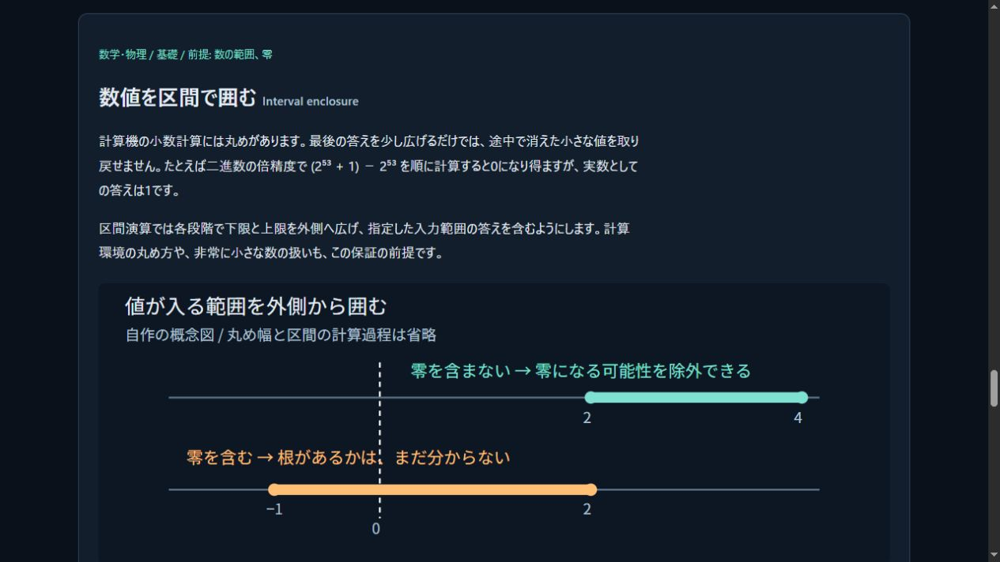
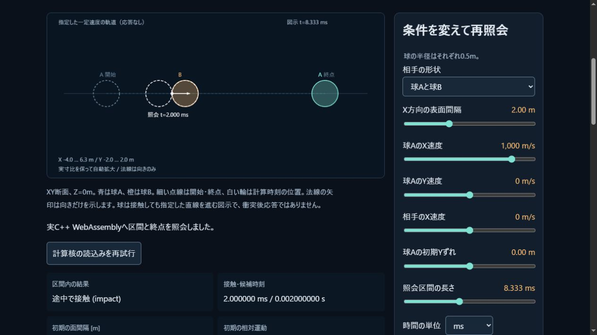

# 接触計算の区間演算と内部分離

2026-11-03 JST。公開済みの一定速度TOI核の次段階として、加速軌道の安全な照会と
接触時刻での応答に必要な基盤を追加した。一般Worldの連続衝突は、まだ実装していない。

## 荷重を保持する区間と時刻固定の接触

`core/src/dynamics_internal.hpp` に候補状態専用の自由伝播と接触solveを分離した。
自由伝播はheld force/torqueを消費せず、接触solveは時間を進めない。
公開 `World::step` は従来と同じ順番で候補を検査し、成功した外側tickで荷重を消費・commitする。
位置投影を無効にした時刻固定接触では、速度/角運動量のみが変わる。

直接10検証群で、一定荷重下の2区間の解析解、摩擦/反発の解析例、予算超過や回転例外後の
原本/荷重保持と再利用を確認。[直接ログ](dynamics-internal-tests.txt)。

変更前コード1ebcfc5と変更後を同じMSVC19.51.36247のRelease相当flagsで実行した
8ケース・412時刻・884 body状態・27,224値のJSONは273,422Bすべて一致した。
[保存した変更前fixture](dynamics-internal-baseline.json)と
[原始の検証メタデータ](dynamics-internal-refactor.json)を残す。
元のJSONと変更後のSHA256はともに
`02c300d2da56388e09cfc0955aaf9b97dd7d83bab91ed7fe0a8f63ceeeccc08d`。
既存simulation-probeの全JSONも変更前後で一致した。
これは同じコンパイラ設定での互換性確認であり、接触モデルの物理的正しさや
他処理系との普遍的なbit一致の証明ではない。
バイト一致を確認したbaseline JSONとoracle CSVは、測定時のCRLFも含めて保持する。
`.gitattributes` にこの2原本の改行変換を抑止する指定を置く。実行スクリプトはLFへ統一する。
[統合したRelease実行ファイルとの比較](dynamics-integrated-comparison.json)でも同じfixtureのバイト一致を確認した。
再現手順・内部APIの前提は[統合計画R0](../docs/CONTINUOUS_WORLD_PLAN.md#実施r0-ccdの前提となる内部分離)。

## 外側から囲む計算

独自C++の区間型、四則、平方、交差/hull、符号分類、多項式のHorner包含を追加。
各演算段階で外向きに広げ、overflow、subnormal、無限境界、零を含む除算を明示して扱う。
IEEE binary64、nearest-even、段階的underflow等が前提であり、不適合環境を拒否する。
モデルと保証範囲は[INTERVAL.md](../docs/INTERVAL.md)。

独立検証は入力/出力のIEEE bitをPythonの整数とFractionへ復号し、四隅の有理演算と
平方の零極値から求めた真の範囲が含まれるかを調べる。参照側ではdouble演算を行わない。
`scripts/verify-interval.py` は6,829区間を要求し、欠落やPythonのassert無効化を拒否する。
この有限corpusの成功は、全入力やコンパイラの形式証明の代わりではない。

最終ソースのNative18群と、同じソースから作った独立の実WASM17群が成功した
（MXCSR固有の1群はWASMの対象外）。双方の6,829区間について包含を検証し、
13,658端点のbitも一致した。[CSV原本](interval-oracle.csv)、
[Nativeログ](interval-native-tests.txt)、[WASMログ](interval-wasm-tests.txt)。
[原本hashと環境の記録](interval-verification.json)。意図的に包含を壊した入力を独立checkerが拒否し、Pythonの最適化でassertを無効にした実行も拒否することを確認した。
既存SDK以外の区間ライブラリ/パッケージ導入はなく、standalone WASM177151Bは
再現用のignored build配下だけに保持する。主simulation ABIの29関数に区間演算を追加していない。

統合ReleaseはCTest7/7、計114検証群が成功。主simulationを公式SDK6.0.13で
WASM184044B/glue38078Bへ再生成し、Nativeと30,336値を比較して成功した。
[比較ログ](interval-simulation-parity.json)の最大絶対差は6.821210263296962e−12。
Nodeの既存89試験も成功し、skip0。Web buildは9057db191e652b4a。
これらは今回の環境での観測であり、普遍的なbit一致や性能目標の達成を意味しない。

教材に[区間演算の説明](../docs/learn/index.html#interval)と自作SVGを追加し、IABで
本文と図の表示を確認した。零を含まない区間による除外と、零を含むだけでは根の存在を
証明できないことを分けて説明する。

## 次の受入

重力や物体ごとのheld forceによる二次軌道を区間として構成し、平面への二次式・球同士の
四次式の最初の接触を、根の存在確認と予算付き分割で調べる。接線や不確定な境界で
無根/衝突を捏造せず、残時間を消さずに外側tickの原状保持へ接続する。
持続接触、一般形状、状態依存の流体荷重は別の受入項目として残る。
任意選択の厳密レンズ光学も[要件](../docs/OPTICS_SCOPE.md)に保持し、未実装を完了扱いにしない。

## 公開後の確認

コード[41b7564](https://github.com/tatata93/pikapikaengine/commit/41b7564eec345d5674f85abe2b53e48c00a7f1e9)の
[Linux CI](https://github.com/tatata93/pikapikaengine/actions/runs/41566711320)が成功した。
GNU13.3.0/Node22.23.4でCTest7/7、正確有理数による6,829区間の包含、Node89/89・skip0。
この実行でのNative/WASM30336値の最大絶対差は0だった。生ログの該当行を
[公開CI記録](interval-public-ci.json)に保存した。

後続の証拠保存の修正a17e11aでは、Gitに実測原本の改行をそのまま保持させ、
コミット済みのbaseline JSON/CSV/原本すべてについて記録hashとの一致を再確認した。
数値コード/主WASMは41b7564から変更していない。
[Pages配信](https://github.com/tatata93/pikapikaengine/actions/runs/41567003884)も成功。

[公開ラボ](https://tatata93.github.io/pikapikaengine/tools/contact-lab.html?v=a17e11a)をIABで起動し、
184044B/build9057db191e652b4aのWASMが2msを返すことを確認。
[公開画面の入力/結果](interval-contact-public.json)を保存した。

