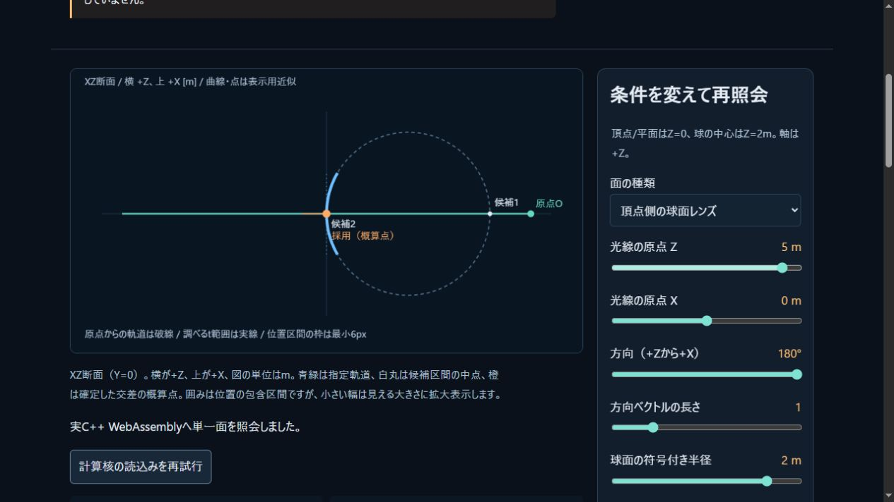
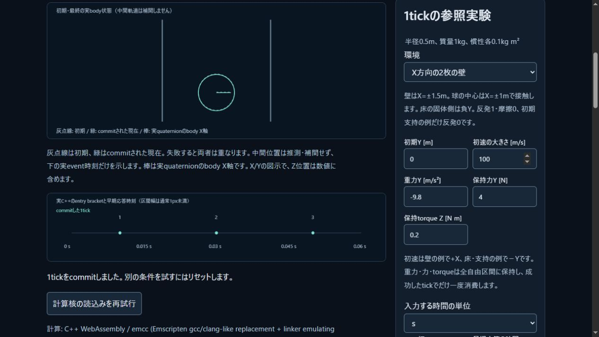

# レンズ面・偏光・保持荷重World CCDの共有実装

2026-11-03 JST。[検証値・原本hash](lens-world-verification.json)。
単一界面/加速照会の公開版180c68eに続き、三つの独自C++核を主WASMへ接続した。
これは多面レンズの画像生成や、支持を含む全物理モデルの完成ではない。

## レンズ面の幾何

[幾何契約](../docs/OPTICAL_GEOMETRY.md)は円形平面・球全体・頂点指定の球面cap。
原入力から軸の数学的な正規化/中心構成も区間へ含め、近い候補から開口/半球/t域を選別する。
先行候補が未確定なら後の候補を勝手に採用しない。根、位置、実距離、両法線の包含を保持し、
表示用の概算点とは区別する。暗黙のepsilonで原点をずらさない。

Native/standalone実WASM各16群、[原本200行](optical-geometry-oracle.csv)の330根を
独立Fractionで確認。平方根のlibmを独立参照にせず、二次式の符号/頂点で包含を検査した。
主WASM ABIにも同じ原入力を渡し、分類/候補と2400端点bitが一致。
[主ABIの記録](optical-geometry-abi-certificates.json)、[Nativeログ](optical-geometry-native-tests.txt)。
checkerのcorpus欠落/Python -O拒否も実行確認した。

## 基底と位相を運ぶ偏光

[偏光契約](../docs/POLARIZATION.md)はStokes/coherencyと右手系の横軸、複素反射係数を保持。
毎回の無偏光平均へ戻さず、次の面へ進む前に基底を変換できる。伝送係数はパワー正規化で、
電場係数や放射輝度の倍率とは区別する。全反射は相対位相を保ち、伝搬透過枝を作らない。
波の時間規約とVの符号を明記した。別光路の共通位相や相関は保持せず、干渉を再現したとはしない。

Native/standalone実WASM各17群、420界面flux・41接線E/H境界・100直接電場比較が成功。
最大観測差は各4.4408920985006262e−16。
[Native](polarization-native-tests.txt) / [WASM](polarization-wasm-tests.txt)のログ。
垂直4%、Brewster二面の同面/直交面、全反射`U=53/75,V=16sqrt(11)/75`等を独立解析値と照合した。

レビューで`I=2^300,a=b=2^-600`の表現可能な出力`2^-900`を、途中の二乗underflowで0にする
問題を発見した。仮数/指数を分け、coherency積の最後で丸める方式へ修正した。
不均一振幅の純p、最小subnormalのidentity、複素積も回帰に追加。
等媒質45度で入力横軸が反射方向と重なる退化も修正し、物理偏光を基底変換で確認した。
指数範囲を拡張した通常double計算であり、仮数の任意精度や一様誤差保証ではない。

## Worldの衝撃応答と残時間

[W1契約](../docs/CONTINUOUS_WORLD.md)は球proxy/静的平面、tick中一定の外力と世界torque。
元半径の入口と、実数F/m+gから再構成した負witnessを確認する。自由区間では伝播丸めを
含む膨張半径で全区間の分離を証明する。膨張が接線を偽の衝撃にしないよう用途を分けた。
時間/空間guardの範囲で少し早く応答し、全bodyを進めて残時間を再照会する。
tick全体が成功したときだけcommitし、荷重を一度消費する。失敗候補のeventは履歴として扱わない。

Native21群が成功。[ログ](continuous-world-native-tests.txt)、[完全入力fixture](continuous-world-native-fixtures.json)、
[独立buildのprovenance](continuous-world-native-provenance.json)。provenanceの文書hashは
後続統合の追記前の原本を示す。旧stepの8fixture/273422Bは変更前後でバイト一致し、
SHA256は`02c300d2da56388e09cfc0955aaf9b97dd7d83bab91ed7fe0a8f63ceeeccc08d`を維持した。

非零重力/異なるF/mの球対、四次の曲がる軌道、10000m/s床衝突、同tick3壁反射、
3body連鎖、同時batch、摩擦と角力積、保持torque、各予算/支持/不確定のrollbackを検査。
完全入力から主WASMのWorldを作り直した[41値比較](continuous-world-parity.json)はMSVC比較で最大差0。
独立corridor最終X=0に対する誤差は空間guard 1e−4/1e−6/1e−8mで
2.0752056713146949e−5 / 4.818372644210811e−7 / 5.0896972192404633e−9mへ減少した。
この集合の観測であり、任意多点系の厳密保存・長時間安定支持の証明ではない。

## 共有出力と回帰

公式Emscripten6.0.13、主WASM288519B/glue40451B、v1へ4関数を追加して36exports。
interval/accelerated/optics/continuous_world/optical_geometry/polarizationの6sourceは
fast-math/contractを禁止した別object。従来dynamicsの方針は維持した。
生成前後の原本hash検査と、source/artifact/license hashをmanifestへ記録。
外部physics/光学ライブラリ・材質値・処方・画像・SDK本体は配布物へ追加していない。

Native統合CTest12/12・計212群、Node144/144・skip0、build/checkが成功。
既存30697値比較も継続成功（Windows最大絶対差6.821210263296962e−12）。
既存単一界面1029例/4116端点bit一致は[new WASMの記録](lens-world-optics-abi-certificates.json)。
ABI上のinvalidは先行outputを保持する。Worldのvalidなモデル失敗はsuccess=falseの診断データを返し、
World/荷重/時計/tickを保持する。詳細配列は[SIMULATION_ABI.md](../docs/SIMULATION_ABI.md)。
Web build873219b2bdcf8530、図解用語13項目。性能目標の達成とは扱わない。

## 実ブラウザ

IABで[レンズ面ラボ](../tools/lens-surface-lab.html)の正面/背面cap/球全体、方向長さ2でのt/距離換算、
接線・開口端・原点自己交差の未確定、明示cutoff後の遠根を確認。[8ケース](lens-surface-local-cases.json)。

[Worldラボ](../tools/continuous-world-lab.html)で3反射、保持力/torqueの成功時消費、
batch予算1による全rollback、同じWorldの予算32再試行、s/ms、高速床、初期支持未対応を確認。
[6ケース](continuous-world-local-cases.json)。288519B/build873219b2bdcf8530の実WASMを使用。

## 次の受入

物理はW2の静止支持/摩擦/接触中荷重配分、一般形状、流体結合、材料損傷が残る。
光学は交点/法線の不確かさを引き継ぐ複数面の光路、分散、有限開口サンプルの収束、
反射光路と収差・ゴースト・フレアの描画が残る。現在の独立核の成功で完了に置き換えない。
