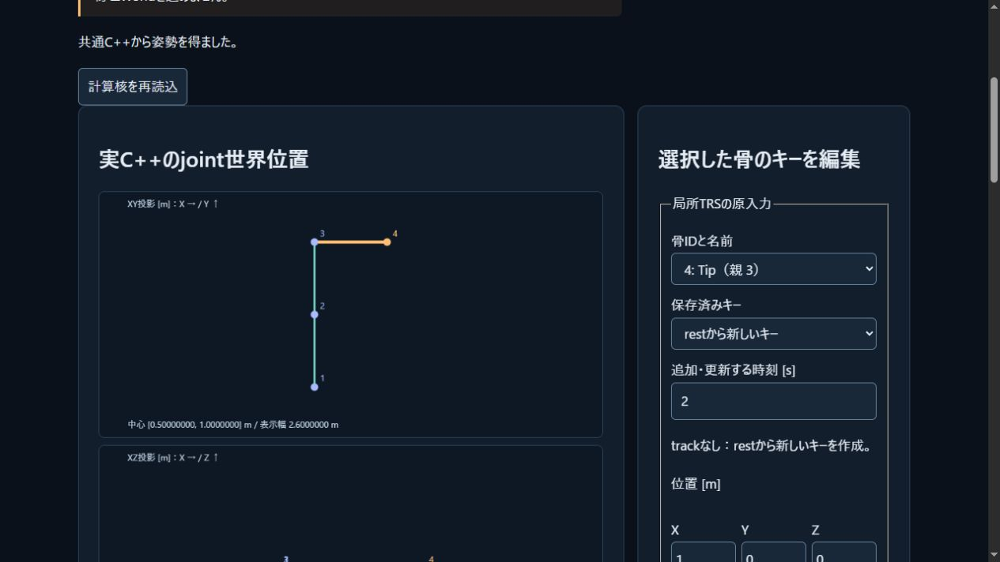

# M2制作B: 骨格キー・共通FK・Native/Web原本往復

2026-11-03。安定bone IDの親木・局所TRS/秒キーと、最短NLERP/step、親world×子localの共通C++姿勢サンプリングを追加した。Web制作ラボは選択したキーの追加/更新/削除、Undo/Redo、JSON保存読込、絶対時刻の再生/停止/スクラブを扱う。Native owned sourceとportable v1/CLIも追加し、原本のID/名前/キー/quaternionの大きさ・符号を保持する。負のゼロだけ+0にcanonical化する。

## ローカル検証

- Native全target clean build成功。CTest27/27・575群（従来498＋motion62＋codec12＋ABI追加3）。主ABI全体51群。
- Node300/300・skip0。主motion実WASM8、ラボ12、原本/NativeCLI往復8を含む。`npm run check` と `npm run build` も成功。HTML内のローカルパス240件を照合。
- standalone Native62/実WASM62群。56完全入力fixtureと128固有時刻oracleのbinary64比較が一致。独立Fraction affine/120桁Decimal参照7290点比較、最大絶対/scale正規化誤差2.196740785039233e−15、有限corpusの比較閾値5.684341886080802e−14内。
- Python検査器の負例144件（`-O` を含む）が全拒否。主SDK再生検査器の負例14件も全拒否。JSON整数tokenの−0も浮動小数として保持し、片側だけzero符号を壊す負例を拒否した。
- 主SDKは51モデル結果1817数値＋5期待exchange拒否と復帰240数値＋oracle128行2048行列値、計4105値がNativeとbit一致。この観測集合の最大parity差0。5件のdomain拒否をモデル計算成功へ混ぜない。
- 既存の物理・光学・支持・接触・偏光POWERを含む23回帰コマンドが全成功。CMake Native fixture/oracle raw bytesも独立standalone Native出力と一致。

主ABI59 exports、API版1/output64を保持。主WASM544541B、SHA256 `838a1929bfbd38da8f4890e5f16c33f67796b0ba0782995aa8b280e49772de1a`。glue48162B、SHA256 `5bd8e49977e129d241065439d721a1539ea7dc9bb0298d3febb7baf505119070`。Web build `4160515ffa5ab2d4` /35modules、教材22記事。source49/配布通知7/artifact2のhashをSDK manifestと照合した。新しい外部package・SDK・library・モデル/モーション素材は追加しない。Emscripten6.0.13通知を保持、エンジンライセンスは未選定。

## 確認した振る舞いと限界

既知2リンクarmのtipはt0で(2,1,0)、t1で約(1,2,0)。親scale(2,1,1)と子q(0,0,1,2)の合成で世界行列の列内積−36/25を保持し、shearをTRSへ分解し直さない。128bone/128track/4096keyの同時最大入力を実主WASMへ渡した。30/60/120描画周期でも同じ絶対秒の姿勢が一致した。巨大/subnormal quaternion、subnormal duration、antipodal、step/key境界、hold/clamp/loop、任意骨順、欠損/循環/重複、不正な後続キー、world overflow、失敗後再利用を確認した。

原本APIの疎配列と、Web portableだけ一般JSON escapeを通す不整合、parentIdの−0保持を発見し修正した。NativeCLIの生成→Web parse/edit/export→Native roundtripと、未知ID/zero quaternion/zero scale/clip外key等の拒否時に指定済み出力byteを保持することを試験した。ファイルI/O障害時のatomic replaceは未実装。

ローカル実ブラウザではキーX2適用→tip X4、Undo→X2、Redoとt1→約(1,2,0)、zero scaleの拒否と姿勢消去、編集取消からloop t2→sample0への復帰を操作した。正確な元JSON文字列から `motion-local-browser.json` へ保存。ブラウザの実ファイル保存/再読込をこの操作記録で行ったとはしない（保存読込はNodeの実WASM UIとNativeCLI往復で検証）。

この核は二進64bitの点近似。光学intervalと同じ包含保証ではなく、任意の長さ/条件数・underflow/cancellation・巨大clockのsubframe精度や60fpsを保証しない。回転は最短NLERPで定速SLERPではない。IK、関節制限/トルク、制御graph、イベント、skinning/mesh bind、glTF importer、ゲーム描画接続は未実装。既存IRON FIELD/他チャットのsample原本を変更していない。

## 証拠と次段

API/原本/ABI契約は[docs/MOTION.md](../docs/MOTION.md)、次段は[SKINNING_PLAN.md](../docs/SKINNING_PLAN.md)。独立proofと実コマンドはmotion-provenance.json / motion-proof-commands.json、主SDK結果はmotion-main-comparison.json / motion-main-outputs.json、ローカル全結果はmotion-verification.json。生ログはmotion-native-ctest.txt / motion-node-tests.txt / motion-regressions.json。

## 公開結果

コード `effe123f2319f7b73da705f5cd7131ccd488a277` の[Linux CI](https://github.com/tatata93/pikapikaengine/actions/runs/41629872499)と[Pages](https://github.com/tatata93/pikapikaengine/actions/runs/41629871609)が成功。GNU13.3.0/Node22.23.4でCTest27/27、Node300/300・skip0、独立点比較3645、主API4105値bit一致を確認した。

[公開制作ラボ](https://tatata93.github.io/pikapikaengine/tools/motion-lab.html?v=effe123)でbuild4160515ffa5ab2d4/実WASM544541Bを起動した。起動、キー適用、Undo/Redo、既知t1、loop t2、tipへの新key追加/最後のkey削除、再生/停止、不正scale拒否、編集取消、1/120秒進行、clip外clamp、既定原本へ復帰の15観測を保存。再生から停止まで約31.3秒進行した（fps・計算時間の性能保証ではない）。14個の成功pose JSONを実DOM文字列から同じsource/timeでNodeの同一主WASMへ再生し、JSON値と形が一致した。不正scaleの1件は姿勢なし・原本保持。JSONのzero符号canonical化をIEEE全bit比較と呼ばず、signed zeroは別の主API hex証拠で扱う。

配信HTML/ラボJS/engine原本/engine bridge/glue/WASM/manifestの7ファイルが全byte一致。workflow job、生ログ、全公開入力/姿勢、再生比較と配信hashは `motion-public-verification.json` と関連rawへ保存。公開ブラウザで実ファイルsave/loadを実施したとはしない。

次の最小kernelはskinningのrest inverse bindと頂点の1..4重み付き変形に着手中。現行公開版の完成扱いには含めない。
