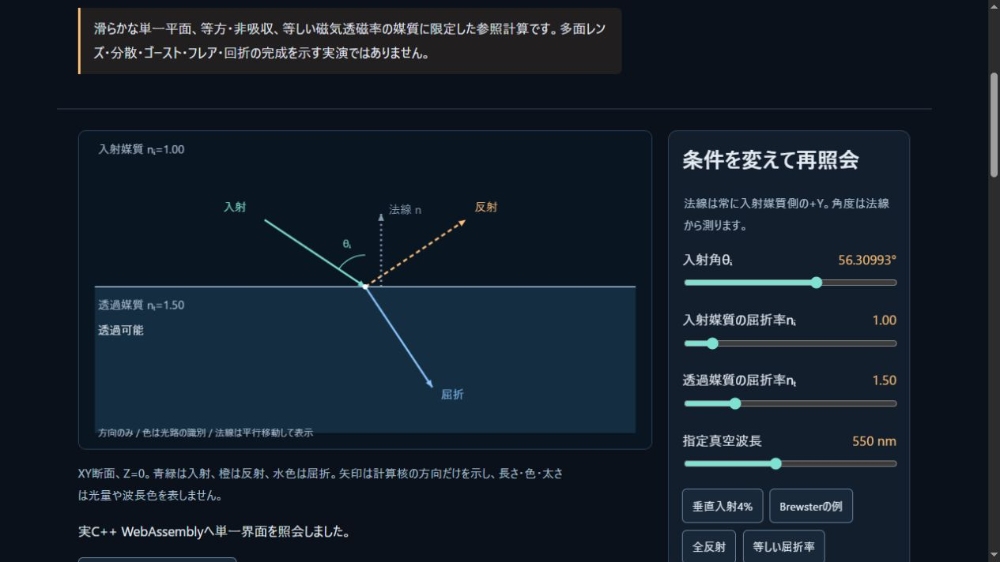
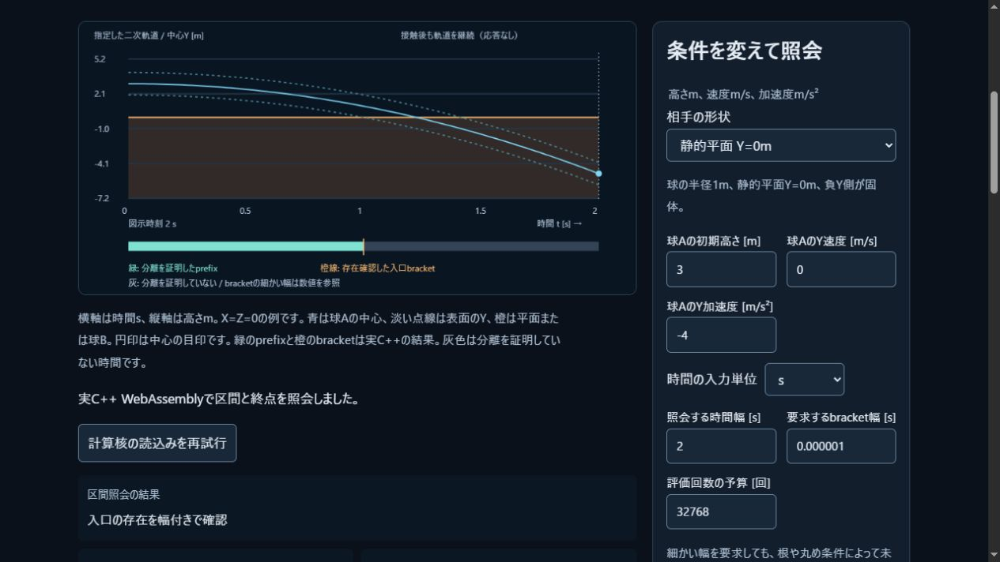

# 単一界面光学と加速軌道照会のWeb統合

2026-11-03 JST。任意の精密光学へ向けた最初の界面核と、加速する球の保守的な照会を
共通C++へ実装した。NativeとWebは同じソースを使い、JSに代替計算を設けていない。
多面レンズやWorld全体のCCDを完了した変更ではない。

## 単一の光学界面

[モデルと契約](../docs/OPTICS_INTERFACE.md)は非吸収・等方・等透磁率の平面境界。
入力方向/法線と指定波長での実屈折率から反射・屈折方向とs/pの法線パワー比を求める。
原入力から作った区間で臨界判定を行い、未確定なら屈折方向/パワーを返さない。
方向とR/Tは通常doubleの近似値であり、それら全体の区間保証ではない。

Native16群、standalone実WASM16群が成功。垂直入射4%、3-4-5のSnell例、
BrewsterのRp≈0/Rs=25/169、全反射、等屈折率、逆経路と独立flux式を検査した。
314透過例のNative最大差はエネルギー4.4408920985006262e−16、独立T式
5.5511151231257827e−16、Snell関係2.6239427297625184e−14。
[Nativeログ](optics-native-tests.txt)。この集合での観測値であり一様誤差保証ではない。

原入力をIEEE bitsから整数/Fractionへ復号する独立checkerで1,029例のD/内積包含を確認。
透過969/全反射57/未確定3で誤確定なし。[原本CSV](optics-oracle.csv)。
同じ入力を主WASMの公開C ABIにも通し、分類と4,116包含端点が一致した。
[実WASMの記録](optics-abi-certificates.json)。近似方向/R/Tのbit一致は要求しない。

## 加速球の入口を幅で確認

[式と受入](../docs/ACCELERATED.md)は一定加速度、固定半径の球対と静的平面。
各演算から区間を作り、時間順に除外する。閉じた分離prefixの正値と負のwitnessを確認し、
指定した時間幅内に最初の入口を囲めた場合だけbracketを返す。接線/初期境界や予算不足は
未解決を返し、接触なしに置き換えない。時間誤差幅をメートルの誤差と混同しない。

Native19群、22解析入口例が成功。試験許容幅1e−7秒に対し最大bracket幅
8.940696716308594e−8秒、入口試験の最大評価180回。
[生ログ](accelerated-native-tests.txt)と[独立buildのメタデータ](accelerated-native-verification.json)。
メタデータのdoc/verifier hashは担当作業終了時の原本であり、後続の統合追記や
公開用checkerのcorpus検査追加とは区別する。核の原本hashは維持した。

[原本CSV](accelerated-oracle.csv)の485行・2,445有理時刻で包含を確認。
平面202区間は二次式の頂点、1軸球対2区間は全極値から範囲全体を独立確認した。
一般3D球対41区間は9時刻のサンプル検査で、時間連続全体の独立証明とはしない。
全体包含の根拠は演算ごとの包含構成と幾何式/Horner式の交差である。

## 共通WASM・ABI・回帰

主simulation ABIは既存v1へ3関数を追加して32関数とした。[配列・flags・予算](../docs/SIMULATION_ABI.md)。
照会はWorld/Hullを割当てたり、既存Worldの状態/荷重/時間を変えたりしない。
失敗は先行outputを保持し、未確定はnullを維持する。cosine=0も欠落と区別する。
Native統合CTest9/9、計154検証群が成功。

公式Emscripten6.0.13で主WASM216160B/glue39106Bを生成。interval/accelerated/opticsは
fast-math/contractを禁じた別objectとし、従来dynamicsのコンパイル方針は変更していない。
生成中に原本が変わればbefore/after hash検査で拒否する。全source/artifact/通知hashと
個別compile flagsは`assets/pikapika-simulation.build.json`へ記録した。
外部の物理/光学ライブラリ、材質表、レンズ処方、画像、SDK本体は配布物へ加えていない。

[Native/WASM比較](optics-accelerated-parity.json)は従来の軌跡と線形TOIに、加速8例・光学7例を
加えた30,697値。最大絶対差6.821210263296962e−12。分類/optional flagsは完全一致、
加速探索のcounterは一致の対象とせず、各予算に収まることを別に検査する。
Node全114試験が成功、skip0。実WASMを使う両ラボの操作harnessを含む。
Web buildは4094312d5095c3dd。性能目標の達成や普遍的なbit一致の証明ではない。
[統合検証と原本hashの記録](optics-accelerated-verification.json)も保存した。

## 実ブラウザ

IABの光学ラボで、垂直4%、Brewster、全反射、臨界未確定、650nm→m、元の臨界ベクトルを
保った波長変更と角度編集での解除を確認した。[実画面の入力/結果](optics-browser-cases.json)。

加速ラボは1秒を含むbracket、球対終点の分離、s→msで2s/1e−6sから2000ms/0.001msへの変換、
評価予算1回と初期境界の未解決、正常条件へ戻した再照会を確認。
[実画面の入力/結果](accelerated-browser-cases.json)。初期画面の取得後にAX観測がtimeoutしたが、
同じ生存タブのDOMから結果/入力を読取り、ページやプロセスを再起動せず操作を継続した。

CSV原本は測定時のCRLFを保持する。公開用Python checkerはLFへ統一し、Python -Oと
corpusの欠落を拒否する。一次資料と自作SVGの来歴は各モデルと権利台帳へ記録する。

## 残り

Worldへの接触時刻・応答・残時間・持続支持の統合、一般形状、流体との接触結合、材料損傷は残る。
光学はレンズ面の交差、分散、複数面と反射光路、偏光/位相の継続輸送、収差と有限開口の収束へ進む。
この平面界面の成功を、ゴースト/フレア/回折・厳密光学全体の完成に置き換えない。
