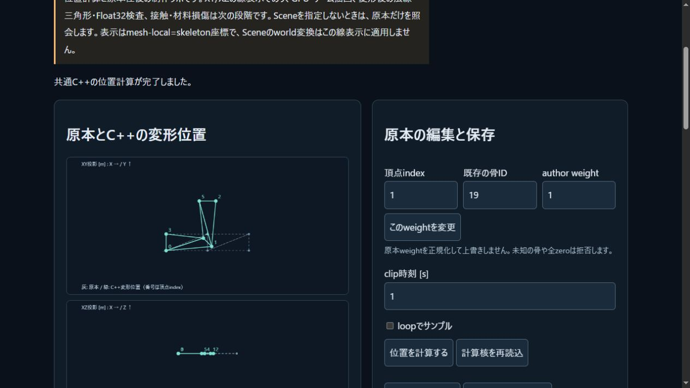

# 所有するskin binding原本とNative往復

2026-11-03。mesh、全author influence、全jointのrest/inverse、局所rest snapshot、全motionを一つの原本へ保存する。既存scene/motion形式とサンプルは変更しない。確定契約は[SKIN_BINDING_FORMAT.md](../docs/SKIN_BINDING_FORMAT.md)。新ラボは重み編集、時間/loop照会、JSON/portable再読込と保存、任意Sceneとの照合を扱う。

JSONは独自の有界scannerで、重複/未知key、非有限値、非零decimalのzeroへのunderflow、壊れたUnicodeを拒否する。原本のdoubleはsigned zeroを保持し、author weightを正規化・修復しない。portableは既存motionをUTF-8 byte長付きで内包する。Native CLI `pikapika-skin` はinit/inspect/roundtrip/weight/sample/matchを提供し、候補全体を検査してからexclusive createする。既存出力や入力を置換しない。

fingerprintは非暗号FNV64で、全頂点/三角形の順序付き比較も必ず行う。衝突controlはhash関数を一定に置換した模擬であり、実FNV衝突を発見したという意味ではない。保存済み局所rest/親と実C++のrest FK全行列を照合し、stale inverseを再生成して隠さない。構造保存可能、context一致、数値completedを分けて表示する。

## ローカル受入

- MSVC19.51/Windows SDK10.0.26100: 新Native IO27群、全679群/CTest29/29。ビルドと実行ログ、cp932の元CTestログとUTF-8変換版を保持した。
- Node24.14.1: 355/355、skip0。新strict JSON7、binding14、UI11群。実SDKと実Native CLIを使い、file読込のUTF-8/BOM/予算・古い非同期読込のcancel・オフライン後復帰も検査した。
- 8固定原本のJSON/portable/Native往復で26322数値bits、30実C++モデル結果650数値bitsが一致した。内訳20completed/5numerical_failure/5ill_conditioned。別に10source品質例外を拒否し、これらを成功した位置へ数えない。
- Python3.12.10標準ライブラリの別実装で、捕捉bit木18848葉と実Native stdout30件、FNV8件を確認。既知のidentity/90度pivotをexact Fractionのauthor比で求め、4原本×4時刻×6頂点×3=288成分の最大絶対/scale誤差は2.7755575615628914e-16。許容256eps。0.5秒はparityだけで、一般入力の精度包含ではない。
- 独立checkerの正例3件/負例23件が期待どおり。両runtimeの出力・bits・Native stdoutを同時に誤った90度位置へ変えても解析参照が拒否した。検査を無効化するPython `-O` も拒否する。
- 実ブラウザ18観測で、重み3の編集、時刻変更時の派生消去、portable→実Native file→ブラウザ再読込、重複key拒否、stored-rest不一致、underflow失敗と復帰、`-0`保持、Scene全形状照合とdirty拒否を確認。既存出力の保存動作と数値成功を混同しない。

実ブラウザのNative往復ではDOMに表示されたportable textをファイルへ保存し、実CLI出力をpasteで戻した。実file chooser/downloadイベントは操作していない。fileハンドラと保存callbackはNode UI harnessで検証した。ローカルscreenshot後のHTML変更は座標空間の説明と表見出しだけであり、公開画面で最終表示を確認する。

SDK63/WASM574261B/glue49388Bは前版とbyte不変。51source/header、7license通知、2artifactを照合した。Native IOは主SDKへ追加していない。全tracked samples/assets/tests/fixturesの9ファイルも前HEADとbyte同一。新外部package/素材/有料serviceは追加せず、本体licenseは未選定。Web build `51c633e84fbbf290` /39modules、教材24記事。

集計/原本hash/再現commandは`skin-binding-verification.json`。完全な入力と結果は`skin-binding-recipes/roundtrip/`、checkerの実stdout/負例logは`skin-binding-reference-*`。元agentのproof一部はOS読取権限で取得できなかったため、同じ確定sourceとarchive corpusでrootが全26controlを再実行し、その取得可能な生証拠を採用した。元記録は削除していない。23個の大きな変異入力の複製は配布せず、公開runnerが元コーパスから再生成する。

## 公開受入

コード`4356c8a050b939ce4b545caf5808ee00d945a7fb`の[Linux CI](https://github.com/tatata93/pikapikaengine/actions/runs/41647718099)と[Pages](https://github.com/tatata93/pikapikaengine/actions/runs/41647717584)が成功。GNU13.3.0/Node22.23.4でCTest29、Node355/355・skip0、独立288成分/23負例、主SDK既存5288bits比較が成功した。新IOの別ASan/UBSan binaryも27群で診断なし。全logには38 warning行が残り、新IOの2行はmisleading-indentationである。任意入力のmemory safetyやwarning-freeは主張しない。

[公開ラボ](https://tatata93.github.io/pikapikaengine/tools/skin-binding-lab.html?v=4356c8a)の18実操作で原本・結果・失敗・復帰の全文packetがローカルと一致した。公開DOM portable→実Native新規file→公開pasteの往復も成功し、signed zeroを確認。最終表示でmesh-localの説明と表見出しを確認した。公開HTML/module/bridge/glue/WASM/manifest/教材/SVGの11ファイルが検証済み原本と全byte一致。公開直前の旧配信/404照会は別記録に残し、成功へ混ぜていない。

証拠は`skin-binding-public-verification.json`と`skin-binding-public-*`、全job log/step一覧。最初の集計でlocal browser件数をobjectのkey数3と数えたため、18件のobservations配列の長さへ訂正した。元の18件rawや各結果は変更していない。

## 次段

表示はmesh-local=skeleton位置のXY/XZ投影であり、Sceneのworld変換は適用しない。法線/GPU skinning、Float32退化、接触形状、塑性損傷、IK/物理制御は未完。次は原本を変えず派生位置のFloat32変換・面積退化・法線生成条件を定義して小さい3D描画へ接続する。単純な旧法線との内積を一般の面反転判定には使わない。その後、独立したオリジナルrobot sampleへ適用する。

## IO loop表記の追補

上の公開CIで見つかった2件のmisleading-indentationについて、fingerprint triangle列とrestWorld照合のfor本体へ明示braceを置き、後続処理を改行した。処理内容とwarning flagは変更しない。ローカルでCTest29/全679群・Node355skip0を再確認し、8原本の入力/Native往復/Scene/全resultを含む34 rawファイルが4356c8aの証拠と全byte一致した。新source hash/実command/build/testはskin-binding-warning-*へ記録。Linuxでの警告消失は次のCIで別途確定する。
