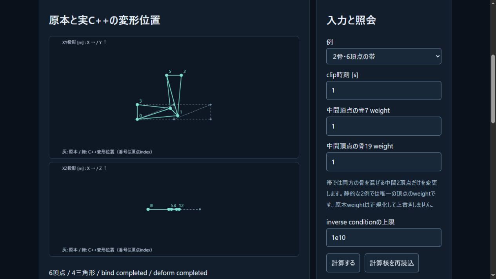

# 共通SDK63: 位置スキニングと実WASM操作ラボ

2026-11-03。既存の位置skinning核を共通C ABIへ4関数追加し、Webの`bindSkin` / `deformSkin`へ接続した。操作入口は[骨で頂点を動かす](../tools/skinning-lab.html)。既存教材23番からも開ける。独自C++のinverse bind、FKとweight付き行列blendの結果を表示し、原本や既存robot sampleは変更しない。

## 変更と範囲

SDKの実入力上限は128bone / 2048vertex / 8192influence。Native kernelのSettings上限128 / 65536 / 262144とは区別し、暗黙の切捨てや分割をしない。C ABIは不正な交換/getterに対して既存snapshotを保持し、受理したモデルの失敗はno-resultへ置換する。JSは原本の転送とcopy snapshotの読出しを担当し、inverse/LBS/FKの別計算を置かない。

2骨6頂点の帯、非一様scaleと回転、巨大translation相殺、正weightのunderflowを照会できる。入力変更で古い位置を消し、明示ボタンで再計算する。XY/XZ投影と全入力・inverse・診断JSONを表示する。ブラウザ画面確認でXZへXY軸を渡していた不具合を修正し、別の軸と実座標を検査する回帰を追加した。

確認用JSONの書出しはNodeのUI harnessで照合した。ブラウザのファイル再読込やbindingアセット往復を検証したという意味ではない。GPU skinning、engine mesh描画、法線/三角形/Float32検査、IK・接触・材料損傷は後続。

## ローカル検証

- Windows MSVC19.51.36247/SDK10.0.26100、Native全651群/CTest28、Node24.14.1の322/322・skip0。新SDK11件、操作ラボ11件を含む。構文check/Web buildも成功。
- 既存の物理・光学・motion等24系統の独立参照/共通WASM回帰が成功。motionは既存4105数値bits一致を保つ。有限corpusの観測結果で、任意入力の一様保証ではない。
- skinningの65fixtureは60件の実C++モデル結果と5件のhost交換拒否へ分類。128oracle/復帰を含む実出力5288数値のbinary64 bitsがNativeと一致。5件をC++モデル成功に数えない。
- 変更していないFraction checkerでfixture304点＋oracle4480点を各対象について確認。通常oracleの最大絶対誤差1.7763568394002505e−15、最大scale正規化誤差2.555909121439209e−16。極端な約1e306m出力では絶対誤差約1.0038e290m・正規化誤差約1.10045e−16であり、絶対m精度の保証に置換しない。品質条件と点計算であって区間包含ではない。
- 実ブラウザ13観測。既知6頂点、時刻0のrest、weight3、shearの列内積−36/25、condition1の拒否と復帰、±2^53の相殺後x1、weight underflow/負weightの拒否と復帰、文字列1e−999の数値化拒否を確認。元のauthor weightを保持し、失敗時に古いgeometryを出さない。

main WASM583708B SHA256 `5f46ed3489f3238cbb953a0fb475ae024768c8c35d5207557e39d60df0ab08c5`、glue49388B SHA256 `a2b4e452375f0805cddee480238d29bdd285791a4ffea6c72c8e2cb165b542d3`。Emscripten6.0.13の既存固定toolchain。25CPP/51source-header/7runtime通知/2artifactのhashを再照合した。外部依存/素材/ライセンス選定の追加はない。Web build `dbbe1310b6a753ab`、36modules。

## 再現と証拠

`skinning-sdk-verification.json`は全体集計・source/artifact hash・raw証拠への対応表。`skinning-sdk-core-provenance.json`と`skinning-sdk-js-provenance.json`に実SDKビルドと主ABI再生のflags/commands/hashを保持する。build時のrevisionBase/dirtyは正直なビルド元記録で、最終commit番号への書換えはしない。原本manifest51hashは生成時のまま維持する。

`skinning-sdk-js-outputs.json`はhex表現を含む実出力、`skinning-sdk-js-replay.json`と`skinning-sdk-js-replay-oracle.csv`は独立checker向け。元Native inputsは既存`skinning-native.json` / `skinning-native-oracle.csv`と同じhashである。主再生は次の引数順を使う。

```
node scripts/verify-skinning-wasm.mjs reports/skinning-native.json reports/skinning-native-oracle.csv build/skin-main.json build/skin-main-outputs.json build/skin-main-replay.json build/skin-main-oracle.csv
```

CIにも同じ再生を追加。完全なローカル実行・保存recipeは`skinning-sdk-recipes/`、既存24回帰は`skinning-sdk-core-regressions.json`。Native LastTestはcp932原本を`skinning-sdk-native-last-test-raw.txt`、UTF8/LF転記を`skinning-sdk-native-last-test.txt`として保持する。独立機械検査で651群を集計した。

次の制作受入は、stable scene ID/mesh fingerprint/bone IDとauthor weight/inverse bindを保持するowned原本bindingのJSON/portable codecとNative CLI往復。その後小メッシュの描画へ進む。



## 公開検証

コード`051c2a9e1cc8a6c681725af21a3ba2b41e524bb8`をorigin/mainへpushし、[Linux CI](https://github.com/tatata93/pikapikaengine/actions/runs/41637374976)と[Pages](https://github.com/tatata93/pikapikaengine/actions/runs/41637373790)が成功した。GNU13.3.0/Node22.23.4でCTest28/28・Node322/322・skip0、主SDKのskinning5288bits比較と既存motion/光学/World等の回帰が通った。

[公開ラボ](https://tatata93.github.io/pikapikaengine/tools/skinning-lab.html?v=051c2a9)を実ブラウザで起動し、同じ13操作を実行。入力・診断・位置のDOM JSON全文は各操作ともローカルと完全一致した。公開runtimeは583708B/build dbbe1310b6a753ab。HTML/lab JS/engine bridge/glue/WASM/manifest/教材indexの7ファイルもローカル配布原本と全byte一致した。

CIには既存箇所を含む38行のcompiler warningがある。特にskinningの4要素配列に対する`std::sort`のarray-bounds警告を次の小さい検証課題として扱う。入力は1..4件を検査しているが、試験成功だけで警告を解決済みとはしない。完全job logと全警告を`skinning-sdk-public-ci.txt` / `skinning-sdk-public-verification.json`に保持する。

公開証拠は`skinning-sdk-public-*`と再現recipeへ保存。HTMLだけの表示を実WASM成功と取り違えず、status/入力/結果/配信hashを照合した。binding原本の読込やGPU/sampleへの接続の未完は維持する。


