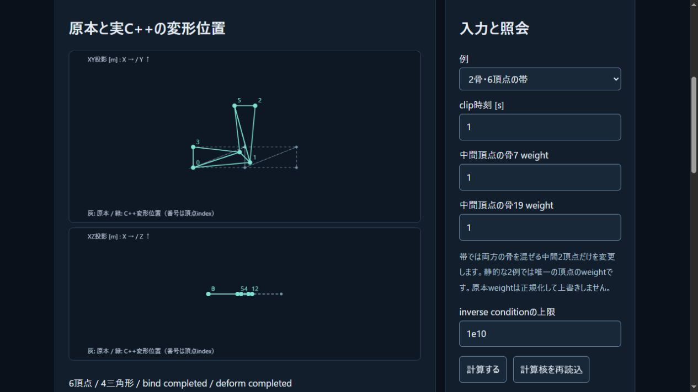

# 4要素weight整列の境界監査

2026-11-03。SDK63の公開CIでGNU13.3が`std::sort`のinline先へarray-bounds警告を出したため、1〜4 influenceを扱う箇所を独自のbounded insertion sortへ変更した。warning抑制flagは追加しない。API、author weight、骨ID、品質条件と元のfixture/oracleは変えない。

入力spanのsizeは事前に1..4へ制限されていた。警告は4要素を超えるgeneric introsort/heap/final insertionの展開先を指し、レビューではその範囲への到達を見つけていない。optimizerのrange情報に起因する可能性は推論であり、実行時の破壊が証明されたという意味ではない。新loopは外側index1..3、未使用slotの手前で終了し、内側slotを減らすだけで全読書きを0..3へ制限する。

## ローカルの証拠

- Nativeの新1群で、4IDの全24順列、1〜4要素合計33順列の位置bits・weight残差・author tuple保持、既知affineの期待位置を確認。duplicate/all-equal13条件と不正5要素を拒否。Native69群、全体652群/CTest28が成功。
- 実SDKにも独立した33順列と重複/5要素の回帰を追加。Node323/323・skip0、主ABI5288出力bits一致と独立Fractionの点比較、既存24系統の回帰が成功。65fixture/128oracleのNative rawは前版と全byte一致。
- 既存MSVC19.51の`/O2 /Zi /fsanitize=address /fp:strict`で旧std::sort原本と新原本を別々にbuild/runし、双方とも新69群でASan診断なし。別の意図的heap overflowを検出してexit1になるcontrolも確認した。controlは成功として混ぜず、期待した失敗として保存する。これだけでGNU optimizerや任意入力の安全性を保証しない。
- 一部Native compile/runのraw名がfixture名と衝突したため、同じ最終source/flagsでcompile/runを再captureした。元commands JSONのstdout/stderr SHAと再captureが両方一致し、元の経緯と修復記録を保存した。ASan前後/controlのrawは衝突していない。
- 修正版の実ブラウザ6観測で帯、shear、相殺、underflowと復帰を確認。入力/診断/位置のDOM JSONは前版の対応する各操作と完全一致した。

SDK63のWASMは574261B、SHA256 `4f0a2bfb026dafe5e4cb8929a5fca37d3b9c2e9b24e096bece9419efdc2a7812`。glue49388Bは前版とbyte同一。51source/header、7通知、2artifact、strict FP flagsを照合し、既存sourceの変更はskinning.cppのみ。Web build `387edd206ca3270e` /36modules。配布容量の実測であり速度向上を測定したという意味ではない。

`skinning-sort-verification.json`に全体集計/原本hash/rawへの対応表、`skinning-sort-core-provenance.json`にcompiler/flags・ASan/復元経緯、`skinning-sort-root-main-report.json`に主ABIの分類と点誤差、`skinning-sort-root-regressions.json`に既存24回帰を保持する。新sourceも位置のpoint計算であり、区間包含・Float32/法線/triangle・接触/材料損傷の完成ではない。

再現recipeは`skinning-sort-recipes/`。旧SDK報告に書いたfixture名の誤記を`skinning-native.json`へ訂正し、その公開rawを使った同じ再生も今回実行した。元の成功ログはbuild内の正しい同一hash入力を使っており、実行証拠は書き換えない。

## 公開前の追加受入

既存の標準Linux CI内へO2の`-Werror=array-bounds` compileと、別O1 binaryのASan/UBSanを追加した。`halt_on_error`と`-fno-sanitize-recover=undefined`で検出を失敗として扱う。現行[GCCのinstrumentation文書](https://gcc.gnu.org/onlinedocs/gcc/Instrumentation-Options.html)が警告とinstrumentationの相互作用を注意しているため、警告compileとsanitizer実行を分ける。新しい有料runner/依存download/配布libraryは追加しない。

次の制作受入は[owned binding計画](../docs/SKIN_BINDING_PLAN.md)の原本保存/照合とNative CLI往復。新計画は未実装であり、位置計算ラボをasset codecやgame skinningの完成と数えない。

## 公開検証

コード`331b6cc0f92ce9cd65c8033ae8cd1f5b017f7237`の[Linux CI](https://github.com/tatata93/pikapikaengine/actions/runs/41639948143)と[Pages](https://github.com/tatata93/pikapikaengine/actions/runs/41639947808)が成功した。GNU13.3.0でO2の`-Werror=array-bounds` compileを通過し、全job logでarray-bounds warningは0。別O1のASan/UBSan binaryは69群・33順列/13重複拒否/5要素拒否を実行し、sanitizer診断なしで終了した。CTest28/28、Node22.23.4で323/323・skip0、主SDK5288bits比較と既存の参照回帰も成功した。

今回のCIには別のindentation/initializer等のwarningが計36行残る。compile回数の異なる前jobとの総warning行数比較で改善量を主張せず、今回対象のarray-bounds警告が出なくなった事実を記録する。全logとwarning一覧を保持し、warning-freeや任意入力のmemory safetyとはしない。

[更新済みラボ](https://tatata93.github.io/pikapikaengine/tools/skinning-lab.html?v=331b6cc)の実ブラウザ6操作で既知の帯、shear、相殺、underflowと復帰を確認し、各診断JSON全文が修正版ローカルと一致した。本体入口/ラボ/bridge/glue/WASM/manifest/教材を含む配信8ファイルも検証済み原本と全byte一致。runtimeは574261B/build387edd206ca3270eである。

証拠は`skinning-sort-public-verification.json`、実job log/step一覧、公開HTTP/DOMの`skinning-sort-public-*`へ保存。次の未完受入はowned bindingのJSON/portable codecとNative CLI往復である。

