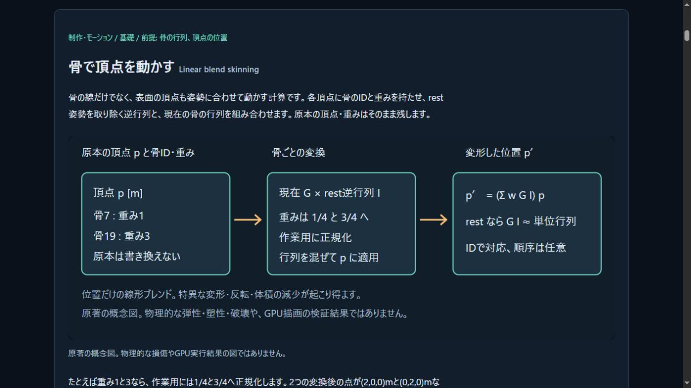

# M2制作B: rest inverse bindと位置スキニング核

2026-11-03。既存motionの骨行列を消費するpure C++20 `skinning::bind/deform` を追加。単一mesh local=skeleton座標のsubsetで、安定bone ID・1〜4の非負author weightと、rest world/inverse bind、現在poseから元頂点を変形する。Nativeライブラリとstandalone実WASMの位置計算段階であり、公開59export SDK、原本binding保存/CLI、renderer/GPUやIRON FIELDへはまだ接続しない。

## 実装と受入

scaled pivotの3×3 affine inverseを自作し、linear ∞norm conditionと両側full affine inverse residualを数値の受入基準として監査する。行列要素は有限±1e150、元頂点は±1e6m、bone128/vertex65536/総influence262144を上限とする。既存のmotion/Transformは変更しない。

author weightはstable ID順の作業用copyで最大値除算→総和除算し、巨大weight同士で総和がoverflowすることを避ける。正のweightがどちらかの段で0へunderflowすればnumerical_failure。入力全体を検査し、失敗時に部分positionsを成功として返さない。rest/pose/bindの配列順は任意、ID集合の対応を検査し、元の頂点/weight/行列を変更しない。

レビューで、各jointを先に頂点へ適用する順では、+2^53/−2^53mのtranslationが打ち消し合う例で、厳密x1に対しpoint x0.5になることを発見した。正規化weightで3×4 affine paletteを先にblendし、その行列で頂点を一度transformする順へ変更した。同じ入力はNative/WASMともx1、独立有理数参照で誤差0となった。任意のcancellationを解決したという主張ではない。

- Native全target integration build成功。CTest28/28・643群（前575＋skinning68）。既存のAPI/物理/光学/原本も含む。
- standalone Native/実WASM各68群。65固定fixture5248数値＋128固有oracle13312数値、計18560個のraw数値bitsが一致。CMake Nativeのfixture/oracle raw bytesもstandalone Nativeと一致。
- 独立Pythonは実binary64入力をFractionへ復元し、別構成4×4 Gauss-Jordanと厳密author-weight比から逆行列/位置を計算。各対象4784点（fixture304＋oracle4480）、両対象9568点を確認。26負例を拒否。
- 通常corpusの比較閾値は256eps×max(1,|厳密参照|)。oracle最大絶対誤差1.7763568394002505e−15、最大scale正規化誤差2.555909121439209e−16。極端な有限出力約1e306mのfixtureでは絶対誤差約1.0038e290m、scale正規化誤差約1.10045e−16。絶対m精度の保証や実用sceneの値とはしない。
- Node300/300・skip0、`npm run check/build` 成功。教材23記事と原著SVGを追加。Web build4160515ffa5ab2d4/35modules、既存SDK59/WASM544541Bは同じ配布物を保持。

## 残る適用範囲

`completed` はこの有限点計算と品質条件を受理した結果で、厳密実数の包含ではない。condition/residualも丸められた点推定で、一般の誤差上限を保証しない。palette内のcancellation、underflow、極端なcondition/大きさと出力のFloat32表現可能性を別に扱う必要がある。ゼロ/特異なblend・面の反転・体積減少は位置だけのLBSで起こり得る。法線、三角形の妥当性、collision形状、弾性/塑性/破壊の完成とは区別する。

次はcommon SDKへのbounded ABI接続と、stable scene ID・mesh fingerprint・bone IDの原本binding保存/NativeCLI往復。その後、既知小メッシュの変形後法線/Float32検査と描画へ接続してからオリジナルrobot sampleを更新する。mesh v1は永続vertex IDを持たず配列indexなので、topology変更への自動追従を先取りしない。

契約は[SKINNING.md](../docs/SKINNING.md)、再開設計は[SKINNING_PLAN.md](../docs/SKINNING_PLAN.md)。実source/SDK/artifact/recipe hashと生結果はskinning-verification.json、skinning-provenance.json、skinning-reference-provenance.jsonを参照。新外部library/SDK/package/図/assetは追加しない。既存Emscripten通知と未選定engine licenseを維持する。

## 公開検証

コード1099240と、生成Python cacheの配布除外を加えたae6b707をpush。[最終Linux CI](https://github.com/tatata93/pikapikaengine/actions/runs/41633411021)と[Pages](https://github.com/tatata93/pikapikaengine/actions/runs/41633409980)が成功した。GNU13.3.0/Node22.23.4でCTest28/28、Node300/300・skip0、Nativeの独立Fraction4784点を確認。Linux側でも相殺回帰x1、通常oracle最大scaled誤差2.5559e−16。local Windows/standalone実WASMの18560bit一致と別の実行証拠として保持する。

[公開教材23番](https://tatata93.github.io/pikapikaengine/docs/learn/index.html?v=ae6b707#skinning)の原著SVG960×360の読込と、SDK/描画が未接続である説明を実ブラウザで確認した。教材index/図/API契約/保持したWASM/manifestの5ファイルが原本と全byte一致。[既存モーション制作ラボ](https://tatata93.github.io/pikapikaengine/tools/motion-lab.html?v=ae6b707)も配布SDK59を使用する入口として保持する。新kernelの位置変形をこのブラウザで実行したという意味ではない。

生job log、workflow、公開DOM/図/配信hashはskinning-public-verification.jsonと関連rawに保存。次段の有界なSDK接続の設計は[SKINNING_SDK_PLAN.md](../docs/SKINNING_SDK_PLAN.md)へ記録（未実装）。

