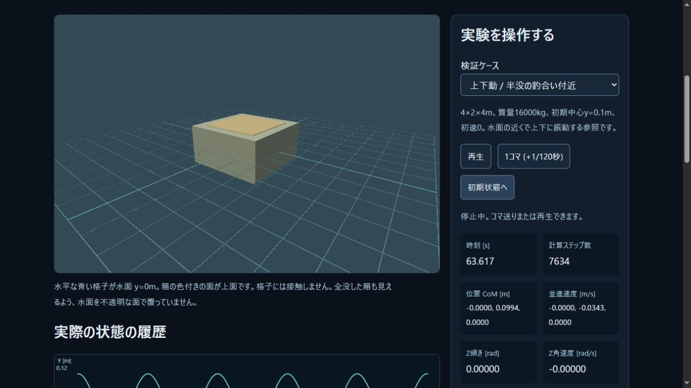
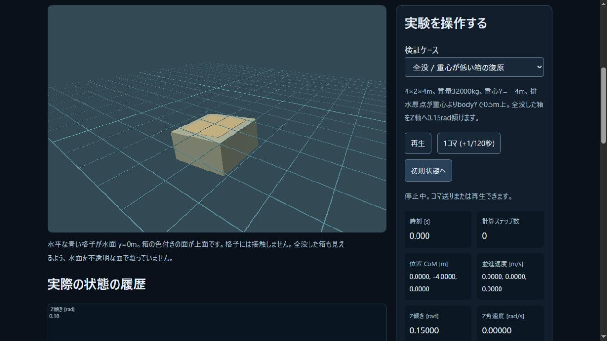
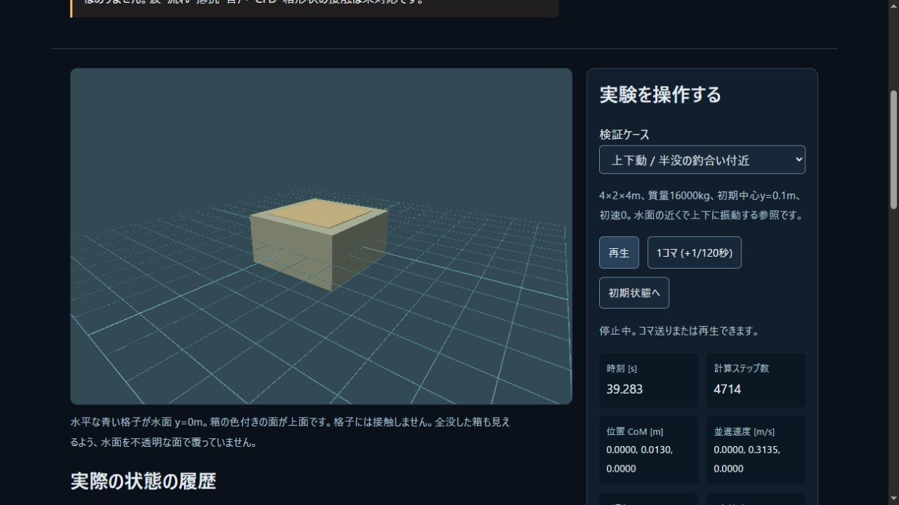

# 共通C++物理の実WebAssembly出力

2026-11-03、Windows10.0.19045 / i5-6500 / GTX1060 6GB / RAM15.94GiB。
コード基点26b6231からの未コミット作業で測定。正確な核原本・生成物SHA256は
[build manifest](../assets/pikapika-simulation.build.json)で識別する。

## 実装

既存の自作C++ `World` / `Hull`を変更せず、寿命・予算・例外を管理する27関数の
[C ABI](../docs/SIMULATION_ABI.md)を追加。Emscripten6.0.13の公式SDK固定版で
実コンパイルし、Nodeとブラウザで同じWASMを実行した。
初回ビルドは受信API指定不足でwasmBinaryが拒否され、設定を修正して再ビルドした。
成功前の出力を成功扱いしていない。

WASM174929B、配布glue37423B（生成直後のCRLF37425BをLF統一）、初期heap64MiB/最大256MiB/stack1MiB、Wasm例外、
single thread、filesystemなし。生成glueと標準C/C++ランタイムの第三者コードを含む。
[配布通知](../third_party/emscripten-6.0.13/NOTICE.md)にMIT/NCSA・musl・LLVMと
リンクしたmath個別通知を保存。SDK本体とツールはbuild/に置き配布しない。

再生成: 公式emsdkをmanifestのcommitへcheckoutし、`python emsdk.py install 6.0.13`と
`python emsdk.py activate 6.0.13`でプロジェクト内設定を用意した後、
`node scripts/build-simulation.mjs build/toolchains/emsdk`を実行する。
OS恒久PATH変更や有料サービスは不要。既存650B moduleは独立した来歴を維持する。

## 数値と操作の検証

- Native MSVC19.51 Release、CTest4/4、core15+dynamics16+hydrostatics20+ABI16=67群。
  [追加ABI試験の全出力](simulation-native-tests.txt)。
- Node24.14.1、全77試験成功。実WASMで自由落下の解析解、弾性球の運動量/エネルギー、
  静水圧、上下動の独立解析解、30/60/120描画周期の同じtick状態、失敗batchのrollback、
  不正mesh置換の原状保持、256回の作成/解放と古いhandle、quaternion描画を検証。
- [Native原データ](simulation-native-probe.json)の4静水圧例・5浮遊軌跡・1自由落下軌跡を
  同じWASMで再計算。30180数値、最大絶対差6.821210263296962e-12、
  許容abs1e-8+relative1e-10内。[比較結果](simulation-parity.json)。これは同じコードの
  処理系比較であり、独立した物理の正しさをこれだけで証明したとはしない。
- 実ブラウザIABで初期化、再生/停止/1tick/ケース切替/reset、上下動・復原の姿勢表示を確認。
  原本シーンの回転保存形式は変えず、動的表示にquaternionを追加した。

## 実ブラウザの測定

[集計JSON](float-web-summary.json)、[上下動の全保持ログ gzip](float-web-heave.json.gz)、
[復原の全保持ログ gzip](float-web-roll.json.gz)。JSONをそのままgzip圧縮し、値や遅いフレームを
除去していない。明示したローカル開発用保存ボタンから同一originのloopbackへPOSTして取得。
通常サーバーでは書込endpoint無効、公開Pagesではボタンを表示しない。ブラウザ自動化の
downloadが長時間待機したためこの取得経路を追加した。巨大全ログはDOMへ展開せず概要だけ表示する。

描画713×478、単体36描画物、水面は位置の目印の格子。音声なし、影なし。
他のプレビューが存在する開発中の単発測定で、復原区間ではNode試験も並行した。
統制された端末比較の性能ベンチマークではない。

| 現在segment | 上下動 | 復原 |
|---|---:|---:|
| 積分した時間[s] | 63.616667 | 49.491667 |
| tick総数/保持 | 7634/7200 | 5939/5940（初期状態含む） |
| 計算破棄時間[s] | 0 | 0 |
| 最大相対エネルギー差絶対値 | 2.299432538e-4 | 3.420960667e-5 |
| running描画記録数 | 3792 | 2937 |
| rAF p95/p99/max [ms] | 16.785/17.165/68.090 | 16.775/16.990/100.120 |
| 16.666667ms超過記録数 | 2444 | 1931 |
| CPU更新・提出 p95/p99/max [ms] | 2.110/5.020/47.685 | 2.835/6.930/27.705 |

上下動は27.716667sと35.9sの2回再生、復原は1tick後に49.483333s連続再生。
全描画履歴はreset間をまたぎ、mode/runningで区別する。上表は各modeのrunning記録だけを集計。
上下動の全4880描画は保持、復原保存時は全17134描画の最新7200を保持している。
tick履歴と描画履歴の保持数/総数を混同しない。percentileは昇順ceil(Np)-1。
初期化216.865ms、WASM生成50.120ms、heap64MiB。実メモリ成長/真のOS割当不足は強制していない。

CPU値はsimulation・encode/submit・chart・DOMを含むが、最後のCPU表示書込は含まない。
GPU処理時間・実提示回数は未測定。厳密フレーム予算超過があるため60fps目標は未達のまま。
これを音声・戦闘負荷込みの合格にしない。

## 続く作業

公開コード[fe3a9f3](https://github.com/tatata93/pikapikaengine/commit/fe3a9f38a5fd099e8c5b47e6fbf998e29504d4b6)の
[Engine CI](https://github.com/tatata93/pikapikaengine/actions/runs/41560159499)と
[Pages配信](https://github.com/tatata93/pikapikaengine/actions/runs/41560159654)が成功。
GNU13.3.0/Node22.23.4でもCTest4/4、WASM30180値比較成功（この実行では最大絶対差0）。
CIのJSは74成功/Native CLIに依存する3件skip。Windowsローカルの77成功と区別する。
一般の処理系間ビット一致は主張しない。

[公開実験](https://tatata93.github.io/pikapikaengine/tools/float-lab.html?v=fe3a9f3)を実ブラウザで起動。
WASMサイズ/来歴照合、WebGPU描画、1tick、再生/停止、39.283s/4714tickを確認。
build 8277480dc456d30f。公開環境にはローカル開発保存ボタンは表示されない。

球/平面接触は汎用Web APIへ出力したが、動的浮遊サンプルは接触なし1体に限定する。
球のCCD、多形状/関節、一般接触と静水圧の結合、非定常流/CFD/材料損傷、
Native/Webの同一戦闘、音声込み性能とGPU/実提示の計測は残る。
任意で高精度化する光学計算は要件と受入を保持しており、この版では未実装。
