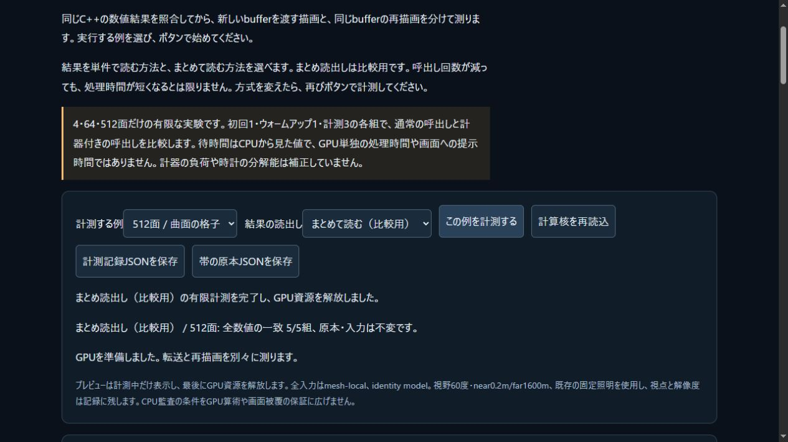

# ブラウザの両読出し方式と実GPU転送

2026-11-04 JST。ローカル受入済み。公開CI/Pagesは後段で別に確定する。

[比較ラボ](../tools/derived-gpu-lab.html)へsingle/batchの明示選択を追加した。既定single、1操作10prepare/20drawの有限範囲を維持する。baselineと計器付きは同じ選択方式を使う。変更時は古い表・記録・保存対象を消し、再読込みや取消後の古い非同期結果を採用しない。

新schema2はsession/runtime世代/実行順とtransportを記録する。検査器は新6rawと旧schema1の4rawを別分岐で扱い、欠損/重複、全66統計行、stage会計、全DTO型/key順/bits/typed bytes、GPU転送/退役の連続性を監査する。

## 実行した範囲

Web build `7f5b0f537e72cef8` / 44modules、最終Node468/468・skip0、構文検査成功。UI専用19群、検査器11群を含む。検査器の単体試験では実C++6 captureと明示した合成timingを使い、実ブラウザ性能測定とは区別する。

ローカルIABで4single→4batch→64batch→64single→512single→512batchを同session/SDKで実行した。60prepare・120draw・60新規転送・60cache、270,940反復数値と全typed bytesが一致。別にNode実WASM6queryを実行し、全firstPair/digestも照合した。Node照会をブラウザ件数へ足さない。旧公開schema1の4rawも改変せず、現SDKの別4queryへ136,460数値/typed bytesが一致した。これは履歴の数値互換で、新SDKの同条件性能比較ではない。

[全6rawと画像](derived-browser-local/)、[ローカル証拠index](derived-browser-local-verification.json)、[検査の全出力](derived-browser-verifiers/)、[全試験log](derived-browser-checks/)、[保存hash](derived-browser-archive.json)、[再実行recipe](derived-browser-recipes/)を保持した。SDKの53source/header・7通知・2artifactを照合し、core/assets/engine/samples/CMakeLists.txtは前公開から不変。WASM592939B / glue50381B、ABI1 / 66exportsは変更しない。Native再buildをローカルで今回実施したとはしない。

## 時間の扱い

warmup後3標本の通常SDK全体中央値msは次の通り。初回/warmup、p95/最大、5stage/未分類残差、token生成とGPU同期submit/validation/queue待ちを全rawへ保持した。

| 面数 | single | batch |
|---|---:|---:|
| 4 | 0.5550 | 0.3450 |
| 64 | 2.9850 | 3.8000 |
| 512 | 20.8150 | 24.3150 |

64/512面ではbatchが長い。この小標本から通常採用へ変更せず既定singleを維持する。CPU観測のqueue待ちを当該meshのGPU単独時間・画面提示fpsにしない。JIT/GC/OS負荷/計器/全DTO比較や保存の次標本への影響は未較正。別環境やNative/最大容量へ速度を一般化しない。

## 最初の検査と修正

6rawの最初のCLI検査は、GPU feature一覧の列挙順の差を環境変化として拒否した。取得できた集合自体は同じだった。rawと失敗command/failure.jsonを保持し、adapter/deviceのfeature一覧だけをcopy上でsortして比較するよう修正した。重複・型/status/集合内容・その他GPU属性差は拒否する。並替え正例と欠損/重複/型/疎配列/属性差の負例を追加し、同じ6rawが最終検査に成功した。再測定で失敗を隠していない。

最初の全Node467試験も成功していたが、上の回帰1群を追加して最終468試験を実行した。最終試験の実行中に採った途中archiveは `derived-browser-checks-early/` へ分け、完了後の正式logと混ぜない。

## 次のゲームへの適用

[原著ロボット背面カバーの案](../docs/DERIVED_MESH_SAMPLE_PLAN.md)を作成した。これは設計のみで、実Source→FK/LBS→derived→所有tokenの装着/開閉と実費用、checked全frameと通常frameの非同期併用/失敗/復旧/資源寿命を先に受け入れる。READY表示だけを戦闘再試験として報告しない。

既存原著図derived-readback.svgは2711B/hash不変で再利用、新package/外部素材/有料serviceなし。本体license未選定を維持する。一般接触・専門車両・流体・弾塑性損傷・IK/制御・高精度撮像と製品全体の未完は継続する。

