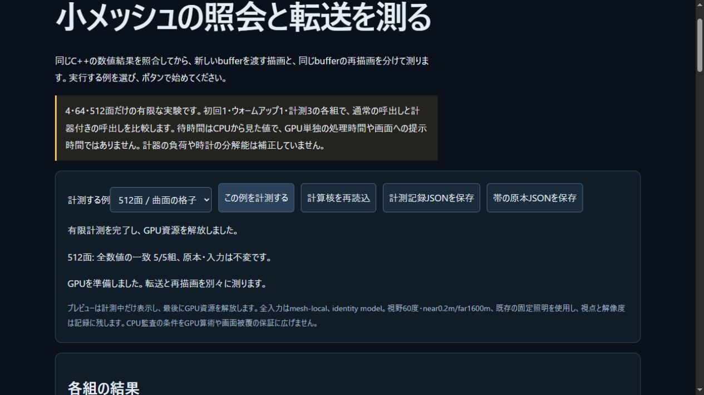
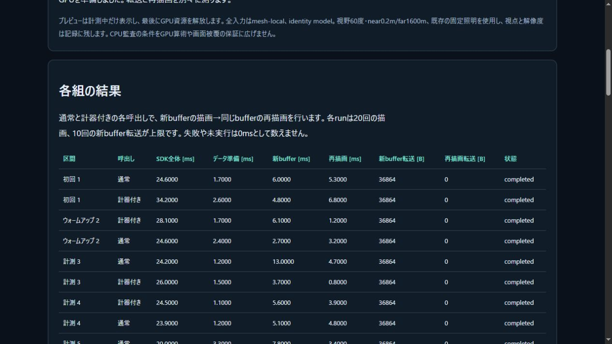

# ブラウザでの派生mesh照会・転送計測

2026-11-04 JST。専用ラボで、原著SDKの数値照会とWebGPU転送/再描画を分けて観測する。[契約](../docs/DERIVED_MESH_GPU_PROFILE.md) / [ラボ](../tools/derived-gpu-lab.html)。C++/SDK/engine/renderer/sampleのsourceは変更していない。公開CI/Pagesの結果は末尾へ追記する。

## ローカル受入

- Node438/438、skip0、構文/Web build成功。前段407群にGPU計測16、ラボ14、実入力1群を追加した。Web build `59555c67664a3f2d`/44modules、教材25記事。
- 実SDK→既存Renderer.renderCheckedのstub GPU経路で4/64/512面を調べ、全288/4608/36864Bと末尾72B、12/192/1536展開頂点、同token再描画時の転送0B、旧buffer退役を確認した。GPU clock/validation/queue失敗や再入・device lostはstub試験で、実機故障を誘発したものではない。
- ラボは各例を固定5pairで実行する。baseline/instrumentedのCPU全DTO/bits照合後、それぞれの新tokenを転送→同tokenを再描画。通常のchecked呼出しと計測helperを交互順に実行し、初回/warmup/計測と両描画を分け、全rawを保持する。成功runは10prepare・20draw・10新規転送・10cache。
- 実IABブラウザで4/64/512面と、計算核の再読込後の4面を実行。計40prepare・80draw・40新規転送・40cacheが完了した。全原本/入力は不変、各最後のmesh bufferも退役し、専用renderer/deviceを解放した。4本のraw JSONはDOM文字列のまま保存し、`-0`をparse→通常JSONで消す再保存はしていない。
- 実ブラウザの初回全DTOと各試行の全出力digestを、Nodeの実WASMへ再照合した。反復込み136,460数値と全typed bytesが一致した。転送量・退役・完了件数と生時刻からの中央値/p95/最大も照合した。新しい記録検査器には入力改変・偽DTO・試行欠損・cache転送・退役数・統計・失敗を成功に偽装する7変異を適用し、全て拒否した。この検査は実GPU内容のreadbackや時計の真正性証明ではない。
- 統合後の固定40+実Source11も再照会。派生query48件のNative基準2318数値bit、実計測経路の40packetへの独立Fraction、7自己群/2受入/36負例が成功した。16completed/24期待失敗、成功17面/51法線成分の最大誤差上界2.384185870951683e−8。失敗prefixはgeometry成功へ数えない。
- 全53 SDK source/header・7通知・2artifactはmanifestと一致。65exports、WASM590964B SHA256 `67daefd24c39af1aefa516d28b35c11808684604bed457c1e16eed15b64e8f73`、glue50029B SHA256 `c787373497549b18cfa8bf1fdb8d39195ca0f2d0d456ce42e2debccb960cc0a4`は不変。ローカルNative/SDKを再buildしたとはしない。

[ローカル実測の対応表](derived-gpu-local-verification.json)、[数値/統計検査](derived-gpu-browser-verification.json)、[archive index](derived-gpu-archive.json)へcommand・source・raw bytesのhashを保存した。archiveは94ファイル/1,934,487B。原本・全入力・最初pairの全出力・後続の全比較/digestと全raw timingは4本のderived-gpu-local-*.json、比較検査の7変異はderived-gpu-browser-controls/、既存独立参照36変異はderived-gpu-controls/に保持する。

## この実行の観測

Chrome155 / Windows、DPR1、canvas1018×338、可視状態visibleの有限測定。adapterはvendor=nvidia・architecture=pascal・isFallbackAdapter=falseを返したがdevice/descriptionは空で、hardware/software分類はunknownとした。利用可能featureと実際のdevice featureを別記録し、timestamp-queryは要求/利用していない。他タブやOSの負荷は制御していない。

表はwarmup後3sampleの中央値ms。rawに初回・warmup、p95・最大も保持する。3sampleのnearest-rank p95は最大と等しい。

| 面数 | SDK通常全体 | SDK計測あり全体 | 通常の新buffer checked全体 | 通常のcache checked全体 | 計測あり新buffer全体 | 計測ありcache全体 |
|---|---:|---:|---:|---:|---:|---:|
| 4 | 0.595 | 0.650 | 5.980 | 3.285 | 1.250 | 1.215 |
| 64 | 3.095 | 4.210 | 5.600 | 1.110 | 3.710 | 1.160 |
| 512 | 22.170 | 25.215 | 4.665 | 3.725 | 2.425 | 3.180 |

512面の計測あり新bufferでは、同期render中央値0.230ms、validation待ち0.900ms、queue待ち1.130ms。cacheでは0.130/0.610/2.375ms。この列ごとの中央値は別trialに由来し、合計して一つの内訳にはできない。各raw trialでは非重複区間と残差の直接式を照合した。

cacheの全体待ちが新bufferより長い場合もあり、通常/計測ありの差は観測費用だけを表さない。GPUは同期処理やvalidation中も並行して動き、queue待ちはGPU単独の実処理時間ではない。別計測のfactory時間、初期化/constructor queue完了もrawに分離した。小標本の値を一般fpsや実キャラクターの更新性能へ換算しない。

## レビューで修正した境界

初期queueの待ち中にGPU callbackが届くと、解決後readyへ戻る経路を再検査で防いだ。描画直後のcallback、dispose失敗、古いロード/非同期結果も成功へ戻さない。時計のfinite値同士の差overflowやhelper固有clockErrorを無効時間として保持し、実数値処理は続ける。

数値の全bit照合・入力不変、GPUの全byte数/退役監査が終わるまではpendingとし、全通過後だけcompletedへ確定する。監査失敗の時刻を成功summaryへ混ぜない。中断したphaseにも予定1/1/3を残し、未実行を0msや予定0件として隠さない。再現試験は不整合と正常復帰を確認する。

新概念図derived-gpu-profile.svgは原著で、CPU同期render・validation待ち・queue待ちを区別する。幅は実測ではない。教材とW3C実読範囲を法務台帳へ記録した。外部package/SDK/素材や有料サービスは未追加、本体licenseは未選定。

公開前のindex監査で、新ラボ3source（HTML/MJS/test）の改行がGitに変換されることを検出した。計測に使った実source bytesをそのまま保持する属性へ明示し、stageを再照合する。計算結果やアルゴリズムを変更したものではない。

次は、観測されたCPU照会・snapshot読出しの費用から最小の改善を選ぶ。数値条件・未確定拒否・原本保持・全byte uploadは維持し、robotの更新頻度/失敗表示を別に受け入れてから適用する。一般接触・流体・弾塑性損傷・IK/制御・高精度光学撮像の残件を維持する。

## 初回公開CIの失敗と修正

`ebf5b5a`のPagesは成功したが、[初回Linux CI](https://github.com/tatata93/pikapikaengine/actions/runs/41676873368)はNode437成功/1失敗で停止した。静的HTML試験が未buildの`src="derived-gpu-lab.mjs"`だけを許容し、生成済み`?build=59555c67664a3f2d`を拒否したためである。CTest30と旧数値参照はこのrunで成功したが、後段sanitizer等のskipを成功へ数えない。

試験1行を正しい任意の16桁build IDを許容する形へ修正し、生成済みHTMLで全438/438skip0・構文/buildを再実行して成功した。実行用MJS/HTML・GPU helper・WASMは変更しておらず、公開4run/80drawの原記録は同じ実sourceへ対応する。初回の全CI logと修正後の全raw/source hashはderived-gpu-job-126059755014.txt、derived-gpu-fix-checks/、derived-gpu-fix-record.jsonへ保持する。修正CIの完了は別に確認する。

## 修正CI・公開受入の確定

修正`158f9f1`の[Linux CI](https://github.com/tatata93/pikapikaengine/actions/runs/41677879779)と[Pages](https://github.com/tatata93/pikapikaengine/actions/runs/41677877981)が全工程成功した。GNU13.3.0/Node22.23.4、CTest30/30、Node438/438skip0、旧2841bits・計測経路2318bits、quick32prepareの54,410反復数値一致、独立36負例の3batchを確認。ASan/UBSanのskinning69・binding IO27・派生mesh54群とstandalone WASM5既知結果も成功した。既存warningは36行で、解消したとはしない。4job全logと3runの全step状態を保存した。

公開IABでも4/64/512面と計算核再読込後4面の40prepare/80draw・40新規転送/40cacheが完了した。ローカルとは別の4runで、全入力・初回全DTO・全反復digest・件数はローカルと一致。Node実SDKへ再照合して136,460数値/全typed bytes、全byte転送量・退役・統計直接式が一致した。公開raw4本はDOM文字列のまま保持する。実行sourceは`ebf5b5a`、試験だけの修正が`158f9f1`で、配信15ファイルHTTP200/commit blob byte一致と、その15ファイルが修正commitでも同一であることを確認した。

[公開証拠index](derived-gpu-public-verification.json)、[公開数値/統計検査](derived-gpu-public-browser-verification.json)、[実行command](derived-gpu-public-browser-command.txt)からrawとhashを追跡できる。公開既存robotは`?v=158f9f1`でC++ WASM/WebGPU READYと出撃ボタン有効を確認した。戦闘操作を再試験したとはしない。

## 次候補のコピー探索

`Array.from(view)`と明示indexの所有Array copyを、変更していない実SDKの別runtimeで比較した。唯一の有限runで30prepare・所有検査5query、全DTOと135,470反復数値bitsが一致。実record長3/18/26/20と合成capacity64の孤立copyは合計500,000回実行した。全rawとrecipe14ファイル/8,562,334Bを[archive](derived-copy-archive.json)へbyte一致で保存した。

SDK全体の中央値msは4面0.589→0.567、64面2.396→3.661、512面15.715→16.000。孤立copyの短縮が全体の一貫した改善にならなかったため、本番置換は採用しない。own method差替え・JIT/GC・観測費用と小標本の影響を分けきった結果ではない。C++/SDK/engine/renderer/sampleは不変、依存・外部素材・license選定の追加もない。[次の受入](../docs/DERIVED_MESH_READBACK_PLAN.md)では既存64 F64容量内の複数record読出しを設計し、数値条件と所有契約を保った実SDK全体の効果を確認する。
