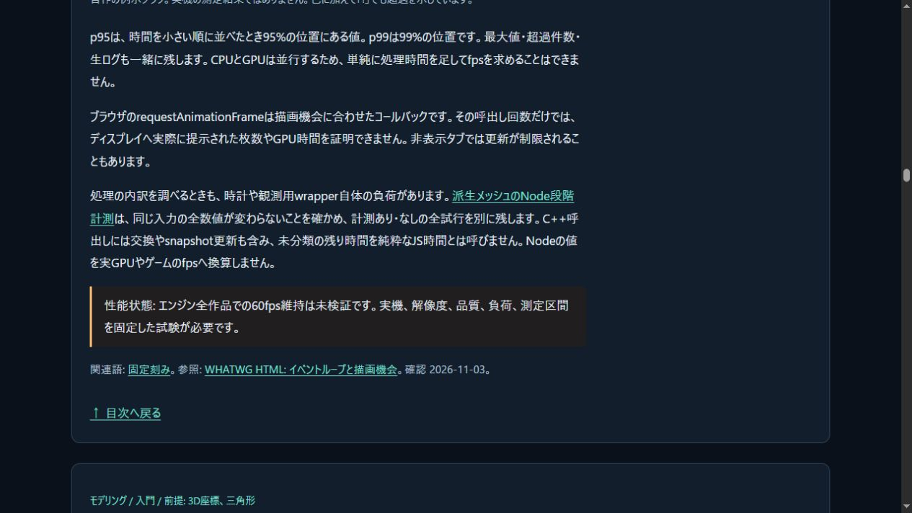
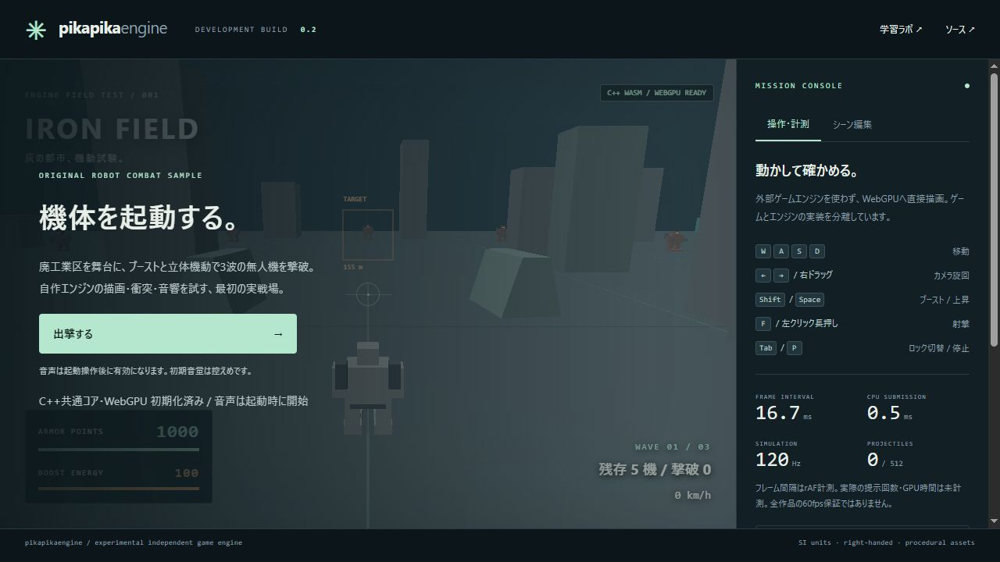

# 派生meshのNode段階計測

2026-11-04 JST。共有SDKの呼出しを別runtime/proxyから観測するツールと、全結果を比較する有界CLIを追加した。[契約](../docs/DERIVED_MESH_PROFILE.md) / [性能計画](../docs/DERIVED_MESH_PERFORMANCE_PLAN.md)。エンジン本体・C++・renderer・sample・SDKは変更していない。公開結果は末尾へ追記する。

## 正しさと再現

- Node407/407、skip0、構文検査とWeb build成功。新profiler12群とCLI4群を含む。時計のthrow/非finite/後退/overflow、モデル例外との同時発生、再入拒否と正常復帰を調べ、時計の異常で実計算を中断しないことを確認した。元method/exportの同一性とWorld/既存snapshotも保持した。
- 固定40例と実Source11例を再生。前段失敗3例では派生queryをせず、残り8例と固定40例の全DTOを元runtimeと比較した。Native基準の派生結果2318数値bit（固定1272+Source派生1046）が一致した。旧SDKの2841比較には変形位置と派生入力も含まれ、この2318と同じ計数ではない。
- 計測経路が実際に返したWASM40packetへ独立Fraction検査を適用し、16completed/24期待失敗、成功17面/51法線成分を確認。7自己群・2受入・36負例も成功。最大の成功法線誤差上界は2.384185870951683e−8。失敗候補の誤差や診断prefixを成功geometryへ混ぜない。
- 凍結した最終CLIをrootが単独実行し、標準10case/100prepare呼出し（90 C++照会、10 host容量拒否）、8,123,305反復込み数値の全DTO/bits/hash比較が成功した。初回・warmup1pair・計測3pairの全時刻を保存。baseline/instrumentedの順を交互にし、正常6caseと期待モデル失敗3case・host拒否1caseを別に保持した。
- 全53 SDK source/header・7通知・2artifactがmanifestと一致。WASM590964B SHA256 `67daefd24c39af1aefa516d28b35c11808684604bed457c1e16eed15b64e8f73`、glue50029B SHA256 `c787373497549b18cfa8bf1fdb8d39195ca0f2d0d456ce42e2debccb960cc0a4`、65exportsは不変。ローカルNative/SDKを再buildしたとはしない。公開CIでは既存Nativeを再buildする。

[archive index](derived-profile-archive.json)は81ファイル/4,210,467Bの元出力・入力・command・source snapshotをbyte不変で対応付ける。`derived-profile-standard/`は全入力/原本/全trialと小出力の初回全packet、大出力の明示previewと全出力hash、`derived-profile-correctness/`は実計測経路の40packet/48timingと参照結果、`derived-profile-controls/`は36変異入力と全実command、`derived-profile-checks/`は全回帰とSDK保持、`derived-profile-recipes/`は再現用原著コードである。大出力のpreviewを全出力保存と読み替えない。

再現コマンド:

```powershell
node scripts/profile-derived-mesh.mjs --output build/derived-profile-local
node scripts/verify-derived-profile.mjs reports/derived-mesh-sdk-fixtures-native-fixtures.json reports/derived-mesh-sdk-fixtures-probe-fixtures.json
python -X utf8 reports/derived-profile-recipes/root-verify.py
```

## 有限環境での観測

Windows/Node24.14.1、Intel Core i5-6500、単一process。SDK起動、原本FK/LBS、query、構造検査/所有copyを分離した。次表は各3計測の中央値ms。初回/warmupは除外してもrawを保持し、p95/最大も[全report](derived-profile-standard/report.json)へ保存する。p95はnearest rankで、この3sampleでは最大値と等しい。

| 入力 | baseline全体 | 計測あり全体 | C ABI query | getter | JS output copy | 未分類残差 | 別token生成※ |
|---|---:|---:|---:|---:|---:|---:|---:|
| 原本帯6頂点/4面 | 0.587 | 0.623 | 0.409 | 0.016 | 0.064 | 0.122 | 0.061 |
| 非軸法線192頂点/64面 | 2.269 | 3.200 | 1.099 | 0.214 | 0.795 | 1.102 | 0.355 |
| shear grid512頂点/512面 | 18.714 | 19.670 | 9.032 | 0.676 | 4.000 | 5.564 | 2.298 |
| grid2048頂点/4096面 | 127.832 | 150.020 | 74.445 | 4.799 | 34.186 | 27.874 | 18.885 |
| grid2048頂点/32768面 | 1040.972 | 1105.278 | 652.357 | 36.013 | 210.674 | 207.197 | 117.877 |

※baseline側の結果へ別途factoryを実行した中央値。計測あり側のfactory時間も全reportに保持。query全体時間には含めない。各列の中央値は別sampleに由来し、合計して一つの内訳にはできない。実trialごとの非重複段階合計と残差の直接式を検査した。

4096/32768面は同じ2048頂点の3906個のgrid面を循環する負荷で、全て異なる独立面のモデルではない。小入力は非軸法線/異なる位置を使うが、実キャラクター全体を代表する保証はない。hash・比較・factoryはquery計時外でも次の計測へ影響する。CPU/OS/V8のcold条件は制御していない。

wrapper/時計は未較正で、baselineとの差を純粋な観測費用と断定しない。C ABI queryは検査/core/commitを含み、getterはpacket copyを含む。未分類残差もJSのencode/decode/validationと計測器などを含み、純粋なJS時間ではない。実GPU upload/queue完了、Native同条件、fpsは未測定。大きい入力を毎frame更新可能とはしない。

## レビューと境界

引数検査を迂回して巨大repeatを渡せないようCLI runnerを非exportとし、出力先をrepo build直下の実directoryへ限定、排他的新規run/260query/10MiB上限を設けた。既存runのbyte不変も試験した。timerを注入する側には副作用なし・同じmoduleの他runtimeを呼ばない契約が必要で、共有moduleの排他lockは提供しない。

時間会計は`unassigned = elapsed - sum(stages)`を直接検査する。浮動小数の逆演算で`sum + unassigned === elapsed`まで要求する誤った検査を避けた。全stageの非負/finite・非重複とcall件数は別に照合した。

教材25記事のフレーム時間へ、計測器が処理へ影響する点とNode/GPUの区別を追記。原著図と既存の予算例を継続し、実測GPU図として扱わない。Node公式時計APIの実読範囲を参考台帳へ記録、外部package/素材/SDKは未追加、本体license未選定を維持した。

Web buildは`758f09bb2a2fab76`/41modules。初回Git index照合で、新しい証拠directory配下の改行がGitに変換されることを検出した。`.gitattributes`を再帰指定して元byteへ戻し、公開前に全raw/source/SDKの実staged blobを再照合する。実測・数値結果を変更したものではない。

次は実ブラウザで、小規模な全byte uploadとqueue完了をCPU照会から分けて測る。今回の大容量でC ABI照会だけでなくsnapshot読出し/copy/DTOにも費用が観測されたため、計測条件を保ったまま改善候補を検討する。数値品質条件や失敗拒否は弱めない。robot更新頻度、一般接触・流体・損傷・IK/制御・高精度光学撮像の残件は維持する。

## 公開受入

コード`5602496c2d5d2e935e6104295be71d83b6733170`の[Linux CI](https://github.com/tatata93/pikapikaengine/actions/runs/41669801929)と[Pages](https://github.com/tatata93/pikapikaengine/actions/runs/41669800722)が成功。GNU13.3/Node22.23.4でCTest30/30、Node407/407skip0、旧SDKの2841数値bit、新計測経路48queryの2318数値bitが一致した。Native/主WASM/計測経路の各参照controlで7自己群・2受入・36負例、別sanitizer69/27/54群も成功。quick32prepareは54,410反復込み数値の全比較を通した。CI runnerの速度はローカルの標準実測へ合成しない。既存warning36行を含む全job logを保存した。

公開16ファイルはcode commit blobとbyte一致。公開教材の25記事と追加した計測説明、既存robotの実WASM/WebGPU READY・起動button有効をブラウザで確認した。今回は戦闘操作や派生animation、GPU性能を試したものではない。数値/renderer sourceが不変のため、前段の公開15操作を全て再実行したとも扱わない。

[公開検証のhash対応](derived-profile-public-verification.json)にCI/job/Pages・HTTP・DOM・画面を保持。HTTP検査recipeの最初の実行は誤ったglue拡張子を指定して止まったため、実manifestの配布名を読み取る方式へ直して16件を完了した。配信側やSDKの変更はない。[次のGPU計測受入](../docs/DERIVED_MESH_GPU_PROFILE_PLAN.md)は未実装の計画である。

[ロボットを起動](https://tatata93.github.io/pikapikaengine/?v=5602496) / [原本と手動3D表示ラボ](https://tatata93.github.io/pikapikaengine/tools/skin-binding-lab.html?v=5602496)




