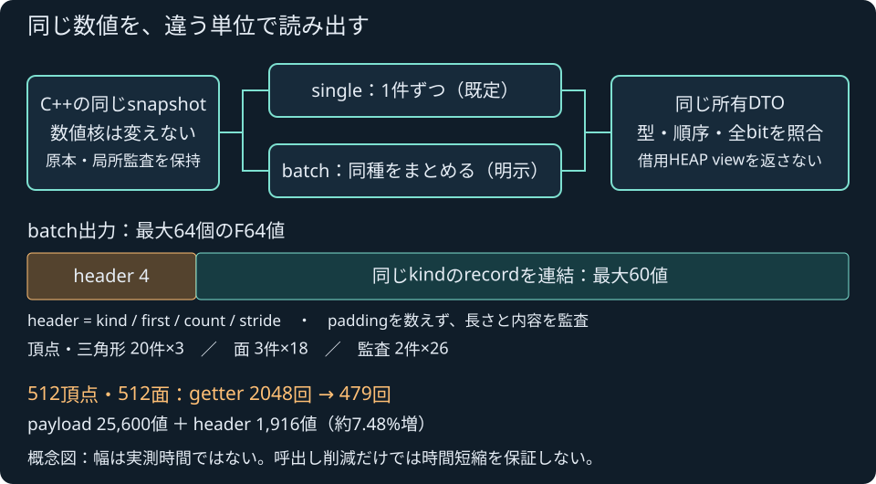
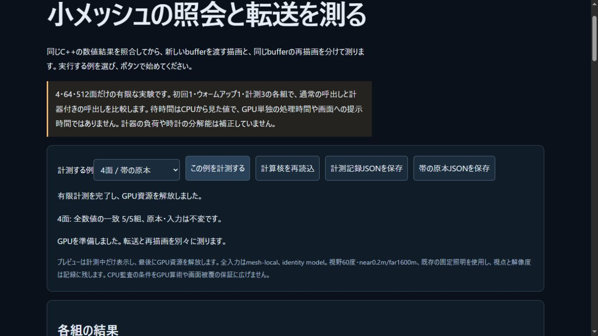

# 派生mesh snapshotのまとめ読出し

2026-11-04 JST。既存64 F64出力領域内で、複数recordを読むC ABIと明示的なJS batch経路を追加した。[実装契約](../docs/DERIVED_MESH_BATCH_READ.md) / [設計時の計画](../docs/DERIVED_MESH_BATCH_READ_PLAN.md)。通常の既定はsingleを維持する。ローカル統合は完了し、公開CI/Pages・公開操作は本報告時点では未実施。公開結果は別に追記する。

## 実装の範囲

新しい `pp_sim_derived_mesh_records(kind,first,count)` は同じ所有snapshotを読み、header4 `[kind,first,count,stride]` と既存payloadを返す。頂点/triangleは最大20件、展開faceは3件、auditは2件。count0・超過・範囲外を自動縮小せず拒否し、失敗時は以前のoutput/countと現在のsnapshotを保持する。acceptedモデル失敗は従来どおりgeometry-nullへ更新され、audit prefixを成功geometryへ変えない。

既存query・single getter・API version1・F64 output容量64・実入力上限2048頂点/32768面を維持した。JSは `readback:'batch'` を明示した場合だけ新経路を使い、不正指定や旧SDKにない機能への要求を入力交換より前に拒否する。不正batchをsingleへfallbackして隠さない。全record監査、signed zero、通常Array/Float32Array/Uint32Arrayの所有を維持する。

計測では `getterKinds` を実ABI呼出し数、`getterRecords` を要求record数として分ける。失敗したNative要求も計測された呼出しであり、成功件数と混同しない。512頂点/512面のgetterは計算上2048→479回だが、header分の転送は約7.48%増える。query核・純粋derived計算・renderer・sampleは変更していない。call削減率を速度向上率とはしない。

## 最終ローカル統合

- Native全744群（旧739群にAPI5群を追加）、C ABI70群、CTest30/30が成功。全kindの最大packet/tail、single payloadとのbits一致、有理cross/法線、不正count/range/overflowの保持、失敗prefix、独立snapshotとWorld時計/resetを試験した。既存の同時2048頂点/32768面試験にも末尾batch確認を加え、重いprepareを重複追加していない。
- 最終Node452/452、skip0、構文検査とWeb buildが成功。Web buildは `c2aa5ebb6392265f` / 44modules。
- Emscripten6.0.13の新共通SDKは66 exports。全53 source/header・7通知・2artifactをmanifestと照合した。API/交換容量の変更はなく、新しい外部依存・素材も追加していない。
- WASM592,939B、SHA256 `32a42eb5cadaba366d5c1090dab59ddcacde6a7a8fb62b1bfdd232d2f0b76dea`。glue50,381B、SHA256 `77e9cd090eca5f9a4b1bc2f04b688f9646124c3310a69bf36fd09a1b9c272d90`。

最終command/stdout/stderrは [Native](derived-readback-checks/native-5deqh1ew/command.json)、[SDK](derived-readback-checks/sdk-m2tud_m8/command.json)、[Node](derived-readback-checks/node-pj7nbhcr/command.json)、[構文](derived-readback-checks/syntax-n9pjd6yo/command.json)、[Web](derived-readback-checks/web-l3_827_i/command.json)に保持した。CTestの全記録は [LastTest.log](derived-readback-checks/LastTest.log)。これらはローカル結果であり、Linux CI/Pages成功を先取りしない。

## 数値・所有の独立照合

fresh Native40固定モデルとSource11を生成し、主SDKとの既存2,841数値bit比較が成功した。single/batchそれぞれ実計測helperを通す48派生queryでも、各2,318数値bitがNative基準と一致した。Source11のうち8例が派生queryへ進み、3例は上流段階の失敗を保持して派生成功へ数えていない。

両transportからの40packetを独立Fraction checkerへ渡し、各7自己試験・2受入control・36拒否controlが成功。16completed/24期待失敗の区別を維持した。completedの17面/51法線成分について最大のcertified error上界は `2.384185870951683e−8`。失敗prefixの認証済み1面/3成分や、不合格候補を含むerror欄は別の範囲であり、このcompleted上界へ混ぜない。失敗prefixは成功bufferではない。

[数値検証まとめ](derived-readback-reference/run-2ho86lez/verification.json)、[fresh Native40](derived-readback-reference/run-2ho86lez/native40.json)、[Source11](derived-readback-reference/run-2ho86lez/source11.json)、[主SDK比較](derived-readback-reference/run-2ho86lez/sdk-report.json)、[single負例](derived-readback-controls-single/summary.json)、[batch負例](derived-readback-controls-batch/summary.json)から原入力・出力・commandを追跡できる。検査対象は局所量と読出し契約であり、world/GPU算術や連続surfaceの保証ではない。

全rawの [archive index](derived-readback-archive.json) は172ファイル/7,049,723Bをsourceからbyte一致で保存した。計測後のarchiveは追加実測0で、証拠のコピーを性能sampleへ数えない。

## 有限なNode比較

専用CLIを4つの独立した実WASM moduleで実行し、single/batchと、それぞれの通常/計測あり経路を比較した。実Source4面・有理法線64面・sheared grid512面、各初回1/warmup1/計測3、計60prepare。全406,410反復数値bits、ordered keys、型、全typed bytesが一致し、最初の全DTOは前公開3caseとも一致した。

全原本/入力、既存DTOの所有、元runtime method/native export/prototypeが不変。初回全DTO・全反復digest・呼出順・環境・全raw timingを保持した。30秒process watchdogと10MiB保存上限内で、記録は4,030,880B。別の [parent-audit.json](derived-readback-profile/run-1793726212894-f47e88d240ce/parent-audit.json) が全件数・bit比較・統計直接式を照合し、その監査による実query追加は0。

原記録は [report.json](derived-readback-profile/run-1793726212894-f47e88d240ce/report.json)、[command.json](derived-readback-profile/run-1793726212894-f47e88d240ce/command.json)、[環境](derived-readback-profile/run-1793726212894-f47e88d240ce/environment.json)と同directory内の各pair/initial JSONに保存した。

以下はwarmup後3sampleの全体中央値ms。初回/warmup、p95・最大、全5stageと未分類残差はrawに残す。3sampleのnearest-rank p95は最大値となる。

| 面数 | single通常 | batch通常 | single計測あり | batch計測あり |
|---|---:|---:|---:|---:|
| 4 | 0.3211 | 0.2371 | 0.3941 | 0.3756 |
| 64 | 2.3400 | 2.3939 | 3.8720 | 2.0969 |
| 512 | 17.7891 | 16.5565 | 20.1442 | 17.6057 |

64面の通常経路ではbatchの中央値が長く、他caseの短縮も一般的な速度保証にはならない。JIT/GC、4moduleの実行順、計測wrapper、検査/保存の後続sampleへの影響、時計分解能とOS負荷は校正していない。計測あり/なしの差を純粋な計器費用とせず、stage中央値を足して1trialの会計にしない。未分類残差は純JS時間でもC++核単独時間でもない。

これはNodeの小入力・小標本比較であり、GPU/Native単独時間、一般fps、最大容量での実時間animationを測ったものではない。既定singleを維持し、batchは明示的な実験APIとして公開準備する。ブラウザでの両transport比較UI、性能上の通常採用、robotへの適用は未受入として残す。

## 初回結果を保持した修正

初回SDK buildには、別enum型同士の減算によるdeprecation warningが1件あった。親が両定数をuint32_tへ明示castし、定数値/計算内容を変えず再buildした。最終SDK stderrは0B、生成binaryは初回と同一だった。[初回SDK log](derived-readback-checks/sdk-r3xabv6w/command.json)を保持し、最初から無警告だったとはしない。

初回Nodeは451成功/1失敗。旧CLI試験がexport数65を固定assertしていたため、新しい66へ訂正し全452/452を再実行した。[初回Node log](derived-readback-checks/node-arvrtsaz/command.json)も保持した。失敗runを最終成功へ混ぜず、最終rawと区別する。

## 図・配布と残る境界

原著図は2,711B、SHA256 `793c33a8ab3f45fa1905950bca90feb7a02e6d2eb151db7f6071fb0d013b67f3`。recordの配置を示す図であり、幅を実測時間へ対応させていない。外部package・SDK・素材や有料サービスは追加せず、本体licenseは未選定のまま。

公開CI/Pages・公開操作は未実施で、親が別途確認して追記する。次のブラウザ比較では同一SDK/同入力・全DTO/全byte転送・所有と失敗表示を維持する。局所meshの読出し改善を、一般物理・流体・弾塑性損傷・IK/制御・高精度撮像やゲームエンジン全体の完成へ広げない。

## ローカルブラウザの既存経路

新SDK66の既存singleラボで4面の10prepare/20draw・10新規転送/10cacheを実行した。取得した全DTOと990反復数値/typed bytes、全288B転送/cache0B、退役と全統計直接式をNode実SDKへ照合した。これは既存singleの互換動作確認で、ブラウザのbatch経路を実行したものではない。[全raw](derived-readback-local-single-4.json) / [検査](derived-readback-browser-verification.json)。新buildの既存robotはREADYと出撃ボタン有効を確認し、戦闘操作試験とは分ける。原著図も実ブラウザで文字・配置を目視し[画像](derived-readback-diagram.png)を保持した。

