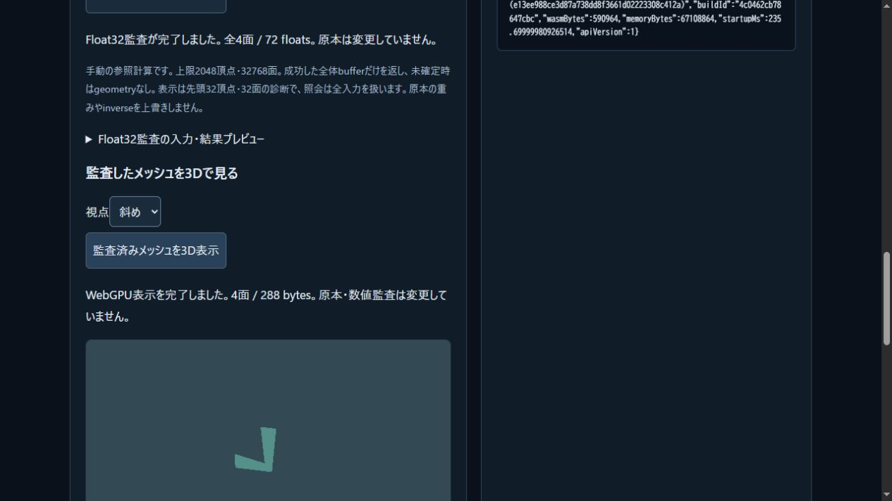

# 監査済みメッシュの手動WebGPU表示

2026-11-04 JST。共有C++の位置/法線監査に成功したbufferを、原本制作ラボから既存の原著WebGPU rendererへ渡す経路を実装した。[操作](../tools/skin-binding-lab.html) / [契約](../docs/DERIVED_MESH_RENDER.md)。公開CI/Pagesの確認は追記する。

`createDerivedMeshRenderData(result)`は全体completed・typed shape/finite/件数/index/展開position/flat normal/diagnosticsの整合を検査して所有copyを作る。公開するfrozen tokenは頂点数/面数/float数だけで、private bytesはWeakMapに保つ。専用derived-mesh経路は既存compileMeshを呼ばず、全interleaved Float32 bytesをそのままuploadする。第三者が偽造した整った監査データへの数学的認証は主張しない。

原本ラボは「位置を計算」→「Float32監査」→「3D表示」の手動操作。固定3視点、identity model、既存照明で小さい帯を描く。視点切替はC++照会を繰り返さない。時刻/原本/Scene/weight/予算変更や前段・派生失敗では古いmeshを隠しGPU mesh資源を破棄する。GPU validation・queue完了を確認してから表示完了とする。GPU失敗でも原本/数値結果を保持し、同じラボから表示を再試行できる。

## ローカル受入

- 最終Node391/391、skip0、syntax/build成功。新renderer18群とlab追加4群を含む。既存orientation描画5群も成功した。raw stdout/stderr、command、source hash、再現scriptはderived-render-root-* / derived-render-recipes/へ保存した。
- mock GPUは全upload bytes・末尾・draw数、所有copyと非偽造token、cache更新/消去、既存mesh/box混在と共通予算、write/create/submit失敗の候補破棄、部分constructor、error scope、device lost、idempotent dispose、遅れた旧失敗が新frame資源を消さないことを検査した。構造容量2048頂点/32768面では2359296Bと98304展開cornerを確認した。これは実GPUで最大容量を描画した試験ではない。
- ラボ19群は実SDKとstub GPUを併用。数値原本保持、入力変更/失敗時の消去、GPU create/draw失敗と復帰、旧renderer callback、非同期create/validation後の古い表示復活の拒否を確認した。GPU故障系はstub試験で、実機のdevice lostを誘発したとはしない。
- 凍結版の実ブラウザWebGPUで15観測。6頂点/4面/288Bを描き、斜め/正面/背面、時刻0、予算不足、原本変更、実LBS全頂点collapse、前段underflow、正常復帰を確認した。失敗時にはcanvasを隠し表示ボタンを無効化し、原本保存を可能なまま保つ。全DOM原本/位置/派生packetと状態を保存した。adapterのhardware/software種別やGPU画素の数値誤差は測定していない。
- 全53 SDK source/header、7通知、2artifactを再照合。配布WASM590964B/glue50029B/SDK65とmanifestはbyte不変。C++/CMake/sampleはGit差分なし。他の原本・assetも保持した。Nativeをこのローカル段で再buildせず、前段739群/CTest30の記録と不変sourceを対応させる。公開Linux CIの再build結果は別に確定する。

レビューでArray.everyが疎なaudit配列の欠損をskipする問題を発見した。C++の正常結果はdenseで、数値核やWASMは変更していない。factoryを全要素検査に直し、新しい専用1群でcross/Q/normalized/normalErrorの6変異を拒否する。修正前390件のignored runを保持し、修正後391件と再build・15実操作を最終受入とした。

Web build `4c0462cb78647cbc`、40 modules、教材25記事。原著SVGを継続し、外部library/素材/SDK/有料serviceは追加していない。本体licenseは未選定。

## 境界と次段

CPUの局所Float32法線誤差契約をGPU/world/view/clip/rasterへ拡張しない。shaderは既存のFloat32変換・normal normalizeと近似照明を使う。任意のshear変換や物理的光学画像、自己交差/接触/材料損傷の完成ではない。固定cameraの外にある原本は見えない場合がある。

実時間animationやrobot全体への適用は次段。まずCPU参照prepareとuploadの費用を分け、入力・面数・refinement・更新頻度・環境を明示して測る。未測定のfpsや一般性能を報告しない。

## 公開受入

コード`90b1afebf9e1e67a7ed0237645d80cd5f6f9d4ee`の[Linux CI](https://github.com/tatata93/pikapikaengine/actions/runs/41663658310)と[Pages](https://github.com/tatata93/pikapikaengine/actions/runs/41663656089)が成功。GNU13.3/Node22.23.4でNative CTest30を再build・実行し、Node391/391skip0、新旧数値2841bit比較、両backend各7自己群/2受入/36負例、別ASan/UBSan69/27/54群も成功した。既存warning36行を含む全logを保持し、warning-freeや任意入力の安全性証明としない。

公開WebGPU15観測の原本/portable/位置/派生数値packetと表示状態はローカルと完全一致。URL・runtime起動時間・canvas pixel寸法だけ比較対象外とした。17配信ファイルはコードcommitとbyte一致。既存robotもC++ WASM / WEBGPU READYまで起動を確認し、ゲーム原本はbyte不変。戦闘操作や新しいanimation適用の試験とは分ける。

`derived-render-public-verification.json`にCI/job/Pages/DOM/HTTP/画像のhashを対応付けた。[公開ラボ](https://tatata93.github.io/pikapikaengine/tools/skin-binding-lab.html?v=90b1afe)で位置計算→監査→3D表示を操作できる。次は[性能調査](../docs/DERIVED_MESH_PERFORMANCE_PLAN.md)へ進む。

