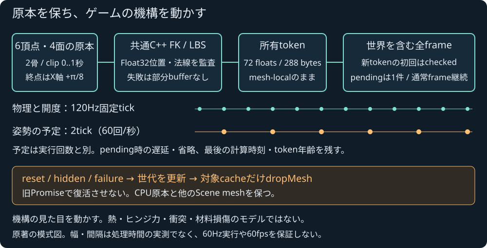

# ロボットの背面機構を実Source・FK・スキニングへ接続

2026-11-04 JST。ローカル受入済み。公開CI/Pagesと公開操作は後段で別に確定する。

IRON FIELDのプレイヤーに原著の背面ヒンジカバーを装着した。移動で少し開き、有効boostで大きく開き、解除・減速で戻る。6頂点4面・2骨、最大X回転π/8。既存のSource原本→共通C++ rest/current FK→LBS→派生Float32位置/法線監査→所有token→全ゲームframeを通す。毎frameにbindを再生成せず、成功した全288Bを既存rendererへ渡す。shaderやJSの代替skinningへ切り替えない。

原著assetは1759B・SHA256 `3be05db664848abb7806d906d8d36248668228ec3c9f1b5a2360c9483c0fd863`。別の制作contextは1243B・SHA256 `04ac3a5630f540692cab66c68082d38af45d92d00fffe74a07adb5ef6447a6d9`。生成recipeと原本のJSON/portable/Native CLI往復を保持する。このcontextは同じ原本から作ったもので、既存levelとの独立一致証拠ではない。levelには装飾meshや架空の親colliderを挿入しない。

## 固定状態と資源境界

開度は120Hz固定stepで更新し、実際のboost消費条件と水平速度を参照する。0.1m/s以下は視覚制御のidle bandとしてrestへ戻す。これは物理速度・FK/LBS・派生監査の許容差ではない。更新予定は2tickごとで、毎秒60回のrequest候補を実GPUの60Hz達成とはしない。pending中の新queryを積み上げず、遅延・省略・実行回数と最後に計算した時刻を保持する。同じclip時刻は同じtokenで再描画する。静止tokenの年齢も含むため、年齢そのものは姿勢誤差ではない。

新tokenの最初だけ、世界も含む全itemsで`renderChecked`が通常submit1回を置き換える。非同期validation→queue待ちの間も通常frameを継続し、物理をqueue待ちへ結合しない。新しい`Renderer.dropMesh(id)`は指定cacheだけを冪等退役し、旧checked失敗が別のScene cacheを消さないepoch境界を進める。最後に描いた画素・draw統計・deviceを消したと主張しない。

数値/予算/SDK/asset失敗はカバーを外して表示し、GPU失敗ではカバーなしの全base frameのchecked復旧を一度試す。復旧失敗は全体停止/dispose。reset/hidden/Scene交換で旧callbackが形状を復活させない。asset再読込み失敗後のresetでも、前のassetを黙って採用しない。既に128meshを使う有効levelの枠を奪わず、カバーを利用不可にして元のlevelを維持する。

## 試験と原本費用

最終Node492/492・skip0、構文検査、Web `b576823ff1731dba` / 45modulesが成功した。Source7群、controller11群、derived renderer24群を含む。Node30/60/120/144描画replayで、player/敵/弾体/hp/energy/kills/waveとvisual固定状態が一致し、cover描画がgame物理を進めないことを確認した。Sourceの既知0/.5/1秒ではroot/hingeの全16行列と全6頂点を独立のX回転解析へ照合した。33有限clip標本の全4面/72float/288Bが成功したが、全連続パラメータの品質証明へは拡張しない。

一度の原本生成は実C++のrest FKとbindを使う。最終`GzrtcP`の15観測は各時刻の初回1・warmup1・measure3を保持する。囲ったpipeline中央値msは0秒1.6780、.5秒1.2251、1秒.9495、全measure最大2.3208。Source全検査/rest/current FK/LBS、derived、tokenと途中の確認・時計を含むNode有限観測で、stage中央値の和ではない。GPU/全game frame・通常経路との無計器比較・一般fpsの保証ではない。

SDKの53source/header・7通知・2artifactはbyte不変。WASM592939B / glue50381B、ABI1 / 66exportsを維持する。C++/共通simulation/skin binding/derived token核を変更していない。今回ローカルでNative再buildしたとはせず、既存の実Native CLIとSDKを使った。外部library/asset/有料serviceなし、本体license未選定。

## 実ブラウザ

最終buildのIABで出撃→通常移動→boost→解除→旋回→連射→P停止を実行し、2機撃破を確認した。全開clip=1を実記録へ保持した。停止後の別captureではtick/開度/query回数/GPU統計が一致し、3meshの常駐が増えなかった。最初の戦闘captureで全転送は既存level1728B＋288B×query数、破棄数=query数−1と一致した。実GPUメモリの読戻しを行った証拠ではない。

障害物barricade-leftをx=−25から−22.5mへ編集→undoで−25→redoで−22.5と実UIで確認した。JSONとportableを保存し、JSONを再読込み→P再開→再出撃でカバーが復帰した。保存したlevelにderived tokenはなく、Source原本は不変。JSONの元arenaにはnativeId/name/sourceType等が無いため、既存codecによる明示的なnative metadata付与後のcanonical portable bytesで両保存を照合した。最初の検査がこのmetadata追加を未考慮で停止した事実は、数値/IDの破損として扱わない。

保存したFrameLog745標本は起動/idle/pauseも含む全rAF観測。中央値16.6800ms/p95 16.7600ms/最大33.3600ms、16.666…ms超521件、droppedSeconds=0。遅いframeを除外せず、これを戦闘中だけの性能や実画面提示fpsとはしない。各Source/derived/token費用と予定省略等は別rawに残す。全hidden/BFCache復帰経路の実ブラウザ再試験は未完で、stub境界試験とは区別する。

## 修正と証拠

最初のpilotは残存速度が指数的に小さくなる間も異なるclipを要求し、約23秒で1364queryを続けた。原rawを残し、上記idle bandとexactrest到達後のquery停止回帰を追加した。初回controller試験の2件は、境界での約2e−16の残りを0とするassertと、反復加算を直接積と同bitにするassertで失敗した。終端は次の固定tickで0に到達すること、途中値の解析差は1e−15内であることへ明示し、計算値を書換えて隠していない。その後の全492試験が成功した。

[ローカル証拠index](robot-cover-local-verification.json)、[最終実操作raw](robot-cover-local-release/)、[ブラウザの集計監査](robot-cover-browser-verification.json)、[原本/Native CLI/費用](robot-cover-source/robot-cover-source-GzrtcP/)、[全check log](robot-cover-checks/)、[archive hash](robot-cover-archive.json)、[recipes](robot-cover-recipes/)へ対応付けた。以前のbuild/探索操作と最終受入はdirectoryを分けて不変で保持した。

これは装飾機構の実スキニングであり、ヒンジ力学・熱・被弾損傷の解ではない。一般接触/角運動/摩擦・車両/航空/鉄道・流体・材料損傷・IK/制御・高精度光学撮像の未完を維持する。公開受入後は共通engineの物理モデルの残件へ戻る。
