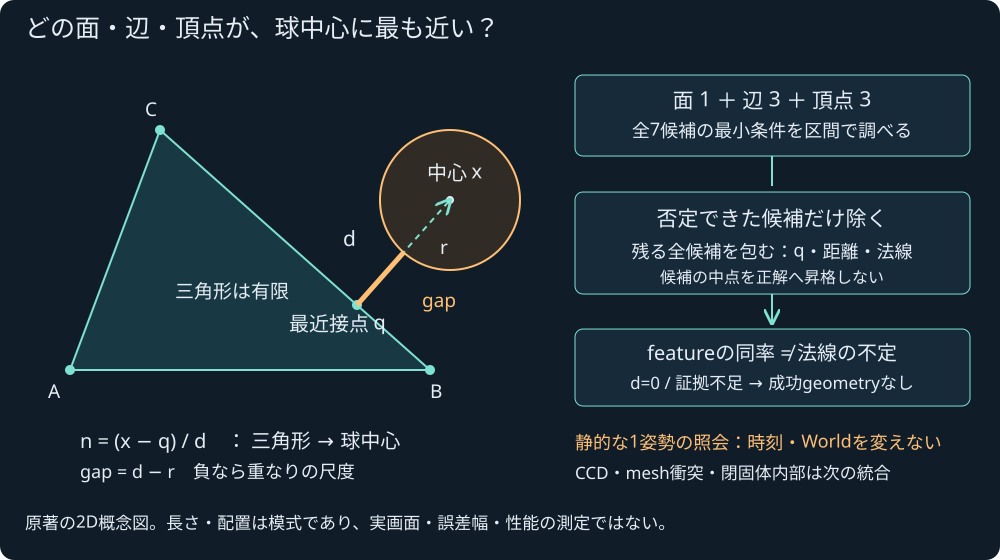
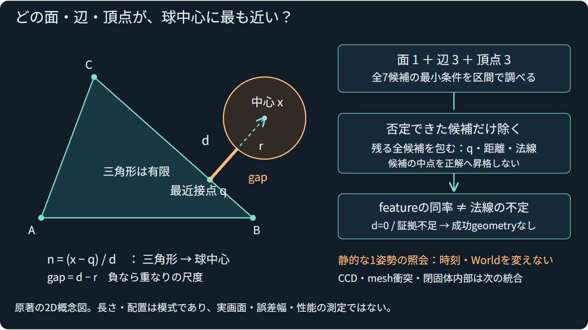

# 球と静的三角形のNative狭域照会

2026-11-04 JST。ローカル受入済み。公開Linux CI/Pagesは後段で別に確定する。

Nativeに原著の `sphere_triangle::query_sphere_triangle` を追加した。1個の球と、stable ID/元頂点順を持つ静的な両面三角形1枚を、world-spaceのm単位で受ける。面・辺・頂点の最近接点、barycentric、距離²/距離/gap、三角形から球中心への法線、法線方向の球表面点を既存Intervalで囲む。描画meshの外接AABBや無限平面へ代替しない。

面1・辺3・頂点3の最小条件を調べ、違反を証明できた候補だけを除く。否定できない候補を全部hullし、局所幅と法線幅を外向き演算で監査する。面/辺などの名前の同率と法線不定を分ける。中心が最近接点に一致、距離正性/条件/品質未確定、予算不足や非有限では成功geometryを返さない。原World・荷重・姿勢・時刻を進めない。丸め方向/FTZ/DAZの制御を変更せず、例外flag/errnoの保存は既存Intervalと同じく保証しない。

## 実装と独立受入

Native単独とWindows MSVC ASanは各126群成功。113有限入力の全結果がbyte一致した。88成功、入力拒否11・品質未確定8・退化2・予算2・悪条件1・数値失敗1であり、後者25件は意図した失敗境界。geometryを捏造して成功へ変えていない。NaN/Inf・非対応丸め/FTZ/DAZ・再利用等は別のunit群にもある。

独立参照はPython標準Fractionで入力binary64を正確な有理数として扱い、feasibleな面内解と全3本のclamped segmentの距離²から最小を選ぶ。productionのKKT分岐を複製しない。88成功の1848参照成分を照合し、距離・法線・球表面点は有理数の平方不等式で確認する。libm/Decimalのsqrt精度を根拠にしない。候補を落としていないことと保持bit、ID、入力と結果の対応、境界の意味も照合した。23改ざん負例を拒否し、case名/順序を変えても同じ集計になる。

共通CMakeへstrict flags付きで組み込み、32/32CTest・Node496/496skip0・構文検査・Web build `75daf0141409872f` /45modulesが成功した。新しい衝撃接続10群は、解析的に既知のq/nをコピー候補の既存ソルバーへ渡す。面/裏面/辺/頂点の64反発例、uniform sphereの摩擦/角impulse、滑りのCoulomb上限、異方慣性の16ケースで既存plane経路とのbit一致、World/load/pose不変と失敗後再利用を確認した。任意の区間を中点へ変換して点ソルバーへ渡すAPIを作ったものではない。

## レビューと初回試行

最初の幅判定は通常doubleのupper−lowerを使っており、丸めた幅が閾値以下でも実数の幅が微小に超過する境界を見逃し得た。外向きの幅上限へ変更し、約1e-323の超過を含む閾値回帰を追加。既定113入力の結果bytesは修正前後で不変だった。明示的に幅広いprofileだけならsqrt更新上限到達でも包含を満たして成功し得ることも別unitで確認した。

centre-on-vertexの最初のunitはzero_distanceというreasonを期待したが、否定不能edgeの丸め幅が残りdistance_uncertainを返すのが正しい保守的結果だった。geometry無しを維持したまま期待reasonだけ訂正した。最初のASan直起動はvcvarsなしで無出力待機し、所有PIDを確認して終了した。そのexit4294967295は成功に数えない。vcvars経由の最終実行で126群/113入力を確認した。

ローカル集計中の表示は一度Pythonの既定cp932がNodeのcheckmarkを出力できず停止したが、試験は既に成功しraw bytesを保存済みだった。表示だけUTF-8で読み直し、検証出力や計算値を書き換えていない。

## 配布・証拠・次段

主SDKの53source/header hash、7通知、2artifactと全assetは不変。主WASM592939B/glue50381B/66exportsを再buildせず、新しい照会は含めていない。既存game/renderer/simulation ABIも不変。新しいCMake Native核、原著の教材SVG/HTML、一次資料の読取範囲と法務台帳だけを対応させた。外部library/asset・課金・license選択は追加していない。

[全ローカルcheck](sphere-triangle-local-verification.json)、[統合集計](sphere-triangle-verification.json)、[独立参照](sphere-triangle-reference.json)、[23負例](sphere-triangle-negative-controls.json)、[全CTest詳細](sphere-triangle-native-all.txt)、[Native/ASan原出力](sphere-triangle-standalone/)、[archive hash](sphere-triangle-archive.json)、[再現recipe](sphere-triangle-recipes/)へ対応付ける。

次は[有界SDK接続案](../docs/SPHERE_TRIANGLE_SDK_PLAN.md)の同じpure核と所有snapshotを最小段階で接続する。設計のみ・未実装。Worldの三角形storage/接触生成/全候補残差、時間方向CCD、mesh manifold・内部辺・閉固体内部、摩擦支持、専門車両/流体/損傷/IK/高精度光学の要求は残る。現在のゲームが三角形接触を使用するとはしない。

## 公開受入

コード`f017d79`の[Linux CI](https://github.com/tatata93/pikapikaengine/actions/runs/41736011687)と[Pages](https://github.com/tatata93/pikapikaengine/actions/runs/41736010663)は全工程成功。GNU13.3/Node22.23.4で32CTest/Node496skip0、113入力/88成功の独立1848成分と23負例、新核ASan/UBSan126群を確認した。既存SDK2841bits・single/batch各2318bits・quick32prepareの54,410数値比較と既存sanitizer等の全stepも成功し、compiler warning36行は旧sourceのまま保持した。

新Native source/header・教材・既存ゲーム/SDK等26ファイル/1,019,267Bはcommit blobとbyte一致した。公開SVGは実ブラウザで文字/全体表示を確認。別の新規タブで既存ゲームのREADYと背面カバー1照会/validation成功・常駐3meshを確認し、元のユーザーtabや前のゲーム状態を変更しなかった。新しいNative三角形照会をWeb/戦闘へ適用した証拠ではない。

全job/stepの結論と、原ログのURL/総行数/行番号付きの必要な数値証拠・全warning行を保存した。抜粋であり全CI decoded logのarchiveとはしない。Linux上でも独立有理数検査が成功したが、Linuxの全raw fixtureを回収した、あるいはWindowsとの全bits比較を新たに行ったとは主張しない。

[公開検証index](sphere-triangle-public-verification.json)、[公開26ファイル照合](sphere-triangle-public-bytes.json)、[既存ゲームREADY記録](sphere-triangle-public-game.json)へ対応付けた。次のSDK接続案は引き続き未実装で、Native-onlyの受入と区別する。

