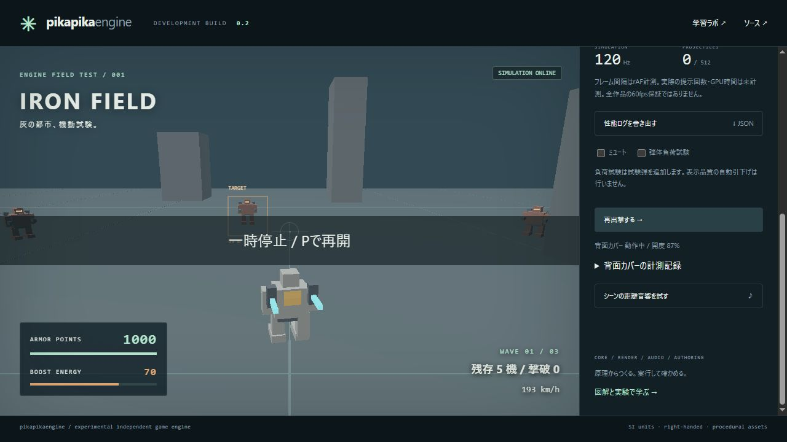

# JSON原本だけの更新をWeb buildへ反映

2026-11-04 JST。ローカル受入済み。公開CI/Pagesは後段で別に確定する。

`scripts/build-web.mjs`はmodule/CSS/WASMをhashしていたが、背面カバーのSource/context JSONを含めていなかった。原本だけを変更するとmoduleとSourceの`?build=`が変わらず、更新前のcacheが再利用され得た。旧コードに隔離fixture試験を実行し、Sourceとcontextの2試験が同じ`b576823ff1731dba`のままで失敗することを記録した。実素材は変更していない。

assets直下のregular fileの`.json`/`.scene`をpath順で追加する3行の入力収集とhash対象の変更を実施した。原本・制作context・level JSON/portable・SDK metadataを含み、既存のmodule/CSS/2WASMを維持する。テキストのCRLF→LF正規化も維持し、無変更の再buildは同じIDを返す。新しいasset形式や下位directoryを増やす場合は入力収集とloaderへのbuild伝達の対応が別途必要。古いHTML自体のcache無効化や配信切替全体のatomic性は保証しない。

## 実行と回帰

新規4試験は実build scriptと実game/lab/lesson HTML/module/assetを一時directoryへコピーし、そこでのみ変更する。Sourceのnameだけの変更→新ID→実`RobotBackCover.load()`の新Source URLと読込値、原本復元→元IDを確認。ここでfetchはfixture fileを返し、C++計算費用の試験とは区別する。21 entry pointの全import map/entry URLが同じ新IDとなり、生成部分を除くHTMLは不変だった。

context・level・metadata・portableの個別変更、新JSON追加/改名/削除、module各区分/CSS/両WASMの変更と復元、作成順の違い・CRLF/LF差・再buildを実行した。全496/496 Node試験・skip0、構文検査、Web `75daf0141409872f` /45modulesが成功した。全assetの実行前後hashが一致し、C++/SDK/renderer/game実装は変更していない。既存のNative CLI回帰は実行したが、今回Nativeの再buildは行っていない。

ローカル実IABを新しいentryから読み直し、boost→停止とSource URL `robot-back-cover.skin.json?build=75daf0141409872f`、SDKの同build IDを実DOM記録で確認。Sourceは原本全文に一致し、19照会全てcompleted/validated、全開clip=1、常駐3mesh・errorなし。入力とquery/queue待ちの有限観測であり、GPU単独時間やfpsの性能主張へは使わない。

[修正前の失敗](web-cache-before.txt)、[focused 4試験](web-cache-focused.txt)、[全checkと原本hash](web-cache-local-verification.json)、[browser raw](web-cache-local-browser.json)、[DOM/UI](web-cache-local-ui.json)、[範囲監査](web-cache-scope-audit.json)、[実行recipe](web-cache-recipes/)を保持する。外部依存・素材・課金・license選択は追加していない。次は[球×静的三角形のNative狭域照会](../docs/SPHERE_TRIANGLE_PLAN.md)へ戻る。

